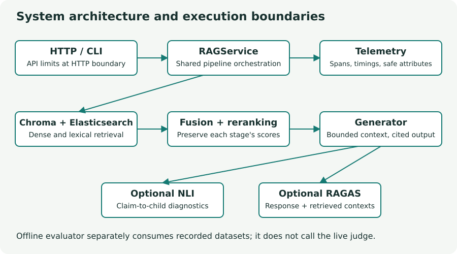
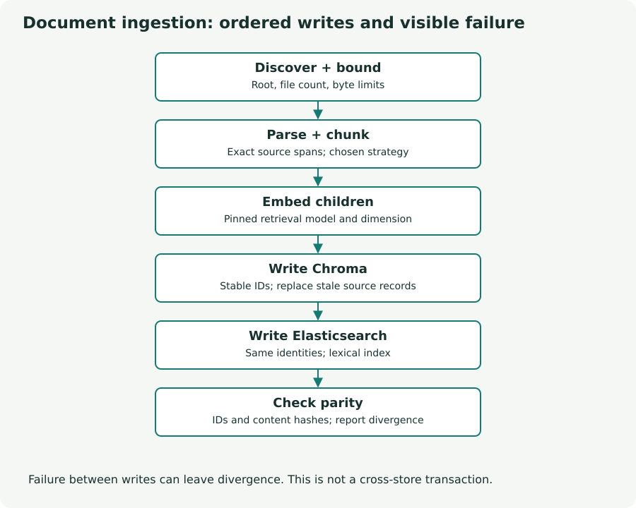
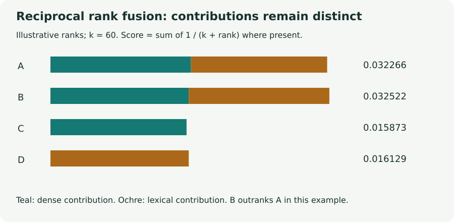
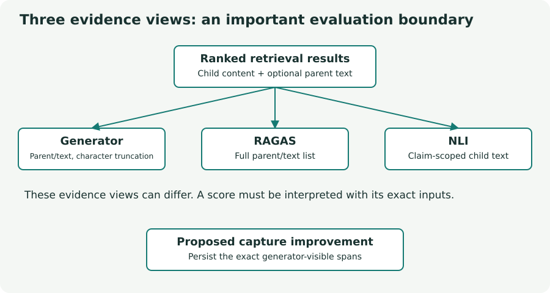
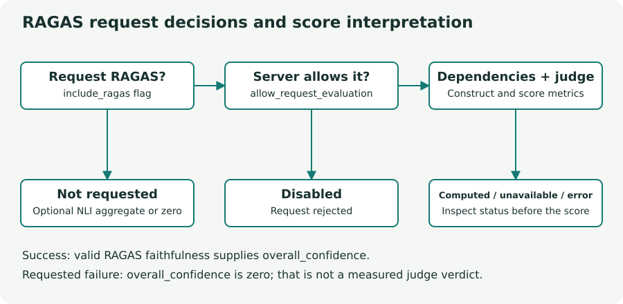
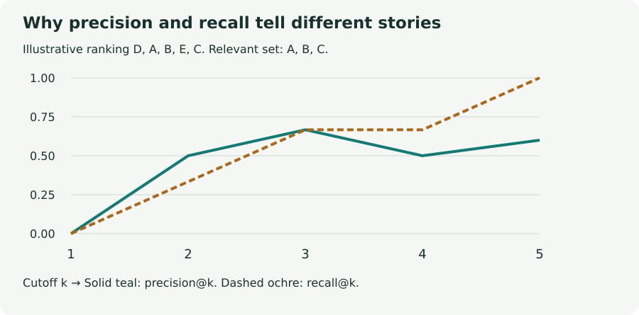

# XAI-RAG: the complete interview reference

Implementation, explanation, and technical questions · Source baseline: `3fe12f7` · Prepared 17 September 2026

This reference explains the repository from first principles and then connects those principles to its actual code. It is meant for deep study and interview practice. Read Part I to understand each mechanism, rehearse Part II as a continuous project explanation, and use Part III to practice six descriptive questions for every component. Follow the source links when an interviewer asks where a behavior is implemented.

The document describes the committed implementation at the recorded revision. Historical validation results are identified as historical. Illustrative refund-policy examples and chart values explain mechanisms; they are not measured production results. Proposed improvements are explicitly presented as proposals. Statements about personal ownership or motivation in the spoken narrative should be adapted to your actual experience.

There are three editions: this editable Markdown source, a PDF with static diagrams and page navigation, and a self-contained HTML reader with interactive architecture, ranking, evaluation-flow, and latency examples. Interactive controls belong to the HTML edition. The PDF preserves the full prose, diagrams, and numerical explanations in a printable form.

**Reading routes:** [Detailed implementation](#part-i) · [30-minute spoken walkthrough](#part-ii) · [132 questions and answers](#part-iii)

**How to study:** trace one document and one question through the whole system before memorizing metrics. Then explain why each stage exists, what it receives and returns, what can fail, and what evidence would justify changing it. Being able to distinguish a tested contract from an unmeasured quality claim is part of a strong technical answer.

**Vocabulary:** a corpus is the document collection; a chunk is the indexed text unit; a candidate is a retrieved item considered for selection; context is the evidence supplied to generation; a reference answer is an externally supplied expected answer; a relevance judgment labels useful evidence; a judge is a model or person assessing output. A score becomes meaningful only with its input, algorithm, scale, and sample size.

Component navigation:

- [01. Problem, architecture, and data contracts](#component-01) · [six questions](#questions-01)

- [02. Document parsing and source identity](#component-02) · [six questions](#questions-02)

- [03. Fixed, semantic, and parent-document chunking](#component-03) · [six questions](#questions-03)

- [04. Embeddings and model lifecycle](#component-04) · [six questions](#questions-04)

- [05. Dual-store ingestion and consistency](#component-05) · [six questions](#questions-05)

- [06. Dense vector retrieval](#component-06) · [six questions](#questions-06)

- [07. BM25 lexical retrieval](#component-07) · [six questions](#questions-07)

- [08. Hybrid search and reciprocal rank fusion](#component-08) · [six questions](#questions-08)

- [09. Cross-encoder reranking](#component-09) · [six questions](#questions-09)

- [10. Retrieval explanations](#component-10) · [six questions](#questions-10)

- [11. Context assembly and LLM generation](#component-11) · [six questions](#questions-11)

- [12. Citations and provenance validation](#component-12) · [six questions](#questions-12)

- [13. NLI claim diagnostics](#component-13) · [six questions](#questions-13)

- [14. RAGAS response evaluation](#component-14) · [six questions](#questions-14)

- [15. Offline datasets, metrics, and quality gates](#component-15) · [six questions](#questions-15)

- [16. Service orchestration and concurrency](#component-16) · [six questions](#questions-16)

- [17. REST API, SSE, and access controls](#component-17) · [six questions](#questions-17)

- [18. CLI and operational workflows](#component-18) · [six questions](#questions-18)

- [19. Observability and privacy](#component-19) · [six questions](#questions-19)

- [20. Configuration, packaging, and deployment](#component-20) · [six questions](#questions-20)

- [21. Tests, CI, and dependency security](#component-21) · [six questions](#questions-21)

- [22. Production gaps and system evolution](#component-22) · [six questions](#questions-22)

## Part I — Complete implementation documentation

Each chapter connects first principles to the current implementation, then examines choices, failures, validation, and improvements. Source links are pinned to the baseline commit so the explanation remains reproducible.

### 01. Problem, architecture, and data contracts

*Figure: System architecture and execution boundaries. Original teaching illustration based on the source; numerical examples are not measured results.*

Retrieval-augmented generation answers a question by first finding relevant evidence and then asking a language model to compose an answer using that evidence. This project adds an explicit account of the retrieval decisions, structured claims and citations, optional claim diagnostics, and optional RAGAS evaluation. Its engineering problem is therefore broader than connecting a vector database to an LLM. It must preserve the identity of evidence while transforming a file into passages, passages into candidates, candidates into context, and context into an answer that can be inspected. The implementation is visible in the [domain contracts](https://github.com/neeraj1909/xai-rag/blob/3fe12f78ff99bc212092099f7d46145f6d6a13f5/src/xai_rag/models.py#L15) and the [shared application service](https://github.com/neeraj1909/xai-rag/blob/3fe12f78ff99bc212092099f7d46145f6d6a13f5/src/xai_rag/service.py#L104).

Throughout the following chapters, consider an **illustrative** file, `team-a/refund-policy.md`, containing “Annual subscriptions may be refunded within 30 days of purchase. Monthly subscriptions are non-refundable.” The illustrative question is “Can I get my annual subscription refunded after 20 days?” This example is not a repository fixture or a report of a successful production request. It provides one continuous way to reason about the boundaries: text extraction must retain the distinction between annual and monthly plans; retrieval must select the annual rule; generation must connect twenty days to the thirty-day limit without inventing additional conditions.

There are two main paths. In ingestion, `RAGService.ingest` discovers bounded files inside a document root, parses each file, chunks its text, embeds the chunk contents, writes Chroma, writes Elasticsearch using the same IDs, and checks parity. Chroma supports vector search and Elasticsearch supports lexical search. These are two representations of the same retrievable records, not two independent corpora. In querying, `RAGService.query` embeds the question, runs both retrieval branches concurrently, fuses their rankings, reranks a bounded candidate set, optionally builds retrieval explanations, generates an answer, optionally checks claims with NLI, optionally computes RAGAS metrics, and assembles the response. HTTP, SSE, and command-line adapters share this service instead of defining separate retrieval algorithms.

The data contracts make these transitions explicit. `SearchResult` describes one native retrieval hit: ID, content, optional parent context, metadata, score, stage, and one-based rank. `FusedResult` adds separate vector and BM25 score/rank fields plus RRF score/rank. `RankedResult` extends it with reranker score/rank. This progression is essential because cosine similarity, BM25 relevance, RRF rank contribution, and cross-encoder output are different quantities. Overwriting one generic score at every stage would destroy the evidence needed to explain why a passage moved. The `to_ranked` method copies the fused representation and appends reranking values, preserving earlier observations.

The generator returns `RAGGenerationResult`, whose answer is accompanied by `Claim` objects and source IDs. A claim records text and its source chunk references. Optional `ClaimVerdict` objects attach NLI entailment, contradiction, verdict, and evidence IDs. The final `XAIRAGResponse` includes those artifacts alongside RAGAS output, overall confidence, stage timings, and token usage. Importantly, the existence of typed fields does not make the values true: Pydantic validates shape and selected bounds, while provenance checks, model judgment, and evaluation address different semantic questions. A valid source ID proves that an ID belongs to supplied evidence; it does not prove that every assertion is supported by that evidence.

`QueryRequest` bounds question length to 1–4,000 characters and `top_k` to 1–100, defaulting to five results. Explanations default on, while NLI and RAGAS flags default off. Request-scoped RAGAS also requires a service setting. Ingestion uses a separate response contract with request-level success, partial, or failed status; per-file outcomes; counts; and parity status. This distinction lets an operator see that one document failed even if others were successfully indexed. A single Boolean would lose that information and make retry decisions ambiguous.

The architecture’s benefits are inspectability and replaceable boundaries. Dependency injection in `RAGService.__init__` allows tests to supply fake embedding, retrieval, generation, and storage functions. That is an implementation fact; interpreting it as a deliberate strategy to isolate external cost and nondeterminism is a reasonable design explanation, not a claim about the author’s personal history. The costs are also concrete: two stores require reconciliation; several models increase startup and memory requirements; optional diagnostics add work; and a long response contract needs careful interpretation by clients.

The [service tests](https://github.com/neeraj1909/xai-rag/blob/3fe12f78ff99bc212092099f7d46145f6d6a13f5/tests/unit/test_service.py#L81) verify shared-stage execution, event ordering, timing keys, and RAGAS routing with fakes. The [API model tests](https://github.com/neeraj1909/xai-rag/blob/3fe12f78ff99bc212092099f7d46145f6d6a13f5/tests/test_api_models.py#L17) verify defaults and input bounds. These establish contracts, not end-user answer quality. An improvement would be an explicit response field describing the provenance of `overall_confidence`, because its meaning currently depends on enabled diagnostics and evaluation status. Another would be a durable record of exactly the context sent to generation. Both would make interview explanations and operational investigations more precise without pretending that another numeric score guarantees correctness.

### 02. Document parsing and source identity

The ingestion pipeline starts by converting a file into a text representation that later stages can split and retrieve. This appears simple for a Markdown file but is a genuine information boundary for PDFs and word-processing documents. A parser can omit a table, reorder columns, or return no text for a scanned page; every downstream model then operates on that imperfect representation. Embeddings cannot recover a policy exception that never entered the text. In an interview, parsing should therefore be described as evidence acquisition, with observable limitations, rather than an invisible preprocessing detail.

The [parser module](https://github.com/neeraj1909/xai-rag/blob/3fe12f78ff99bc212092099f7d46145f6d6a13f5/src/xai_rag/ingestion/parser.py#L23) accepts `.pdf`, `.docx`, `.txt`, `.md`, and `.markdown`, using a lowercased suffix. Plain text and Markdown are read as UTF-8. DOCX extraction joins nonempty paragraph text with blank lines. PDF extraction first imports `pymupdf4llm` and calls its Markdown conversion. Only an `ImportError` triggers a fallback to basic PyMuPDF page text joined with blank lines. This is not a catch-all PDF repair mechanism: a parsing exception from an installed converter is allowed to propagate. The distinction matters when diagnosing corrupted files or model-independent ingestion errors.

The document’s identity is separate from its extracted text. `source_identity` resolves both the file and the logical document root, requires the file to be beneath that root, and returns the relative path in POSIX form. Thus `/srv/docs/team-a/refund-policy.md` and `/home/me/docs/team-a/refund-policy.md` can share the logical identity `team-a/refund-policy.md` when ingested under equivalent roots. Meanwhile, `team-b/refund-policy.md` remains distinct even though the basename is identical. This is more robust than using absolute paths, which couple IDs to deployment locations, or basenames, which collide across directories. That source string later participates in deterministic chunk IDs and source-scoped stale-record deletion.

Before parsing, the canonical service calls [discover_document_paths](https://github.com/neeraj1909/xai-rag/blob/3fe12f78ff99bc212092099f7d46145f6d6a13f5/src/xai_rag/service.py#L53). It resolves paths, accepts a supported file or recursively discovers supported files in a directory, and enforces file-count, individual-size, and aggregate-size bounds. It also checks each resolved candidate against the document root, catching a symlink that points outside it. Defaults are 100 files, 20,000,000 bytes per file, and 100,000,000 bytes per request. These bounds reduce accidental resource exhaustion but are not parser sandboxing or a guarantee against every malformed document. A future isolation boundary would need to address parser CPU, memory, and execution time as well.

For the running illustrative example, the UTF-8 Markdown reader returns the annual and monthly refund rules as one string. Character offsets produced later refer to that string. They are not byte positions in the original file, and for converted PDF or DOCX they are certainly not source-page coordinates. This distinction prevents an easy overclaim: the repository retains text-span provenance, but does not implement a complete mapping from every generated claim back to a PDF bounding box. If an interview requires document highlighting, the appropriate answer is that page and geometry metadata would need to be preserved during parsing and carried through the contracts.

There are two directory-related functions, and they must not be conflated. `parse_directory` is a helper that loops over supported files, logs parsing failures, and returns nonempty results. The canonical `RAGService.ingest` path instead discovers files first and parses them individually so that each can receive a terminal outcome. A parser exception becomes a failed document with an error type; an empty parse produces no chunks and is reported as skipped after storage receives the empty replacement. Because storage replaces source records, an empty result can remove old chunks for that source. Whether that is appropriate for an unexpected parser regression deserves an explicit operational policy.

The implementation does not invoke an explicit OCR stage, so scanned-PDF quality must not be promised. DOCX paragraphs do not constitute comprehensive extraction of tables, headers, comments, or embedded images. UTF-8 decoding can reject another text encoding. The sentence structure of a visually correct PDF can also be different after extraction. These are good interview follow-ups because they expose the difference between supporting a suffix and supporting every document layout within that suffix.

Tests provide narrow but useful evidence. [Source identity tests](https://github.com/neeraj1909/xai-rag/blob/3fe12f78ff99bc212092099f7d46145f6d6a13f5/tests/unit/test_store.py#L132) cover nested logical paths; [ingestion tests](https://github.com/neeraj1909/xai-rag/blob/3fe12f78ff99bc212092099f7d46145f6d6a13f5/tests/unit/test_ingestion_service.py#L14) cover size limits, escaping symlinks, and the shared parse-to-store sequence. They do not form a broad PDF/DOCX extraction benchmark. Proposed improvements include fixture documents with tables and scanned pages, extraction-quality checks before replacement, and explicit parser-version metadata. Each improvement should be evaluated against whether the necessary evidence survives into retrieval, not merely whether parsing returns a nonempty string.

### 03. Fixed, semantic, and parent-document chunking

Chunking chooses the unit that retrieval can select. An entire document can mix many topics and dilute a useful embedding; a tiny fragment can omit the subject or exception needed to interpret a rule. This repository offers three distinct compromises through [chunk_text](https://github.com/neeraj1909/xai-rag/blob/3fe12f78ff99bc212092099f7d46145f6d6a13f5/src/xai_rag/ingestion/chunker.py#L27). It returns `TextChunk` dataclasses containing content, index, start/end character offsets, strategy, and optional parent text and offsets. The offsets are meaningful because the chunk content remains an exact slice of the parsed text, which later supports deterministic identities and inspection.

The first important correction is units. Despite a parent-document docstring describing “128 tok” and “512 tok,” the executable algorithms operate on Python string character positions. Default `chunk_size=512` and `chunk_overlap=50` are characters. They are not tokenizer counts and cannot be converted to model context usage by a universal constant. `chunk_text` validates positive size, nonnegative overlap, a semantic threshold between zero and one, and—for fixed splitting—overlap smaller than size. Blank text yields no chunks. Unknown strategies raise an error instead of silently choosing another mode.

**Fixed splitting** uses `_split_spans`. Starting at a character offset, it chooses a hard endpoint no farther than `chunk_size`. When more text remains, it searches the latter half of that candidate span for a natural separator, preferring a blank line, then newline, then period-space, then space. It takes the last occurrence of the first available separator type. The next start is `max(end - overlap, start + 1)`, ensuring forward progress even around awkward boundaries. The word “fixed” therefore means bounded windows with boundary preferences, not invariably equal-length chunks. Overlap intentionally repeats some evidence between adjacent chunks and can improve boundary recall at the cost of extra storage and duplicated context.

**Semantic splitting** first uses a regular expression to separate sentences after punctuation followed by whitespace, then maps the resulting strings back to ordered source spans. Sentences exceeding the maximum character size are split into bounded units. It embeds units using the configured `all-MiniLM-L6-v2` revision and compares adjacent embeddings by cosine similarity. A new group starts when similarity is below `semantic_threshold` or the next unit would exceed `max_size`; otherwise the source span grows. The algorithm compares neighboring units, not each sentence to a running topic centroid. Lowering the threshold permits more joins; raising it creates more breaks, subject to the same size ceiling. No overlap parameter is applied to the successful semantic grouping path.

If the semantic dependencies raise `ImportError`, the implementation falls back to fixed splitting with overlap `min(50, max_size - 1)`, but labels the resulting chunks `semantic`. This is an observable limitation in experiment provenance: metadata identifies the requested strategy, not necessarily the executed algorithm. A model download failure or arbitrary runtime exception is not covered by that fallback. A proposed improvement is to record both requested and effective strategy, with the fallback reason, so evaluation can distinguish a true semantic experiment from a degraded execution.

**Parent-document splitting** first creates nonoverlapping parent spans using `chunk_size`. It then creates nonoverlapping child spans up to 128 characters within each parent. Each child’s offsets are translated back into the full parsed document, and the child carries the complete parent text and parent offsets. Embedding and BM25 index the child content, while retrieval exposes parent text as `context_content` for generation. This separates matching granularity from reading granularity. However, several matching children can carry the same parent, so downstream context can repeat unless explicitly deduplicated; the chunker itself does not merge those hits.

For the illustrative refund policy, a small fixed boundary might separate “within 30 days” from “Annual subscriptions,” while overlap can keep both in one window. Semantic grouping might join related annual-plan sentences and separate an unrelated billing paragraph, but the actual decision depends on model similarity and threshold, not human judgment. Parent retrieval could match the child mentioning “30 days” and then provide the parent containing the plan type and exception. These are hypotheses about a useful representation, not measured improvements. A fair comparison holds corpus, questions, labels, embedding model, and retrieval budget constant while measuring recall and answer support.

The [chunker tests](https://github.com/neeraj1909/xai-rag/blob/3fe12f78ff99bc212092099f7d46145f6d6a13f5/tests/unit/test_chunker.py#L10) verify blank-input behavior across all strategies, bounded fixed chunks, exact spans, a long semantic sentence, parent provenance, and invalid fixed settings. They do not demonstrate that semantic boundaries improve a real corpus. Further tests should cover abbreviations, repeated sentences, multilingual punctuation, separator edge cases, and effective fallback metadata. Further quality work should measure coverage of relevant evidence, duplicate context, index growth, and sensitivity to size and threshold. The defensible interview answer is that chunking is an experimentally selected representation decision whose structural correctness and retrieval quality need separate evidence.

### 04. Embeddings and model lifecycle

A dense embedding represents a text as a fixed-length vector so that a geometric comparison can act as a relevance signal. The useful intuition is that phrases with related meanings may be close even when they share few words. That is a learned approximation, not a formal guarantee of semantic equivalence. In the illustrative refund example, a question about “getting my money back” may be related to a passage about being “refunded.” Exact conditions, negation, numbers, and rare identifiers can still be difficult. This explains why the project pairs dense retrieval with lexical retrieval instead of assuming that one vector captures every kind of relevance.

The [embedder](https://github.com/neeraj1909/xai-rag/blob/3fe12f78ff99bc212092099f7d46145f6d6a13f5/src/xai_rag/ingestion/embedder.py#L15) loads `BAAI/bge-small-en-v1.5` through Sentence Transformers using revision `5c38ec7c405ec4b44b94cc5a9bb96e735b38267a` and `trust_remote_code=False`. The configured dimension is 384. `_load_model` has an `lru_cache(maxsize=1)`, so the model is loaded lazily and retained per process. This avoids repeated construction during ordinary sequential use, but should not be described as a shared model service across multiple processes. Separate worker processes can load their own copies and consume their own memory. Concurrent first calls also deserve explicit warmup planning rather than assuming that a cache is a distributed lifecycle manager.

`embed_texts_sync` passes a list of strings to `model.encode`, using a default batch size of 32 and `normalize_embeddings=True`, then converts the resulting array to ordinary Python lists. Progress display is enabled only for more than 100 input texts. The asynchronous wrapper sends this synchronous function to an executor, which keeps the event loop available while inference runs. It does not make the underlying mathematical operation asynchronous or free; CPU, GPU, memory, and executor capacity remain finite resources. `embed_query` uses the same wrapper for a one-element list and returns its first vector.

Using the same encoder for stored chunks and questions matters because the coordinate systems must match. Two models can both produce 384-dimensional vectors while assigning entirely different meanings to their dimensions. Equal shape is therefore necessary but not sufficient for compatibility. L2 normalization rescales a nonzero vector to unit length; for normalized vectors, the dot product equals cosine similarity. The Chroma collection is configured for cosine distance, and retrieval later converts distance to similarity using `1 - distance`. None of these transformations creates a probability that a passage answers a question.

Model identity participates in an [index fingerprint](https://github.com/neeraj1909/xai-rag/blob/3fe12f78ff99bc212092099f7d46145f6d6a13f5/src/xai_rag/ingestion/store.py#L72) together with revision, configured dimension, schema version, and distance metric. Existing stores with a missing or different fingerprint fail compatibility checks. The practical consequence is that changing the embedding model requires reindexing rather than mixing new query vectors with old document vectors. Metadata also stores model name, revision, dimension, and fingerprint per chunk. This provides an inspectable account of intended index construction, though metadata alone does not recompute or certify the actual numeric vector.

There are multiple model roles in this project, and they must remain distinct in an interview. The BGE small encoder creates searchable document and query vectors. The MiniLM model decides semantic chunk boundaries. A BGE cross-encoder reranks query–passage pairs. DeBERTa performs NLI claim diagnostics. Hosted generation and RAGAS use their own configured models. The [model inventory](https://github.com/neeraj1909/xai-rag/blob/3fe12f78ff99bc212092099f7d46145f6d6a13f5/docs/model-inventory.md#L1) records local revisions and operational cautions. A pinned local revision improves reproducibility; it does not establish domain quality, license suitability, or successful performance on the deployment hardware.

An illustrative ingestion batch containing the annual refund rule produces one vector for each child or ordinary chunk. A later question produces another 384-element vector and searches the same collection. If the index was built under a different fingerprint, the intended behavior is to refuse its use at initialization instead of silently returning meaningless similarities. If model loading fails, embedding cannot proceed; the embedder has no fallback model. Choosing a substitute would change the representation contract and require a controlled new index, not just an exception handler that hides the failure.

The current [embedder unit test](https://github.com/neeraj1909/xai-rag/blob/3fe12f78ff99bc212092099f7d46145f6d6a13f5/tests/unit/test_embedder.py#L10) checks the dimension accessor against the current Sentence Transformers interface with a fake model. Storage tests check fingerprint rejection. These tests do not establish real model recall, warm latency, cold-start time, or peak memory. Useful proposed improvements are explicit startup warmup, observed dimension validation against configuration, batch-size benchmarking, model-version tags in evaluation reports, and representative retrieval labels. Any query-prefix convention or alternate model should be introduced only after checking that model’s requirements and measuring the effect, because the current code encodes raw query text without an added instruction prefix.

### 05. Dual-store ingestion and consistency

*Figure: Ingestion order and the dual-write consistency boundary. Original teaching illustration based on the source; numerical examples are not measured results.*

Hybrid retrieval depends on two stores representing the same corpus. If Chroma contains an updated refund rule while Elasticsearch still contains the old rule, fusion can combine incompatible versions and the generator can receive contradictory evidence. This repository addresses that problem with deterministic identities, source replacement, compatibility fingerprints, explicit bulk-error handling, and parity checks. It does not implement a distributed transaction. That distinction is central to explaining what has actually been built: the system can detect several forms of divergence and support repeatable repair, but it cannot promise that both stores change atomically.

[build_chunk_id](https://github.com/neeraj1909/xai-rag/blob/3fe12f78ff99bc212092099f7d46145f6d6a13f5/src/xai_rag/ingestion/store.py#L57) serializes a versioned identity containing logical source path, chunk index, start/end offsets, strategy, and content, then computes SHA-256. The serialization sorts keys and uses consistent separators. Repeating ingestion of the same representation therefore produces the same IDs, which supports upserts instead of duplicate inserts. A changed passage, moved span, new index, or strategy produces a different ID. This is not simply a hash of text: identical text in two source files remains separately attributable. Parent text is metadata rather than an explicit member of that chunk-ID identity.

Metadata records source path, span, strategy, parent information when present, content hash, embedding model and revision, dimension, and index fingerprint. The fingerprint describes schema version, embedding identity, dimension, and cosine distance. Chroma stores it on the collection; Elasticsearch stores it in mapping metadata. The compatibility checks reject existing mismatched indexes. A missing fingerprint on an empty Chroma collection can be initialized, but a populated incompatible collection requires reindexing. Compatibility answers “is this index intended for this representation?” while parity answers “do these stores currently contain the same IDs and recorded content hashes?” They are related checks with different purposes.

The canonical [ingestion sequence](https://github.com/neeraj1909/xai-rag/blob/3fe12f78ff99bc212092099f7d46145f6d6a13f5/src/xai_rag/service.py#L374) writes Chroma first. `store_chunks_chromadb` rejects unequal chunk and embedding counts, fetches existing IDs for the logical source, upserts the new records, then deletes old IDs not present in the replacement set. The returned new IDs are passed to `store_chunks_elasticsearch`, which ensures index compatibility and readiness, submits bulk index operations using those same IDs, and waits for refresh. If the bulk response reports errors, it extracts error types and raises `StorageWriteError`. Only after a successful bulk response does it delete stale Elasticsearch records for that source.

Consider an **illustrative** source with old chunks A and B. An edit now creates A and C. Successful Chroma replacement upserts A/C and removes B; successful Elasticsearch replacement does the same. Replaying A/C is idempotent at the record-identity level. However, if Elasticsearch fails after Chroma finishes, one store may contain A/C and the other A/B, or a partially written set. The service records that document as failed and later checks parity. There is no rollback restoring Chroma to A/B, and no journal that automatically resumes the failed operation. Reingestion can repair the records if the source and settings are stable, followed by another parity check.

`check_index_parity` reads Chroma metadata and paginates Elasticsearch records using `search_after` sorted by `chunk_id`. `compare_index_records` reports missing IDs on either side and mismatched recorded content hashes for common IDs. Equal counts alone would miss a swap of B for C, so set comparison is necessary. Nevertheless, a consistent report is not a proof that vector values, parent metadata, or every field match; those are not compared. It also is not a transactionally consistent cross-store snapshot if writes occur while the scan runs. The service performs a global parity check after ingestion, so preexisting divergence outside the current source can affect the final request status.

Empty replacement has meaningful semantics. Chroma deletes existing source IDs when the new list is empty, while Elasticsearch deletes by source. The document is then reported as skipped because it produced no chunks. This can be useful for intentionally emptied sources, but unexpected empty parsing can remove prior evidence. Concurrent ingestions of the same source introduce another risk: overlapping upsert and stale-delete operations can race. Neither a per-source lock nor a versioned publication protocol is present in these functions. A careful interviewer answer should acknowledge those boundaries before proposing a solution.

The [storage tests](https://github.com/neeraj1909/xai-rag/blob/3fe12f78ff99bc212092099f7d46145f6d6a13f5/tests/unit/test_store.py#L1) exercise stable IDs, provenance, bulk item errors, readiness, fingerprints, and parity differences. The gated [dual-store integration test](https://github.com/neeraj1909/xai-rag/blob/3fe12f78ff99bc212092099f7d46145f6d6a13f5/tests/integration/test_dual_store.py#L38) uses real disposable stores and deterministic vectors to check retrieval and replacement. It does not constitute concurrent failure-injection proof. Proposed next steps are a durable ingestion manifest, source-version locking, fault injection between each write/delete boundary, and versioned index publication for larger migrations. These improvements should be selected according to recovery requirements, rather than describing all dual writes as “eventually consistent” without a mechanism that actually drives convergence.

### 06. Dense vector retrieval

Dense retrieval turns a question into an embedding and asks which stored chunk vectors are nearest under a selected distance. It is useful when query and document vocabulary differ, such as “money back” and “refund.” The result is a set of candidate passages for further ranking and generation, not an answer. A passage can be semantically related but fail the precise question: a monthly-plan refund policy may be close to an annual-plan question while giving the wrong condition. That is why evaluation should distinguish finding topical material from recovering the exact evidence needed for an answer.

The [vector_search function](https://github.com/neeraj1909/xai-rag/blob/3fe12f78ff99bc212092099f7d46145f6d6a13f5/src/xai_rag/retrieval/vector_search.py#L16) accepts a Chroma collection, one query embedding, and a candidate limit. It calls `collection.query` with that vector, requests documents, metadata, and distances, and reads the first query’s results. The collection is created with `hnsw:space` set to `cosine`. The application delegates nearest-neighbor search to Chroma rather than implementing a search graph itself. It should therefore avoid claiming a particular recall/latency operating point merely because HNSW is mentioned in the wrapper’s docstring. Those properties depend on index configuration, data, hardware, and measured workload.

The wrapper converts each distance to similarity using `1.0 - distance`. For cosine distance, a distance of 0.2 corresponds to similarity 0.8; a distance of 1.2 corresponds to similarity -0.2. These numbers are **illustrative mathematical examples**, not measured repository results. Negative similarity remains a valid returned value and must not be interpreted as “this item did not come from vector search.” Membership is represented by `stage=VECTOR` and a positive rank. The project deliberately keeps rank separate from score so later explanations do not confuse a negative native score with a missing retrieval branch.

Each result carries the stored chunk ID, child or ordinary content, metadata, native similarity, and its one-based result position. If metadata contains `parent_content`, the wrapper copies that into `context_content`. For a parent-document index, matching therefore happens against the child embedding while generation can use the larger parent passage. The child remains the identity carried through fusion and citations. That is useful provenance but also a subtle interpretation boundary: a later model may use information in the parent beyond the narrow child that initially matched the question.

The canonical service embeds the query once and runs vector retrieval in a worker thread concurrently with asynchronous Elasticsearch search. This is necessary because the Chroma call used here is synchronous. The service uses `settings.vector_search_k`, default 100, as the branch’s candidate limit. This differs from `QueryRequest.top_k`, default five, which controls final reranked output. Between them, fusion merges candidates and the service selects at least `max(top_k, reranker_candidate_k)` fused candidates for the cross-encoder. Dense recall must therefore be understood at several cutoffs: what Chroma returned, what survived fusion truncation, and what remained after reranking.

For the running example, imagine Chroma returns the annual-refund chunk at rank two because another billing passage is geometrically closer. BM25 may rank the annual rule first because it contains the specific terms. Fusion can preserve both signals and reranking can evaluate the query–passage relationship. If Chroma never returns the relevant chunk, later stages can recover it only if another retrieval branch does. If neither branch retrieves it, the generator cannot reliably reconstruct the missing policy from the supplied evidence. Increasing answer-model capability does not repair that upstream recall failure.

Failure handling is deliberately simple at this wrapper. Empty IDs return an empty list. Mismatched parallel result arrays fail because `zip(..., strict=True)` rejects uneven lengths. Dimension errors, network errors, and dependency errors propagate; there is no application retry decorator or automatic lexical-only fallback in `vector_search`. The [retry-contract test](https://github.com/neeraj1909/xai-rag/blob/3fe12f78ff99bc212092099f7d46145f6d6a13f5/tests/unit/test_retrieval_retries.py#L11) explicitly verifies that a permanent input error makes one call. This does not describe all internal client behavior, but it establishes that the application does not blindly retry an invalid vector.

The real-store integration test checks nearest-neighbor ordering with deliberately constructed vectors and confirms parent-context propagation. That isolates persistence and retrieval mechanics from model quality. Representative dense retrieval evaluation would additionally require questions with relevant chunk labels, including paraphrases, negation, rare terms, and near-miss policies. Proposed improvements include approximate-search recall comparison against exact search on a manageable sample, observed vector-dimension checks, per-query branch diagnostics, and measured candidate-budget tuning. A similarity threshold should not be copied from an unrelated corpus: its useful value depends on the encoder, text representation, and the error cost of rejecting valid evidence.

### 07. BM25 lexical retrieval

Lexical retrieval finds passages through analyzed terms rather than embedding geometry. It is especially useful for identifiers, unusual names, error codes, and questions whose decisive words occur directly in the evidence. In the refund example, “annual” and “30 days” can be more discriminative than a broad semantic relationship to billing. Lexical search is not synonymous with literal substring search, however. Text is processed by an analyzer before matching, so punctuation, case, and token boundaries affect what becomes searchable. The correct description of this project is an Elasticsearch full-text branch with a standard analyzer, not a bespoke exact-match engine.

The [index setup](https://github.com/neeraj1909/xai-rag/blob/3fe12f78ff99bc212092099f7d46145f6d6a13f5/src/xai_rag/ingestion/store.py#L219) creates `content` as a text field using the standard analyzer, `chunk_id` and `source_file` as keyword fields, and `metadata` as an object with indexing disabled. The metadata remains available in returned source records, but its internal fields are not indexed for arbitrary structured filtering. Index creation uses one shard and zero replicas, a simple operational default whose resilience should not be overstated. Existing index mappings must contain the expected fingerprint, and readiness waits for at least yellow health with active primary shards before indexing proceeds.

The [bm25_search wrapper](https://github.com/neeraj1909/xai-rag/blob/3fe12f78ff99bc212092099f7d46145f6d6a13f5/src/xai_rag/retrieval/bm25_search.py#L16) sends an asynchronous Elasticsearch search against `content`, requesting up to `k` hits. Its query is a `multi_match` of type `best_fields`, with `tie_breaker=0.3`, although only one field is currently listed. Consequently the multi-field tie-breaker should not be credited with combining several document fields in this implementation. The service uses a default lexical candidate limit of 100 and runs this coroutine concurrently with vector search. The wrapper requests content and metadata, then converts hits into typed `SearchResult` objects with BM25 stage and one-based rank.

The familiar BM25 intuition is term rarity multiplied by a saturating term-frequency contribution with a length adjustment. In a conventional form, each matching term contributes `IDF(t) × f(t,d)(k1+1) / [f(t,d)+k1(1-b+b|d|/avgdl)]`, and contributions are summed. Here `f` is term frequency, `|d|` is document length in analyzed terms, and `avgdl` is average length. This formula is conceptual background; the application does not reimplement it or explicitly set `k1` and `b`. Elasticsearch computes the returned score. Claiming custom parameter tuning would require configuration and evaluation evidence that this repository does not provide.

Saturation explains why repeating “refund” twenty times should not produce twenty times the usefulness of a single occurrence. Rarity helps distinguish a specific plan code from a common word. Length normalization helps avoid rewarding long passages merely because they contain more words. These are retrieval heuristics, not truth judgments. A passage saying “Annual plans are not refundable” can share nearly every important term with a refundable-plan question, so lexical rank cannot establish factual entailment. The later reranker, generator, and evaluation stages address different parts of that problem, each with its own limitations.

For an illustrative query containing “annual subscription refund,” the annual policy chunk may rank above a general billing paragraph because its analyzed terms match more strongly. A paraphrase such as “get my money back” might produce weaker lexical matching while dense retrieval still finds the policy. This complementarity is the basis for hybrid retrieval. Raw BM25 scores cannot simply be compared with cosine similarities: a lexical score of 8.0 and a cosine score of 0.8 live on different scales and do not mean that lexical evidence is ten times stronger. This project combines ranks with RRF and preserves each native score for inspection.

The retrieval wrapper itself has no custom retry loop and no silent fallback to an empty list after errors. Elasticsearch failures propagate to the service. The [permanent-input-error test](https://github.com/neeraj1909/xai-rag/blob/3fe12f78ff99bc212092099f7d46145f6d6a13f5/tests/unit/test_retrieval_retries.py#L28) checks that an invalid query is not repeatedly issued by the application wrapper. The [integration test](https://github.com/neeraj1909/xai-rag/blob/3fe12f78ff99bc212092099f7d46145f6d6a13f5/tests/integration/test_dual_store.py#L38) checks that an indexed quantum-physics passage is retrieved with lexical terms and agrees with vector retrieval on the fixture. That establishes a working boundary without demonstrating production relevance.

Useful proposed extensions start with evidence: inspect analyzed tokens for failing identifiers, collect judged queries, and compare lexical recall before changing analyzers. Multiple searchable fields could support title boosts; dedicated keyword fields could support truly exact identifiers; language-specific analysis could help another corpus. Each changes index behavior and may require reindexing. Access-control filtering would also need an explicit indexed schema rather than assuming that disabled metadata can enforce permissions. An interview answer should connect these changes to a diagnosed retrieval failure, not recommend a larger search configuration merely because Elasticsearch supports it.

### 08. Hybrid search and reciprocal rank fusion

*Figure: Illustrative RRF rank contributions. Original teaching illustration based on the source; numerical examples are not measured results.*

Hybrid retrieval combines complementary ways of finding evidence. Dense retrieval can match paraphrases; lexical retrieval can preserve rare or exact terms. Combining them is useful only if the merging rule respects their incompatible scoring scales. This project uses reciprocal rank fusion, or RRF, which works from result positions rather than adding a cosine similarity to a BM25 score. Its central assumption is modest: a document that ranks well in several lists deserves consideration even when the lists have different native score distributions. It does not claim that rank agreement proves correctness.

The [rrf_fusion implementation](https://github.com/neeraj1909/xai-rag/blob/3fe12f78ff99bc212092099f7d46145f6d6a13f5/src/xai_rag/retrieval/hybrid.py#L22) assigns each document `sum(1 / (k + rank))` over the lists in which it appears. The default constant is 60, and values below one are rejected. Rank is one-based. A larger constant makes the contributions of nearby ranks more similar; a smaller constant emphasizes top positions more strongly. Because missing membership contributes nothing, appearing in both branches can outweigh a high position in only one. The RRF value is an ordering score, not a probability or a calibrated confidence in the generated answer.

Here is a fully **illustrative** calculation. Let the vector list be A, B, C, and the lexical list be B, D, A. At `k=60`, A receives `1/61 + 1/63 = 0.03226646`; B receives `1/62 + 1/61 = 0.03252247`; C receives `1/63 = 0.01587302`; and D receives `1/62 = 0.01612903`. The fused order is B, A, D, C. B wins even though A was first in the vector list, because B is second in vector and first in lexical while A is third in lexical. Nothing in this calculation requires their original BM25 or cosine values to be comparable.

Deduplication uses chunk ID, not identical content or source filename. The function keeps a `seen_in_list` set so a duplicate ID in one branch does not receive repeated contributions. An occurrence in another branch still contributes, as intended. If an explicit native rank is present, that value is used; otherwise enumeration supplies the position. If stage is absent, list zero is treated as vector and list one as BM25 for provenance. Those compatibility fallbacks should not encourage callers to discard stage metadata: explicit stage and rank make arbitrary combinations less ambiguous.

The first occurrence of an ID supplies content, parent context, and metadata. Native vector and BM25 scores/ranks are retained separately, with `None` for an absent branch. Results are sorted by descending fused score and then by ascending ID, making ties deterministic. The first-record behavior creates a subtle consistency assumption: if two stores return the same ID with inconsistent metadata, fusion does not reconcile the records. It trusts the first representation. Upstream parity and ingestion discipline reduce some risks, but parity does not compare every metadata field. A future merge validator could detect disagreements before generation.

There are two related call paths in the repository. The convenience `hybrid_search` function gathers a threaded Chroma call and an async Elasticsearch call, fuses the lists, and returns all three lists. The canonical `RAGService.query` instead performs its own timed gather and then directly calls the injected fusion function. This preserves separate stage timings and dependency injection. An interviewer asking “where does hybrid search run?” deserves that exact distinction: the service implements the same conceptual hybrid operation without calling the helper. A helper’s presence alone does not establish the application’s runtime path.

After fusion, the service takes a candidate prefix of size `max(request.top_k, settings.reranker_candidate_k)` and passes it to the cross-encoder. The configured candidate default is five. This is an important quality bottleneck: retrieving 100 results from each branch does not mean the reranker examines 200 results. For the default five-output request, it normally receives only the top five fused candidates. A relevant passage at fused rank six cannot be rescued by the reranker. Increasing the candidate budget is a plausible improvement, but must be evaluated against extra model work, memory, and latency rather than asserted to be universally better.

The [retrieval-contract tests](https://github.com/neeraj1909/xai-rag/blob/3fe12f78ff99bc212092099f7d46145f6d6a13f5/tests/unit/test_retrieval_contract.py#L23) check a worked RRF value, preservation of negative native similarities, missing-branch `None`, deterministic ties, and preservation through reranking. The integration fixture exercises the helper with real stores. Proposed comparisons include vector-only, lexical-only, RRF, normalized weighted fusion, and a learned fusion model if enough labels exist. The evaluation should measure both candidate recall and final ranking, because a method can improve top-one ranking while discarding evidence needed for a multi-part answer. In the illustrative refund case, the question is whether the annual rule and relevant exception survive together, not whether the fused score looks numerically larger.

### 09. Cross-encoder reranking

Retrieval and reranking answer different computational questions. A retriever searches a large collection cheaply enough to obtain a candidate set. A reranker spends more computation deciding which members of that set best answer the particular question. In this project, dense search and BM25 produce candidates, reciprocal rank fusion combines their positions, and `Reranker` applies a cross-encoder to the selected fused candidates. A cross-encoder reads the query and passage together, so its prediction can depend on interactions between their words. The embedding retriever instead encodes a document independently of the future question, allowing its vector to be stored in advance. This is the central reason that the two models occupy different positions in the pipeline. The explanation follows the actual [reranker implementation](https://github.com/neeraj1909/xai-rag/blob/3fe12f78ff99bc212092099f7d46145f6d6a13f5/src/xai_rag/retrieval/reranker.py#L39).

The default model is `BAAI/bge-reranker-v2-m3`, pinned to revision `953dc6f6f85a1b2dbfca4c34a2796e7dde08d41e`. `_load_cross_encoder` constructs Sentence Transformers' `CrossEncoder` lazily, disables remote repository code with `trust_remote_code=False`, and caches one model through `lru_cache(maxsize=1)`. Lazy loading avoids paying the model startup cost merely by importing the module; it transfers that cost to the first real use. Caching saves repeated model construction within a process, but multiple application processes can still own separate copies. Model memory and first-request latency therefore remain deployment considerations rather than properties solved by the cache.

The service chooses `candidate_k = max(request.top_k, settings.reranker_candidate_k)` and passes `fused[:candidate_k]` to the reranker. The default candidate setting is five, while the request defaults to five final results. Consequently, the default configuration can rerank only five candidates even though each first-stage retriever requests up to one hundred. It is inaccurate to say that the cross-encoder always scores every retrieved result. Increasing `top_k` also increases the minimum candidate pool, preventing a request for more results from being silently capped by a smaller configured default. This connection is visible in the [service candidate selection](https://github.com/neeraj1909/xai-rag/blob/3fe12f78ff99bc212092099f7d46145f6d6a13f5/src/xai_rag/service.py#L238).

`_score_pairs` constructs one `[query, passage]` pair for each candidate and calls `model.predict`. The passages are `result.content`, not expanded `context_content`; parent-document retrieval can therefore rank a focused child passage and later generate from a larger parent. Returned values are converted to Python floats. They are relevance scores used for ordering, with no repository calibration converting them into a probability that an answer is correct. In particular, a value such as 0.8 must not be described as an 80 percent factual guarantee. The raw scale belongs to the selected model and its prediction behavior.

The async `rerank` method sends synchronous scoring to a shared `ThreadPoolExecutor(max_workers=2)`. This prevents the scoring call itself from occupying the application event-loop thread, allowing other async work to progress. It does not make inference cost disappear, and it does not promise that arbitrarily many requests can run simultaneously. Beyond the two workers, submitted jobs queue. A service timeout also should not be interpreted as proof that an already-running inference thread has stopped. Empty candidates return an empty list without loading the model. For nonempty input, `zip(..., strict=True)` requires exactly one score per candidate, exposing a contract error if the model output shape is wrong.

Every candidate is converted through `to_ranked`, which preserves vector, BM25, and RRF scores and positions. The new reranker score is added rather than written into an old field. Results sort by descending reranker score; ties use the original RRF rank, then the identifier. Only the first `top_k` results survive, and their new positions are recorded as `reranker_rank`. Separate positions make a useful diagnostic possible: a chunk can have `rrf_rank=3` and `reranker_rank=1`, which means the second stage promoted it. Overwriting its old position would destroy that evidence.

Consider the illustrative refund question used throughout this reference: “Can I get my annual subscription refunded after 20 days?” Suppose fusion puts a general billing introduction first, the annual-refund rule second, and the monthly-subscription exception third. Illustrative cross-encoder scores of 0.2, 0.9, and 0.4 produce a new order of annual rule, monthly exception, introduction. The generator then sees the most directly useful material earlier. However, if the annual rule was sixth and only the first five fused candidates were admitted, the reranker cannot rescue it. This is a candidate-recall limitation, not a failure that a more powerful reranker can automatically repair.

Quality should therefore be measured at both boundaries. First examine whether the relevant chunk survives the candidate cutoff. Then compare reranked ordering against fused ordering on the same judged queries. The offline runner already computes reranker NDCG deltas, while service timing records the `rerank` duration. A larger candidate pool is a hypothesis to test against both measurements, not an assumed improvement. Alternatives include keeping fusion order, scoring a wider pool, batching across requests, or replacing the model with a smaller reranker. Each changes a quality, latency, memory, or operational tradeoff; none has a demonstrated advantage in this repository without additional evidence.

The current contract test replaces model inference with known scores and verifies that reranking changes order while retaining RRF ranks and scores. Another service test verifies that requested `top_k` is not silently limited by the candidate default. These tests prove data handling and orchestration, not model relevance on real customer questions. A useful next test set would include ties, malformed score counts, empty inputs, and parent-context examples, followed by representative relevance judgments and warm/cold latency measurements. The existing [retrieval contract tests](https://github.com/neeraj1909/xai-rag/blob/3fe12f78ff99bc212092099f7d46145f6d6a13f5/tests/unit/test_retrieval_contract.py#L45) provide a clear starting point for explaining that distinction in an interview.

### 10. Retrieval explanations

A retrieved answer is easier to investigate when the system can show how its evidence reached the final context. XAI-RAG implements this through `RetrievalExplainer`, a deterministic transformation from search results and reranked results into `RetrievalExplanation` objects. It records each selected chunk's identifiers, scores, positions, text preview, overlapping query terms, and a short selection narrative. This is useful operational evidence: a reviewer can distinguish a passage found only through semantics from one found through both semantics and lexical matching. It is not a causal explanation of the neural model's internal decision. The distinction is essential when explaining what the “XAI” in the project actually delivers. The relevant source is [retrieval_explainer.py](https://github.com/neeraj1909/xai-rag/blob/3fe12f78ff99bc212092099f7d46145f6d6a13f5/src/xai_rag/explainability/retrieval_explainer.py#L21).

`explain` receives the original query, raw vector results, raw BM25 results, and the final reranked list. It produces one explanation for each reranked item, preserving final order. It therefore explains the evidence selected for answering, rather than every discarded candidate. The service calls this only when `include_explanations` is true, which is the request default. The output is returned with the final response and its own `explain` stage duration. Disabling explanations saves this deterministic processing and response payload, but it does not change the already-completed retrieval and reranking algorithms.

The strongest source of evidence is the provenance already carried by `RankedResult`: `vector_score`, `vector_rank`, `bm25_score`, `bm25_rank`, `rrf_score`, `rrf_rank`, `reranker_score`, and `reranker_rank`. These values retain their original meanings instead of being collapsed into one comparable score. Vector similarity, BM25 score, RRF rank contribution, and cross-encoder output are different quantities. Displaying them in separate named fields lets the reader follow the sequence without implying that, for example, BM25 8.0 is inherently better than cosine similarity 0.7. The shared [domain models](https://github.com/neeraj1909/xai-rag/blob/3fe12f78ff99bc212092099f7d46145f6d6a13f5/src/xai_rag/models.py#L70) encode this separation.

For compatibility with older ranked records, the explainer also builds dictionaries of the raw vector and BM25 results by ID. If the ranked record lacks a stage rank but the raw stage contains the chunk, it recovers the native score and rank from there. When the raw record lacks an explicit rank, list position plus one supplies the fallback. Membership is decided by whether a rank exists, not whether a score is positive. That matters because a retrieved vector result can legitimately have a negative similarity score. Treating `score > 0` as “was retrieved” would falsely describe such a chunk as absent. A focused unit test explicitly protects this case.

Matching terms are deliberately simple. `_tokenize` lowercases the text, finds word-like tokens with a regular expression, discards tokens shorter than three characters, and returns a set. Query and chunk token sets are intersected and sorted. The explanation stores the complete resulting list, while its narrative mentions at most ten terms. This is neither the Elasticsearch analyzer nor a linguistic stopword system. Three-character function words can remain; two-character technical abbreviations can disappear. The comment about filtering noise is an intention behind a length rule, not proof of meaningful keyword extraction. No stemming, synonym expansion, or semantic attribution is performed here.

In the illustrative refund example, the question contains “annual,” “subscription,” “refunded,” and “days,” while a passage might say “Annual subscriptions may be refunded within 30 days of purchase.” Simple token overlap includes “annual,” “refunded,” and “days”; singular “subscription” does not match plural “subscriptions.” Nevertheless, semantic retrieval and the cross-encoder can rank that passage highly. A short or empty overlap list therefore does not mean the passage is irrelevant. Conversely, an irrelevant monthly-refund passage may share many query words. The term display is a reading aid, not a substitute for relevance judgment.

The narrative is assembled from deterministic branches. A chunk present in both searches is described as receiving contributions from both under fusion. A vector-only chunk is described as semantically retrieved without BM25 membership, and a BM25-only chunk as lexically retrieved without dense membership. The reranker score is appended in each case. `content_preview` is the first 200 characters of the child `content`; it is not necessarily the full parent text later sent to the generator. A user examining the preview alone could miss qualifications appearing later in the passage or in the parent. A richer evidence viewer would need to expose the relevant complete context with provenance.

The current implementation also has precise explanatory limits. It does not identify which tokens caused the cross-encoder score, measure how removing a passage changes the answer, or establish that the LLM actually relied on a cited source. The statement about both searches boosting fusion reflects an additional RRF contribution, but does not quantify a counterfactual rank change relative to a different candidate population. An interview answer should say that the system offers stage attribution and traceability, then describe causal attribution or perturbation experiments as possible future work. Calling the current narrative a proof of why the neural model reasoned as it did would overstate the implementation.

Validation should check facts in the explanation against the actual pipeline records. The existing [negative-similarity test](https://github.com/neeraj1909/xai-rag/blob/3fe12f78ff99bc212092099f7d46145f6d6a13f5/tests/unit/test_retrieval_contract.py#L65) covers stage membership; the rank-preservation tests protect the source fields it consumes. Further improvements could cover fallback behavior, stable ordering, absent reranker scores, Unicode and short technical terms, and consistency between previews and generation context. Product evaluation would ask whether a human can diagnose a retrieval failure faster with these artifacts, without mistaking formatted numbers for verified truth. That gives the explanation feature a measurable purpose while preserving the boundary between transparent bookkeeping and model interpretability.

### 11. Context assembly and LLM generation

*Figure: Generator, RAGAS and NLI evidence views. Original teaching illustration based on the source; numerical examples are not measured results.*

The generator converts ranked evidence into a bounded prompt, asks the language model for a structured response, and validates the response before exposing it downstream. This is the point where retrieval becomes an answer. `RAGGenerator` accepts the user query and a list of `RankedResult` objects, then returns `RAGGenerationResult` containing answer text, decomposed claims, source IDs, and token usage when available. Its responsibility is narrower than the entire RAG pipeline: it does not retrieve documents, rerank candidates, or independently evaluate factual support. Those are upstream and downstream stages coordinated by the service. The complete implementation is in [generator.py](https://github.com/neeraj1909/xai-rag/blob/3fe12f78ff99bc212092099f7d46145f6d6a13f5/src/xai_rag/generation/generator.py#L142).

Context assembly uses `_format_context`. For each ranked item, it chooses `context_content` when truthy, otherwise the child `content`, and wraps the selected text in an explicitly identified `retrieved_chunk` block. Ranking order is preserved. The function counts the characters already used, includes the separators and wrapper overhead in the remaining budget, and truncates content to fit. If there is no room for another wrapper plus content, it stops. The default context budget is 32,000 characters. This is a bound on the context block, not on the entire prompt, and it is not a tokenizer-aware token limit. The fixed system instructions, query, model-specific tokenization, and requested output consume additional capacity.

Parent context is a purposeful distinction. A small child can be useful for focused retrieval and reranking, while its parent contains definitions, exceptions, or surrounding explanation needed to answer correctly. In the illustrative refund document, the selected child might contain the annual 30-day rule; its parent might also contain the non-refundable monthly-plan exception. The generator gets the parent when present. If several children share a parent, this formatter does not deduplicate that parent text. Repeated large parents can consume the budget and push later evidence out, even when the selected child passages themselves are short. That is a concrete optimization opportunity rather than an implemented feature.

The system prompt instructs the model to answer using only the supplied chunks, attach inline `[chunk_id]` references to factual statements, emit separate claims and their source IDs, and use an explicit insufficient-information answer when needed. It also calls the chunks untrusted data and tells the model to ignore instructions inside them. These instructions express the desired behavior; they do not make a malicious or ambiguous document harmless by definition. The context remains model input, and the repository does not implement a formal security boundary inside the model. The source delimiters aid interpretation, while post-generation checks enforce a narrower, deterministic provenance contract.

The API call uses OpenAI chat completions with a strict JSON response schema containing `answer`, `claims`, and `sources`; each claim contains `text` and `source_chunk_ids`. Required keys and `additionalProperties=False` constrain the generated shape. The default generator model is `gpt-4o-mini`, temperature is 0.1, and the constructor default output allowance is 2,048 tokens. A supplied `AsyncOpenAI` client supports tests and alternative wiring. Otherwise the generator constructs one from the configured API key, timeout, optional base URL, and `max_retries=0`. Configuration specifies a default 60-second LLM timeout. These values describe the code snapshot, not a promise about future hosted model availability.

Retries are explicitly owned by the Tenacity wrapper around `generate`: up to three attempts with exponential waiting capped at ten seconds for connection errors, API timeouts, internal server errors, and rate limits. Disabling the SDK's retry count avoids accidentally stacking two visible retry policies at that boundary. JSON parsing failures, schema validation failures, and citation contract failures are not among those retry conditions. Retrying malformed provenance automatically could incur additional charges without fixing the underlying problem; here the error propagates for the service/API boundary to handle. A request timeout also bounds the broader pipeline, which includes work beyond generation.

Two no-answer paths deserve separate explanation. If there are no ranked chunks, the method returns the fixed insufficient-information response immediately and does not call the model. If the completion has `content=None`, it logs the condition and returns the same answer with empty claims and sources. The latter is a broad empty-content fallback; the code does not preserve a distinct provider refusal reason. Otherwise, it parses JSON, validates it as `RAGGenerationResult`, applies citation validation, and copies prompt/completion token counts from `response.usage` when present. Those counts refer to generation, not to optional RAGAS judge and embedding calls later in the pipeline.

There is an important mismatch between selected evidence and consumed evidence. The generator validates IDs against all ranked chunks, even if the character budget excluded some from the formatted prompt. Meanwhile, RAGAS receives the full ordered list of parent-or-child contexts from the service, without this formatter's truncation. Local NLI checks child content. These three views can differ. A high evaluation score may therefore refer to evidence the generator did not actually receive. The first improvement should be an explicit context artifact containing emitted IDs, emitted text, truncation information, and a digest, reused by generation, citation checking, and evaluation. This would make evidence boundaries inspectable rather than reconstructed independently.

Current generator tests use a fake completion client to verify acceptance and rejection of citation structures. They establish deterministic behavior without making a paid model call. They do not demonstrate instruction following under adversarial context, response quality, or refusal calibration. Additional targeted coverage should inspect the actual formatted prompt at budget boundaries, parent duplication, empty-content handling, token accounting, and retry classification. Representative live generation and human assessment would then test the remaining model behavior. In an interview, this separation makes the claim precise: the repository enforces an output and provenance contract around generation, while semantic answer quality requires separate evaluation.

### 12. Citations and provenance validation

Citation validation answers whether a generated reference resolves to evidence supplied to the generator interface. It does not answer whether that evidence proves the sentence. XAI-RAG deliberately has a deterministic provenance check as well as model-based support diagnostics, and an interview explanation should keep those responsibilities separate. A source identifier is a join key connecting an answer back to a retrieved chunk. It becomes valuable only when the source record retains enough provenance to locate and inspect the original document. Here, the generator's `_validate_citations` checks the identifiers emitted in three places: inline answer brackets, the top-level source list, and each structured claim's source list. See the [validation function](https://github.com/neeraj1909/xai-rag/blob/3fe12f78ff99bc212092099f7d46145f6d6a13f5/src/xai_rag/generation/generator.py#L110).

The function starts with the ranked chunk IDs in their supplied order and a set of those IDs for membership testing. A regular expression extracts bracketed strings from the answer, excluding nested brackets and newlines. It then unions those inline identifiers with the top-level `sources`. Each claim's `source_chunk_ids` is deduplicated while preserving first occurrence, and an empty list raises `GenerationContractError`. The claim references are added to the attributed-ID set. If there are structured claims but no inline citation anywhere in the answer, validation fails. Finally, every attributed identifier must belong to the available-ID set; unknown identifiers produce an error rather than being silently removed.

After validation, the source list is normalized to available chunk order, keeping only IDs referenced in at least one of the three channels. This has two useful effects. Duplicate top-level sources cannot create duplicate output entries, and the final source ordering follows the supplied evidence rather than an arbitrary set iteration. A valid claim reference can add an ID to the normalized source list even when the LLM omitted it from the top-level list. The validator therefore normalizes bookkeeping while rejecting impossible references. The `Claim`, `RAGGenerationResult`, and `XAIRAGResponse` contracts preserve the normalized result for downstream diagnostics and API serialization.

For a concrete example, suppose the generator receives illustrative chunks `refund-annual` and `refund-monthly`. An answer such as “An annual subscription is refundable within 30 days [refund-annual]” with a corresponding claim pointing to `refund-annual` passes the ID checks. If the model emits `[refund-policy-2027]`, the validator rejects it because that identifier was not supplied. If the same valid ID appears three times in the top-level source array, the final array contains it once. These behaviors are easy to test and are stronger than simply asking the model to cite sources. They still do not establish that the cited annual passage actually says 30 days; a valid ID attached to a false 90-day claim can satisfy the deterministic check.

Several edge cases reveal the exact scope. The implementation requires at least one inline citation when claims exist; it does not parse the answer into sentences and prove that every factual sentence has its own citation. It does not prove that every factual statement appears in the structured claims array. An answer with no structured claims can bypass the claim-level citation requirements, provided any IDs it does emit are valid. It also does not demand that every inline reference appears in a particular claim, or that the textual claim exactly matches a sentence in the answer. These are not reasons to discard the existing check; they are reasons to describe it accurately and identify additional coverage needed for stronger attribution guarantees.

The bracket parser itself is intentionally simple. Ordinary bracketed prose can be interpreted as a citation identifier and rejected if it does not match a chunk. Conversely, citation syntax outside the recognized pattern is not extracted. Because the output contract instructs one syntax, this is a practical constrained interface, but it is not a general Markdown citation parser. If future answers need mathematical brackets, footnotes, or rich documents, a structured citation-span representation would be less ambiguous. Such a redesign would connect answer offsets directly to source IDs and optionally to source spans, while keeping a readable rendering for users.

The most significant current boundary is context truncation. `_validate_citations` receives the entire ranked list, whereas `_format_context` may have omitted or truncated chunks to stay within its character budget. Therefore “available” currently means supplied to `generate` as an object, not necessarily emitted in the final prompt. A reference to an excluded ranked ID can pass membership validation. The same concern applies when a parent context is truncated before the supporting sentence. A future context manifest should record exactly what text and identifiers reached the model, and validation should use that artifact. Source-span provenance would further distinguish a reference to a whole parent from the specific text the answer relies on.

Offline evaluation supplies two complementary metrics. Citation validity is the proportion of unique cited IDs present in the available reranked IDs. Citation coverage is the proportion of recorded claims with at least one valid available source. An answer can have perfect validity but poor coverage when the few citations it emits are valid while many claims have no references. It can have full coverage even if a claim also includes an invalid ID, because coverage tests for at least one valid source; validity catches the invalid ID. Neither metric checks semantic entailment. The runner excludes explicitly refused answers from these answer-level citation aggregates, avoiding a requirement to cite a refusal as though it were a factual response.

The existing [generator contract tests](https://github.com/neeraj1909/xai-rag/blob/3fe12f78ff99bc212092099f7d46145f6d6a13f5/tests/unit/test_generator_contract.py#L35) cover unknown references, deduplication, and claims missing sources. The metric tests distinguish validity from coverage, while gate tests show that answered records lacking citation evidence fail the configured blocking thresholds. Further tests should target partial inline coverage, omitted claims, budget-excluded IDs, and bracket ambiguities. The design lesson is to make each guarantee explicit: resolvable provenance is enforceable with deterministic code, whereas factual support and completeness require additional models, richer contracts, and human-reviewed examples.

### 13. NLI claim diagnostics

Natural language inference, or NLI, compares a premise with a hypothesis and classifies their relationship. In this repository, a retrieved child passage is the premise and one generated claim is the hypothesis. Entailment means the passage supports the claim according to the model; contradiction means it conflicts; neutral means the available relationship does not reach the implementation's support or contradiction decision. This turns a long answer into inspectable claim-level diagnostics. It remains a learned text classifier, not a theorem prover or an oracle for facts outside the evidence. The repository's [`FaithfulnessChecker`](https://github.com/neeraj1909/xai-rag/blob/3fe12f78ff99bc212092099f7d46145f6d6a13f5/src/xai_rag/explainability/faithfulness.py#L68) implements this local diagnostic separately from RAGAS response evaluation.

The configured model is `MoritzLaurer/DeBERTa-v3-base-mnli-fever-anli`, pinned to revision `6f5cf0a2b59cabb106aca4c287eed12e357e90eb`. The loader retrieves its tokenizer and sequence-classification model with remote code disabled, switches the model to evaluation mode, and caches the pair. The cache key includes model name and revision. Inference runs under `torch.no_grad()`, avoiding gradient construction. A shared two-worker thread pool runs claim checks off the async event loop. These details make the module usable inside the async service, although they do not remove model memory requirements or guarantee cancellation of work already running in a thread.

`_score_pair` tokenizes premise and hypothesis together with truncation and a maximum length of 512 tokens. It applies softmax to the model logits and then maps each output index through `model.config.id2label`. The implementation accepts integer or string keys and normalizes label names case-insensitively to find entailment, neutral, and contradiction. It rejects a model that does not expose all three meanings through `NLIModelContractError`. This is much safer than assuming that class zero always means entailment: two valid NLI models can order their labels differently. A dedicated test deliberately puts contradiction first and entailment last to verify semantic mapping.

Claim checking scopes the evidence before scoring. When a claim declares source IDs, only ranked chunks with those IDs are examined. Without declared IDs, all ranked chunks are considered. For every scoped child, the code records the highest entailment value and its chunk, and independently the highest contradiction value and its chunk. It does not discard strong conflicting evidence merely because another passage supports the claim. The default entailment and contradiction thresholds are both 0.5. If maximum contradiction reaches its threshold and is at least maximum entailment, the verdict is `not_supported`. Otherwise sufficient entailment produces `supported`; remaining cases are `neutral`.

Consider an illustrative claim, “Annual subscriptions can be refunded within 30 days.” The cited annual-policy child could yield entailment 0.88 and contradiction 0.03. The verdict is supported. Now suppose two declared sources disagree: an old policy yields entailment 0.60, while a current policy yields contradiction 0.95. The code returns `not_supported` with both supporting and contradicting chunk IDs preserved. These are illustrative model outputs, not measured performance. The policy for competing evidence is simple maximum-score comparison; it does not use document dates, source authority, or an explicit conflict-resolution model. In production, those additional signals could be more meaningful than comparing two uncalibrated classifier scores.

The reported `confidence` also has branch-dependent meaning. For a supported verdict it is maximum entailment; for a contradiction-driven verdict it is maximum contradiction; for neutral it is the larger of those two values. It is not simply the softmax probability of the neutral label, and it is not a calibrated probability that the final answer is true. Each claim verdict separately retains `nli_entailment` and `nli_contradiction`, allowing a consumer to inspect what drove the decision. When no chunks exist at all, `check_claims` returns `not_supported` with zero confidence for every claim. If chunks exist but none match a claim's declared IDs, the scoped loop has no observations and the ordinary threshold logic produces neutral instead.

The service runs these checks only when `include_faithfulness` is enabled and generated claims exist. The default request leaves that flag false. It emits a faithfulness event and returns the full report when enabled. The response field `overall_confidence` uses average NLI entailment only when RAGAS was not requested; if valid RAGAS evaluation was requested and computed, the field uses RAGAS faithfulness instead. If requested RAGAS fails, the service returns zero rather than substituting the local NLI aggregate. Explaining this branch distinction prevents the mistaken claim that the application has one universal faithfulness algorithm.

There are three especially important diagnostic limitations. First, a claim may require combining two passages, but the checker scores each child independently and takes a maximum; it does not concatenate all declared evidence for multi-hop reasoning. Second, the generator can read expanded parent context while NLI reads `chunk.content`, so legitimate support in the parent may be absent from the NLI premise. Third, 512-token pair truncation may remove the decisive sentence. A neutral or contradictory outcome therefore needs inspection of the actual scored text before being treated as a generation failure. Similarly, missing structured claims mean there is nothing for this checker to inspect, even if the answer contains unsupported prose.

The [NLI tests](https://github.com/neeraj1909/xai-rag/blob/3fe12f78ff99bc212092099f7d46145f6d6a13f5/tests/unit/test_faithfulness.py#L1) validate label mapping, preservation of stronger contradiction from another chunk, and source scoping. They use controlled outputs and do not establish accuracy on the refund example or any production corpus. Improvements should begin with a human-labeled set containing support, contradiction, missing evidence, parent-only support, and multi-document claims. That set can measure false support and false contradiction, guide threshold calibration, and compare pairwise versus combined evidence. The best interview framing is that NLI adds inspectable local diagnostics, with explicit known boundaries and a concrete path to validation.

### 14. RAGAS response evaluation

*Figure: RAGAS request decisions and status interpretation. Original teaching illustration based on the source; numerical examples are not measured results.*

XAI-RAG has an actual RAGAS integration, not merely metric names resembling RAGAS. The adapter imports `Faithfulness`, `AnswerRelevancy`, `ContextPrecision`, and `ContextUtilization` from `ragas.metrics.collections`. It constructs scorer objects and awaits their `ascore` methods. The relevant locked integration is RAGAS 0.4.3, whose installed metric source was inspected for this reference. The application exposes three output keys: `faithfulness`, `answer_relevancy`, and `context_precision`; the concrete scorer behind the last key depends on whether a reference answer is supplied. This distinction is central to explaining what the integration evaluates. See the [adapter](https://github.com/neeraj1909/xai-rag/blob/3fe12f78ff99bc212092099f7d46145f6d6a13f5/src/xai_rag/evaluation/ragas_eval.py#L36).

Faithfulness tests whether the answer's statements are supported by the supplied context. In the installed collections implementation, the judge first decomposes the response into atomic statements, then evaluates those statements against the joined contexts, and returns the supported-statement fraction. If four judged statements are supported out of five, the illustrative score is 0.8. This is different from averaging the local DeBERTa entailment values and different from measuring real-world correctness. An answer can faithfully repeat an outdated policy, or faithfully discuss irrelevant material. The official [RAGAS faithfulness definition](https://github.com/vibrantlabsai/ragas/blob/main/docs/concepts/metrics/available_metrics/faithfulness.md) documents the supported-claims interpretation; the version-specific edge behavior here comes from inspecting the installed 0.4.3 source.

Answer relevancy asks whether the response addresses the question. RAGAS generates questions from the answer, embeds the generated questions and the original question, and averages their cosine similarities. The installed default strictness is three generated-question attempts. It also obtains noncommittal judgments; in this collections version, the result is zeroed when all retained generated-question outputs are noncommittal. If no questions are generated, it returns zero. This is not an exact-answer comparison and not a factual-correctness metric. A confidently wrong response about the requested refund deadline can be highly relevant to the question. Cosine similarity is also not inherently a calibrated probability, and the adapter checks finiteness rather than clamping every score into zero-to-one. The [official answer-relevancy description](https://github.com/vibrantlabsai/ragas/blob/main/docs/concepts/metrics/available_metrics/answer_relevance.md) explains this question-reconstruction method and notes the potential negative cosine range.

Context precision uses a judge-generated usefulness verdict for each ordered context. With a reference answer, `ContextPrecision` assesses contexts against the query and that reference. Without a reference, `ContextUtilization` assesses them against the query and generated response. Both use an average-precision-style calculation: sum precision at each relevant rank, then divide by the number of contexts judged relevant, with a tiny numerical epsilon in the implementation. For illustrative verdicts `[1, 0, 1]`, the result is approximately `(1 + 2/3) / 2 = 0.8333`. Moving the irrelevant context first gives `[0, 1, 1]` and approximately `(1/2 + 2/3) / 2 = 0.5833`. The [official context-precision documentation](https://github.com/vibrantlabsai/ragas/blob/main/docs/concepts/metrics/available_metrics/context_precision.md) confirms the reference distinction and rank-sensitive interpretation.

This metric should not be confused with the native `precision_at_k`, whose denominator is the requested cutoff, or native `average_precision_at_k`, whose denominator includes the known relevant set. RAGAS context precision only knows the usefulness labels it generated for the returned contexts. It does not measure whether an omitted relevant document existed elsewhere in the corpus. The reference-free variant also evaluates usefulness relative to the answer actually produced, so an incomplete answer can conceal missing evidence for omitted parts of the question. The current integration does not calculate RAGAS context recall or answer correctness. Those could be future additions, but they are not present merely because the library supports them.

The client setup is explicit. `_build_scorers` creates `AsyncOpenAI` with the configured key, LLM timeout, no SDK retries, and optional base URL. `llm_factory` wraps the configured judge model, default `gpt-4o-mini`; `OpenAIEmbeddings` uses default `text-embedding-3-small` for relevancy. These embeddings are independent of the BGE embeddings used to retrieve documents. The adapter constructs a frozen `RagasScorers` bundle, including whether the context scorer expects `reference` or `response`. A factory injection seam allows tests to replace judge calls with controlled scorers while keeping the adapter's argument routing intact.

`evaluate_response` starts the three metric coroutines with `asyncio.gather`. This permits the top-level metrics to overlap, but does not mean that all judge calls inside each metric are parallel. In the inspected version, context usefulness is assessed one context at a time, while relevancy generates its question attempts in a loop. Faithfulness uses its statement-generation stage before the verdict stage. Consequently, three output numbers can involve substantially more than three external requests, plus embeddings. The current response records generation token usage, not total evaluator cost. Exact evaluator spending or latency must be measured; no live paid judge run is claimed by the adapter's unit tests.

Success returns `status='computed'`, the three numeric scores, and `error_type=None`. Import failure returns `status='unavailable'` with `dependency_unavailable`. Setup or scoring exceptions return `status='error'`, empty scores, and the exception class name. `_score_value` rejects NaN and infinity. This matters because RAGAS faithfulness can yield NaN when no statements or verdict statements exist, and empty contexts can fail metric validation. The adapter does not preserve partial metric success when another member fails; its envelope describes the evaluation as one all-or-error result. A future per-metric status format could retain useful scores and explain missing ones independently.

Request evaluation requires both the server permission setting `allow_request_evaluation` and request flag `include_ragas`. It is disabled by default. The optional `evaluation` dependency extra must be installed; the default deployment image omits that extra. The service passes the question, generated answer, and ordered parent-or-child contexts, but no reference answer, so normal request evaluation uses `ContextUtilization` under the `context_precision` output key. Direct adapter callers can supply `ground_truth` to select reference-based `ContextPrecision`. The [service evaluation branch](https://github.com/neeraj1909/xai-rag/blob/3fe12f78ff99bc212092099f7d46145f6d6a13f5/src/xai_rag/service.py#L318) then uses computed, numeric, in-range faithfulness as `overall_confidence`; requested failure produces zero, with its status still available for interpretation.

The most urgent measurement caveat is context mismatch: the service passes full ranked contexts, while generation truncates a character-bounded context string. Evaluation can therefore see support absent from the prompt. The native NLI view differs again by using child text. Capturing the exact generation context would improve all three. Other practical improvements include recording metric variant and judge version, collecting per-metric usage, sampling evaluation asynchronously, and calibrating against human judgments. The adapter tests prove class construction, exact arguments, reference routing, response envelope, and dependency failure. They do not prove judge reliability or production readiness. The optional dependency security limitations documented elsewhere also remain distinct from whether the metric calls are correctly wired.

### 15. Offline datasets, metrics, and quality gates

*Figure: Illustrative precision and recall as the cutoff changes. Original teaching illustration based on the source; numerical examples are not measured results.*

The offline evaluator is a deterministic measurement layer over stored observations. `xai-rag evaluate` reads a dataset and calculates a report; it does not rerun retrieval, generate answers, or invoke RAGAS. This boundary makes reports reproducible and inexpensive, but it also means their credibility depends on how the observations were captured. A manually entered judge score remains a stored number, not proof that a judge was called. The repository separates dataset contracts in `evaluation/models.py`, arithmetic in `metrics.py`, and aggregation plus gates in `runner.py`. The [runner entry point](https://github.com/neeraj1909/xai-rag/blob/3fe12f78ff99bc212092099f7d46145f6d6a13f5/src/xai_rag/evaluation/runner.py#L337) explicitly computes without external services.

`EvaluationDataset` contains one manifest, query cases, and ingestion records. Typed JSONL records distinguish `manifest`, `query`, and `ingestion`; loading rejects missing or duplicate manifests and unknown record types. The manifest carries schema version 1.0, dataset/corpus/configuration revisions, evaluator version, model revisions, and metadata. Query cases separate graded relevance labels and expected answer/refusal behavior from observed ranked IDs, answer text, citations, claim verdicts, actual refusal, timings, usage, costs, errors, and judge/human scores. Models reject unknown fields, preventing misspellings from silently disappearing. The SHA-256 digest is calculated from a canonical serialization of the entire validated dataset, including observations. It identifies that artifact; it is not a signature proving who collected it.

Retrieval metrics operate on vector, BM25, fused, and reranked ID lists independently. Only queries with at least one positive relevance grade enter relevance-based aggregates. Precision@k counts unique relevant hits in the first k positions and divides by k, deliberately penalizing a short list. Recall@k divides those hits by all judged-relevant IDs. Hit rate is one if any relevant ID appears. Reciprocal rank is one divided by the first relevant position, and its macro average is MRR. AP@k sums precision at each first occurrence of a relevant hit and divides by `min(number_of_relevant_ids, k)`; its query average is MAP@k. Duplicated IDs retain their positions but cannot earn relevance twice. These exact conventions are defined in [metrics.py](https://github.com/neeraj1909/xai-rag/blob/3fe12f78ff99bc212092099f7d46145f6d6a13f5/src/xai_rag/evaluation/metrics.py#L30).

For a worked example, use illustrative grades `{a: 1, c: 3, d: 2}` and returned IDs `[a, b, c]` at k=3. Precision and recall are both 2/3; hit rate and reciprocal rank are 1; AP is `(1 + 2/3)/3 = 5/9`. NDCG uses graded gain `2^grade - 1` discounted by `log2(rank + 1)`. Actual DCG is `1 + 7/2 = 4.5`; ideal DCG is `7 + 3/log2(3) + 1/2`, so NDCG is about 0.479. This example shows why getting a relevant result first can yield perfect reciprocal rank while graded ranking is still weak: the most relevant chunk was placed third. The unit tests use precisely this arithmetic to protect implementation semantics.

The runner additionally measures duplicate rate for nonempty stage lists. Fusion NDCG delta compares fused NDCG with the better of dense and BM25 for each query; reranker delta compares reranked with fused NDCG. These are useful attribution measures, but an average can conceal regressions in a minority of important queries. Positive delta also does not prove a statistically reliable improvement. Representative sampling, paired case analysis, and uncertainty estimates remain future analysis work. The current runner does not automatically stratify by the stored tags or metadata, even though those fields allow datasets to retain the information needed for later slices.

Generation metrics separate citation validity, citation coverage, normalized exact match, token F1, and claim verdict rates. Validity uses unique IDs from both answer-level citations and claim references against reranked IDs. Coverage asks whether each recorded claim has at least one valid reference. Explicit refusals are excluded from these citation aggregates. Exact match normalizes case and alphanumeric tokens; token F1 uses multiset overlap against a reference answer, rewarding overlapping wording rather than semantic correctness. Claim support, not-supported, and neutral rates aggregate individual verdicts across cases, so their sample size is claims, not queries. Judge and human score names are discovered from stored dictionaries and averaged only where present. There is no automatic claim-contradiction metric because `not_supported` can include lack of evidence, not only contradiction.

Operational metrics include query error rate, refusal accuracy where both expected and actual decisions exist, input/output token means, estimated cost mean and total, and total/stage latency percentiles. Percentiles use linear interpolation at position `(n-1)q`. For illustrative latencies 10, 20, 30, and 40 ms, p50 is 25 ms and p95 is 38.5 ms. With very few cases, such a p95 is arithmetic over a small sample rather than a credible production tail estimate. Ingestion metrics include success/failure/skip rates, observed index parity, span and provenance coverage over chunks, chunk-length/overlap distributions, and ingestion latency. A successful skip is classified separately from a successful write; callers should not silently reinterpret the success-rate denominator.

Missing evidence is represented by a metric with `value=None`, `sample_size=0`, and `status='not_computed'`, rather than fabricated zero quality or automatic success. The sample size varies by metric eligibility: judged queries for retrieval, answered non-refusal cases for citations, claims for support rates, measured requests for latency, and recorded chunks for span coverage. A report with 100 queries might have only ten judged retrieval cases and two measured costs. Those denominators must accompany interpretation. Some dynamic metrics, such as a judge name never observed, do not appear at all; gate application treats an absent metric as not computed. Schema validation is substantial, but not every numeric field explicitly rejects non-finite values or enforces cross-field alignment, so dataset-quality checks can still be improved.

TOML gates specify inclusive minimum and/or maximum values, a named owner, and a rationale. A gate must have a boundary and cannot have minimum greater than maximum. Blocking gates fail the report when their metric fails or is unavailable; advisory gates report the outcome without changing the overall pass flag. The committed gates protect zero smoke errors, complete citation validity/coverage, index parity, provenance, and duplicate-free reranked results. Proposed recall, NDCG, claim quality, refusal, and p95 thresholds are advisory. The 1,000-ms latency target is explicitly a placeholder, not an approved production SLO. The implementation returns a passing report if no gates are supplied, which means “no configured gates failed,” not “production approved.” The advisory retrieval gates target cutoff two, whereas CLI defaults calculate cutoffs one, three, five, and ten. Supply `--k 2` to calculate those particular gate metrics; without it they are not computed, though the advisory status does not fail the report.

`compare_reports` returns candidate-minus-baseline deltas and marks comparisons missing when either value is absent. It does not infer metric direction: a positive recall delta is usually desirable, while positive error or latency delta is usually undesirable. It also does not establish that datasets are comparable merely because both have digests. The caller must hold query population, corpus, relevant labels, and measurement conditions appropriately constant or document the differences. The stored [synthetic smoke dataset](https://github.com/neeraj1909/xai-rag/blob/3fe12f78ff99bc212092099f7d46145f6d6a13f5/evals/smoke/evaluator-contract.jsonl#L1) contains two query records and one ingestion record and explicitly marks itself non-representative. Its baseline verifies arithmetic and CI wiring, not real retrieval quality or a historical live RAGAS run.

The next production evaluation slice should capture actual per-stage observations against a frozen corpus, obtain reviewed relevance and answerability labels, preserve exact generation context, and record genuine RAGAS outputs with metric versions. A human-reviewed calibration subset can then reveal judge disagreements and support meaningful thresholds. The existing tests already cover hand calculations, JSONL/digest round trips, sample sizes, missingness, blocking versus advisory behavior, comparison deltas, and CLI exit codes. That is a strong foundation for evaluator correctness. The honest interview claim is that the measurement machinery is implemented and testable; representative evidence collection and product-level acceptance are separate work.

### 16. Service orchestration and concurrency

`RAGService` is the application's central coordinator. Retrieval, generation, diagnosis and evaluation have separate implementations, but a caller should not have to reconstruct their order. The service accepts a validated `QueryRequest`, calls those components, and returns `XAIRAGResponse`. REST, server-sent events and the CLI reach this same method. This architecture reduces the chance that a command-line answer uses different retrieval or citation rules from an HTTP answer. It does not make their surrounding controls identical: HTTP adds authentication, a concurrency semaphore and an overall timeout; the CLI calls the service directly. [Source: service](https://github.com/neeraj1909/xai-rag/blob/3fe12f78ff99bc212092099f7d46145f6d6a13f5/src/xai_rag/service.py).

The constructor receives a Chroma collection and an asynchronous Elasticsearch client. It also accepts replaceable functions and factories for embedding, search, fusion, ranking, generation, explanations, faithfulness, evaluation and ingestion. These are dependency-injection seams: tests can supply deterministic behavior while preserving real orchestration. For example, a fake generator can return a known citation without opening a provider connection. The service still owns when generation happens and which ranked passages it receives. This is a concrete architectural boundary, not a claim that every dependency has a formal interface or separate deployment.

Query execution first rejects a RAGAS request if request evaluation is disabled. It embeds the question, then starts dense and BM25 retrieval together using `asyncio.gather`. Dense search calls a synchronous Chroma API, so `asyncio.to_thread` moves it off the event loop. Elasticsearch is awaited directly. Fusion follows after both results arrive. Reranking sees at most the first `max(request.top_k, settings.reranker_candidate_k)` fused candidates and returns the requested number where enough candidates exist. The maximum prevents a larger requested `top_k` from being silently constrained by the smaller configured candidate default. Explanations are optional; generation follows; claim NLI runs only when requested and claims exist; RAGAS runs only when requested and permitted.

In the illustrative refund-policy example, the same query about an annual refund after twenty days enters either transport. Dense search may find the annual-policy meaning while BM25 matches the literal policy terms. The service waits for both, fuses their identities, reranks candidates, and hands evidence to generation. It can publish a retrieval event before generation finishes, but that event already follows reranking. These dependencies explain why the whole pipeline cannot run concurrently: generation requires selected context, and answer evaluation requires a completed answer. Parallelism is used where inputs are independent, not simply wherever functions are asynchronous.

The API's `_run_bounded_query` places `asyncio.timeout` outside an `asyncio.Semaphore`. Consequently the default 120-second deadline includes time waiting for one of four per-process execution slots. Suppose, illustratively, a request waits ninety seconds and then needs forty seconds of processing. It times out after the remaining thirty seconds; it does not receive a fresh execution deadline. Multiple worker processes each have their own semaphore. Four workers therefore do not share a global four-query capacity limit. Ingestion does not pass through this query semaphore or query timeout. [Source: API bounds](https://github.com/neeraj1909/xai-rag/blob/3fe12f78ff99bc212092099f7d46145f6d6a13f5/src/xai_rag/api/app.py).

Cancellation needs equally careful language. The SSE generator cancels its pipeline task when its own cleanup runs and awaits task termination. That is useful cleanup, but cancelling an await on thread work does not prove that the underlying synchronous computation or network operation has stopped. Likewise, concurrent retrieval is not implemented as a durable work queue or a distributed cancellation protocol. A proposed improvement is explicit task ownership and cancellation tests around slow stores, provider calls and CPU inference, with queue and active-work measurements to show whether resources are actually released.

Timing uses `time.perf_counter`. `_timed` records successful stage durations in the response and wraps operations in tracing spans. The overall retrieval duration encloses two overlapping child stages, so adding vector, BM25 and retrieval durations double-counts time. Total response latency begins inside the service and excludes API semaphore waiting. Ingestion processes discovered files sequentially, reports per-document failures, then checks index parity; its partial-success result is deliberately different from aborting the entire batch on the first bad document. Unit tests exercise event order, off-thread vector work, candidate bounds and RAGAS result wiring. These prove contracts under controlled fakes. They do not establish throughput, hard cancellation or production capacity; those need measured execution at the deployed boundary.

### 17. REST API, SSE, and access controls

The FastAPI module turns the service into an HTTP application and owns transport validation, authentication, readiness, error mapping and streaming. `POST /query` accepts the Pydantic query model and returns the complete response model. The query must contain one to four thousand characters; `top_k` is between one and one hundred and defaults to five. Explanations default on, while NLI and RAGAS default off. These are API contract limits, not evidence that all accepted requests have equal cost. A long query, a larger candidate pool or optional evaluation can substantially change the work behind an otherwise valid request. [Sources: API](https://github.com/neeraj1909/xai-rag/blob/3fe12f78ff99bc212092099f7d46145f6d6a13f5/src/xai_rag/api/app.py), [models](https://github.com/neeraj1909/xai-rag/blob/3fe12f78ff99bc212092099f7d46145f6d6a13f5/src/xai_rag/models.py).

The three work routes, `/query`, `/query/stream` and `/ingest`, depend on `require_api_key`. The configured key must be at least thirty-two characters; otherwise authentication fails closed with 503. A missing or wrong supplied `X-API-Key` receives 401. Comparison uses `secrets.compare_digest`. After successful authentication a deque of timestamps implements a sixty-second sliding window, with a default sixty accepted calls per minute. The bucket is keyed by a hash of the one configured key, so all authenticated callers share one principal. It is not a user-account system, tenant authorization service or distributed quota. Separate application processes have separate rate-limit state.

CORS parses an explicit comma-separated allowlist and discards `*`. Credentials are disabled, and permitted methods and headers are restricted. CORS controls cooperating browser access; it does not replace API authentication or document authorization. Documentation and OpenAPI endpoints are disabled unless `expose_docs` is enabled. The repository does not enforce per-document ACLs after retrieval. In the illustrative refund example, authenticating a caller proves possession of the shared key, not permission to read `team-a/refund-policy.md`. A multi-team deployment would need identity and authorization carried into both retrieval branches and preserved during parent-context expansion.

`POST /ingest` accepts `source_path` and `strategy` as query parameters. This is server-side filesystem ingestion, not a file-upload API. The path is resolved against the configured ingestion root; nonexistent or outside-root paths receive 400. The service then discovers supported documents and rechecks resolved file boundaries, including symlink targets, before enforcing count and byte limits. Limit errors return 413. The resulting document report maps complete success to 200, partial success to 207 and complete failure to 500. Path confinement is useful, but it does not implement content sniffing, malware screening, OCR or a sandbox for document parsers.

SSE exposes stage progress. A retrieval event contains retriever counts and ranked IDs; a generation event contains the completed answer, claim count and sources; an optional faithfulness event contains claim indices, verdicts and confidence values; `done` contains completion status and latency. There are no token-by-token events. More subtly, the pipeline's final `XAIRAGResponse` is discarded by the streaming wrapper. The stream does not deliver a complete claims list, retrieval explanation objects, RAGAS score envelope, token counts, stage-latency dictionary or aggregate confidence. A caller needing those fields should currently use `/query`. Optional RAGAS evaluation can delay `done` without publishing its scores. This distinction is essential when explaining what “streaming support” actually means.

Liveness and readiness answer different operational questions. `/live` returns a process-only alive response. `/ready` and its `/health` alias verify Chroma heartbeat, Elasticsearch reachability and the configured index reaching at least yellow health. A reachable Elasticsearch process with an unavailable primary shard must not make the application ready. Startup retries required search connections five times with increasing waits, and ultimately fails if they remain unavailable. Readiness does not test provider credentials or warm all local models, so it is not proof that every later generation will succeed.

Errors are intentionally summarized: ordinary query failures log the exception type and return a generic 500; timeout becomes 504; disabled request evaluation becomes 400. Once an SSE response is underway, errors are communicated as events rather than a new HTTP status. Unit tests cover key failure modes, bounds, confined paths, error privacy and red-index readiness; the E2E fixture exercises authenticated ingestion, JSON queries and event presence. Stronger proposed checks include exact stream payload compatibility, disconnect cleanup, concurrent limiter behavior, authorization leakage and overload admission. These should test the public HTTP boundary rather than infer correctness solely from direct function calls.

### 18. CLI and operational workflows

The Click command group exposes four operational workflows through the installed `xai-rag` executable: `ingest`, `query`, `validate-indexes` and `evaluate`. Rich formats human-readable reports, while selected commands can also write JSON. These commands serve different boundaries. Ingest and query connect directly to stores and the shared service; parity validation inspects both indexes; offline evaluation reads captured files without performing provider calls. The CLI is therefore neither a wrapper around HTTP nor a single evaluation interface that automatically runs all models. [Source: CLI](https://github.com/neeraj1909/xai-rag/blob/3fe12f78ff99bc212092099f7d46145f6d6a13f5/src/xai_rag/cli.py).

`ingest` takes an existing file or directory and offers `fixed`, `semantic` and `parent_doc` strategies. Its default strategy is semantic, chunk size is 512 characters and fixed overlap is 50 characters. It creates store clients, calls `RAGService.ingest`, closes Elasticsearch in a `finally` block, and prints each document's status, chunk count and duration. Any final status other than success raises a Click exception, producing a nonzero command outcome. A directory containing one successfully stored document and one failed document therefore must not look successful to an automation script merely because some chunks were written.

An important CLI/API difference concerns source identity. For a CLI file input, the document root is that file's parent; for a directory input, it is the directory itself. The API instead uses its configured ingestion root. In the illustrative example, ingesting a common root containing `team-a/refund-policy.md` preserves that relative identity. Ingesting the file directly can yield only `refund-policy.md` relative to its chosen parent. Because source identity participates in storage identity, an operator should use a stable root convention rather than alternate invocation styles casually. This is also why the CLI is a trusted local operation and does not inherit the HTTP ingestion-root restriction.

`query` accepts the question as an argument, with `--top-k`, `--explain/--no-explain` and `--faithfulness/--no-faithfulness`. It prints retrieval scores and reasons, the answer, an optional NLI table and total service latency. A missing native score is displayed as a dash, avoiding the false assertion that a retriever assigned zero. The displayed content and claim text are shortened for console readability; the underlying service objects are not defined by those previews. There is no `--ragas` flag and no general JSON query-output option in this version. The default `QueryRequest` created by the CLI consequently leaves RAGAS disabled, even if server configuration permits it.

`validate-indexes` compares chunk IDs and recorded content hashes between Chroma and Elasticsearch, optionally restricted by `--source`. Human output includes store counts and a missing/mismatch count; `--json-output` emits the detailed report. Divergence raises a Click exception. For example, if the refund policy reaches Chroma but an Elasticsearch write fails, this command is an appropriate read-only diagnostic. It does not repair the missing records or prove that both stores contain the latest business-approved corpus. Equal indexes can still both be stale, which is why parity and freshness are separate operational questions.

`evaluate` loads a JSONL dataset or a JSON dataset, computes deterministic metrics and optionally applies TOML gates. Repeated `--k` flags select ranking cutoffs; otherwise they default to one, three, five and ten. `--output` writes the report. `--baseline` accepts another dataset, recomputes its metrics, and produces candidate-minus-baseline comparisons; `--comparison-output` writes those deltas and requires a baseline. This is not a command that reads a prior report and calls RAGAS on new questions. It operates on captured observations and labels, so the operator must first obtain trustworthy capture data through a separate workflow.

The evaluation table explicitly displays `not computed` for missing values and shows sample sizes. Blocking-gate failure exits nonzero, enabling CI to reject a change; advisory gates communicate proposed targets. Unit tests verify JSON output, dataset digest preservation and failure exit behavior. For automation, structured outputs and exit codes matter more than attractive terminal tables. Useful extensions would include stable JSON query output, a dedicated capture command that retains exact contexts and model revisions, and a documented root convention for ingestion. Those are proposed improvements, not currently available flags. In an interview, the strongest CLI explanation connects each command to an operational decision: load data, inspect an answer, diagnose consistency, or evaluate an already captured experiment.

### 19. Observability and privacy

Observability describes what the running system did and where time or failures occurred. Evaluation asks whether retrieved evidence and generated answers were useful or correct. They intersect, but a short successful trace is not proof of a faithful answer. XAI-RAG implements both request-level timing fields and OpenTelemetry instrumentation. The service wraps its overall query and important stages in spans; ingestion emits document-level spans; a reusable decorator supports instrumenting asynchronous helpers. This gives an engineer a path from a slow user request to embedding, retrieval, reranking, generation or evaluation work. [Source: telemetry](https://github.com/neeraj1909/xai-rag/blob/3fe12f78ff99bc212092099f7d46145f6d6a13f5/src/xai_rag/observability/tracing.py).

`pipeline_stage` starts a span, filters supplied attributes, measures elapsed milliseconds and updates two metric instruments. `xai_rag.pipeline.stage.duration` is a histogram; `xai_rag.pipeline.stage.outcomes` counts normal and exception outcomes. Metric attributes identify the stage and, for outcomes, whether it completed normally or with an error. They do not attach raw questions as metric labels. This distinction matters because query-specific labels would produce unbounded metric cardinality as well as privacy exposure. A span can carry a correlation hash without making every distinct query its own time series.

The service uses attributes such as model names, pinned revisions, candidate counts, claim counts and a hash of the question. `hash_text` computes an unsalted SHA-256 digest. It enables repeated identical text to share a stable identifier while avoiding plaintext capture in that field. It is not anonymization: someone who knows a short likely question can hash that candidate and compare. Correlation also makes repeated user behavior linkable. A proposed policy could use a keyed digest, restricted access and retention controls depending on the sensitivity of the deployment. Such a policy is not implemented by the hash function itself.

Attribute filtering removes keys containing content, document, prompt, query, secret or token unless the key ends in `_hash`; only scalar strings, booleans, integers and floats pass. This is a useful defensive layer for explicit application attributes. It is not a semantic detector that recognizes sensitive text placed under an innocent key such as `description`. The async decorator likewise hashes the `query` keyword argument when requested and records exception types rather than explicitly adding their messages. Tests verify that the fake span used by the decorator does not contain the private query or exception text. That test's scope should be respected when discussing guarantees.

There is an additional implementation caveat. Both wrappers use `tracer.start_as_current_span` with its default exception behavior and let failures propagate. A documentation-time diagnostic using the installed OpenTelemetry 1.44.0 SDK and an in-memory exporter confirmed that a synthetic exception message appeared in an exception event from `pipeline_stage`. No private data or remote collector was involved. The existing fake span-context test cannot catch this. Therefore application-added fields are filtered and logs deliberately summarize error types, but complete exported-span privacy is not established. A proposed repair must control SDK exception recording and test all attributes and events, including provider errors that echo input. The same review should cover FastAPI automatic instrumentation and collector configuration.

At application startup, telemetry setup happens only when an OTLP endpoint is configured. `setup_tracing` creates a resource with the service name, a tracer provider, a batch span processor and OTLP gRPC span exporter. It also creates a meter provider with periodic OTLP metric export and clears cached instrument references. Shutdown flushes and closes both providers. Telemetry setup failure logs an exception type and leaves the API running. The default Compose configuration supplies an empty endpoint, so declaring these components in Python does not mean a collector or dashboard exists in the default stack.

For the illustrative refund question, a useful trace could show a normal retrieval stage and a slow external-evaluation stage without retaining the policy text. If a bad answer is reported, that trace alone cannot reveal whether the context omitted the thirty-day clause. A privacy-reviewed evaluation capture must retain the required evidence separately. Proposed operational improvements include queue-wait and saturation metrics, model-cache/download observations, collector authentication and retention, explicit cancellation outcomes, and release/model identifiers for correlation. The current `except Exception` outcome logic should also be tested under cancellation rather than presumed to count every terminal condition correctly. The goal is a trustworthy account of both performance and failure, with a clear boundary between diagnostic metadata and sensitive evaluation records.

### 20. Configuration, packaging, and deployment

Configuration is centralized in a Pydantic `Settings` object instantiated when its module imports. Environment variables use the `XAI_RAG_` prefix and a local `.env` file is configured as another source. Field constraints reject invalid ports, negative limits and out-of-range thresholds. Unknown values are ignored, deliberately allowing retired settings to remain without preventing startup. That convenience has a tradeoff: a misspelled variable can be ignored rather than explain why the intended behavior did not change. Operators should inspect effective nonsecret settings and understand that changing a file does not dynamically rebuild an already-imported singleton. [Source: settings](https://github.com/neeraj1909/xai-rag/blob/3fe12f78ff99bc212092099f7d46145f6d6a13f5/src/xai_rag/config.py).

Repository defaults describe several different model roles. Dense embedding uses `BAAI/bge-small-en-v1.5` with 384 dimensions. Reranking uses `BAAI/bge-reranker-v2-m3`; NLI uses `MoritzLaurer/DeBERTa-v3-base-mnli-fever-anli`; semantic chunking uses `all-MiniLM-L6-v2`. Their immutable revisions are recorded in settings and the model inventory. Hosted generation and RAGAS judging default to `gpt-4o-mini`; RAGAS embeddings default to `text-embedding-3-small`. Pinning local artifacts improves reproducibility but does not establish quality or permission to use them in every deployment. A hosted alias is also different from a pinned local weight revision. [Source: model inventory](https://github.com/neeraj1909/xai-rag/blob/3fe12f78ff99bc212092099f7d46145f6d6a13f5/docs/model-inventory.md).

The package targets Python 3.11 through 3.14, uses Hatchling, and installs the `xai-rag` console entry point. `pyproject.toml` declares dependency ranges and optional extras; `uv.lock` records the resolved dependency graph. On Linux, Torch uses an explicit CPU package index. A generic installation that resolves dependencies again can lose the intention of that uv source mapping, which is why CI reinstalls the built wheel without resolving dependencies after creating the locked environment. Dependency names have distinct roles: FastAPI and SSE serve requests, Pydantic validates contracts, Chroma and Elasticsearch persist retrieval data, model libraries run inference, OpenAI accesses the generation boundary, and OpenTelemetry records operations.

RAGAS is an optional `evaluation` extra pinned to 0.4.3 with pre-1.0 LangChain constraints. The source comments and production-readiness snapshot record unresolved advisories and compatibility reasons for keeping it separate. This describes the repository's recorded state, not a fresh vulnerability assessment. Installing the extra and enabling request evaluation are independent steps. A flag cannot import packages that are absent. The normal Dockerfile uses `uv sync --locked --no-dev --no-editable`, so the production image does not include the optional evaluation extra. Compose exposes RAGAS settings, but those settings alone do not make its default image evaluation-capable.

The Dockerfile has a builder stage and runtime stage, both based on a digest-pinned Python 3.12 slim image. The builder installs the locked application environment; runtime copies that environment and runs as UID 10001. Uvicorn listens inside the container on port 8000, and a health check calls `/ready`. The command-line host and port are explicit in the image command, so the presence of similarly named application settings should not be mistaken for automatic uvicorn argument wiring. No default model weights are copied into the image by this Dockerfile; the writable Hugging Face cache supports later downloads or prepopulation.

Compose runs three principal services: Chroma, Elasticsearch and the API. Chroma and Elasticsearch use persistent named volumes; the API mounts `sample_docs` read-only and a separate model cache. Host ports bind to loopback. Elasticsearch is a local single-node service with authentication disabled and a 512 MB JVM heap. The API has defaults of four CPUs and 8 GB memory. Those are configured limits, not measured capacity guarantees. The stack has no collector, secrets manager, load balancer or production TLS termination. An untracked `Dockerfile.cpu` was present during authoring but is not the shipped Dockerfile and is not evidence of repository deployment behavior.

The E2E override adds a deterministic local LLM service and uses a smaller pinned reranker, isolated index names and two concurrent query slots. It disables Elasticsearch disk-allocation thresholds specifically for tiny disposable test data. That override must not become a production recommendation. For the refund example, an operationally complete deployment would need source data, both healthy indexes, available model weights and provider configuration in addition to a running container. Improvements should therefore be validated at those boundaries: preload weights, verify store authentication and TLS, measure cold and warm resource use, test restoration of volumes, and distinguish default images from deliberately evaluation-enabled environments.

### 21. Tests, CI, and dependency security

The test suite separates deterministic unit behavior, real store integration and deployed HTTP behavior. That separation is essential in a RAG project: a test can prove that a citation is normalized correctly without proving that the language model chose a true statement. Unit tests use controlled inputs and replaceable components to check chunk boundaries, embedding offload, storage IDs, retrieval provenance, retry behavior, generation contracts, NLI labels, RAGAS adaptation, orchestration, evaluation metrics and API models. Their purpose is to detect code regressions cheaply and reproducibly, without downloading models or spending provider credits. [Source: tests](https://github.com/neeraj1909/xai-rag/tree/3fe12f78ff99bc212092099f7d46145f6d6a13f5/tests).

The integration test uses real Chroma and Elasticsearch but deterministic vectors. It writes two document chunks, checks parity, queries vector and lexical search, verifies hybrid identity and parent context, then replays a smaller chunk set and confirms stale-record removal. This exercises serialization, index mappings, persistence and actual search APIs. It deliberately does not assess the semantic quality of the embedding model because the vectors are constructed by the test. Environment flags opt into integration and E2E execution so a normal local run can skip these infrastructure-dependent boundaries rather than unexpectedly creating or modifying services.

The E2E test targets the deployed HTTP service. It checks liveness/readiness, missing-key rejection, ingestion and repeat ingestion, answer citations, timing fields, SSE event presence, disabled evaluation and four concurrent query completions. The local OpenAI-compatible stub returns a deterministic response derived from the first retrieved chunk and fixed token counts of 32 input and 16 output tokens. Those counts verify propagation; they are not realistic provider-cost measurements. The E2E override also uses a smaller reranker. A passing run demonstrates a working system path through real HTTP and stores while preserving those substitutions in its claim.

CI defines quality, Python compatibility, integration and container jobs. Quality installs locked development and evaluation extras, checks lock/imports/Ruff/Compose, runs unit coverage with a 70% minimum, executes synthetic evaluation gates, builds package artifacts and performs package smoke checks. The main quality job uses Python 3.12; the compatibility matrix adds 3.11 and 3.14. Integration starts disposable stores. The container job builds the pinned image, verifies UID and CPU Torch, generates an SBOM, scans vulnerabilities, deploys the stub-backed stack and exercises dependency-readiness failure and recovery. [Source: workflow](https://github.com/neeraj1909/xai-rag/blob/3fe12f78ff99bc212092099f7d46145f6d6a13f5/.github/workflows/ci.yml).

Supply-chain checks inspect different things. `pip-audit` checks an exported default-runtime dependency set; Bandit analyzes Python source; zizmor checks Actions definitions; Gitleaks scans full Git history; Syft inventories the container; Trivy scans image vulnerabilities. Action and tool revisions are pinned, checkout credentials are not persisted, and workflow permissions are read-only. Dependabot schedules weekly ecosystem updates with a seven-day cooldown. These controls reduce specific risks but do not imply that every advisory is fixed, that scanners find every defect, or that a declared workflow has successfully run on GitHub.

The distinction between installed test dependencies and audited runtime dependencies matters here. CI installs the optional RAGAS extra to test compatibility, but its default-runtime export does not include that extra. The repository's dated readiness document explicitly records unresolved RAGAS/LangChain advisories. It also records an earlier Trivy result with 51 HIGH and 3 CRITICAL Debian findings and three precise exceptions expiring on 2026-10-09. Those are historical observations, not fresh counts from this documentation work. The unfiltered scan is retained, while separate gates reject fixable HIGH/CRITICAL findings and unaccepted CRITICAL findings. [Source: exception policy](https://github.com/neeraj1909/xai-rag/blob/3fe12f78ff99bc212092099f7d46145f6d6a13f5/security/trivyignore.yaml).

In the illustrative refund example, a unit test can establish that only retrieved IDs appear as citations; an integration test can establish that an updated policy replaces stale chunks in both stores; an E2E test can establish that an authenticated caller receives an answer. None alone proves the answer's policy interpretation is correct. That requires reviewed examples, including annual versus monthly plans and ambiguous timing. Improvements should fill evidence gaps rather than merely increase test count: real exporter privacy tests, cancellation and overload tests, exact SSE payload contracts, representative golden data, real-provider schema/error checks and target-specific restore drills. Coverage is a useful regression floor, but test boundaries and assertions determine what the evidence actually means.

### 22. Production gaps and system evolution

The repository's strongest defensible position is that it implements a RAG pipeline with meaningful local validation boundaries, while production suitability still depends on evidence and controls outside the current code. Its readiness document says “locally production-validatable, but not production-certified.” That is a dated assessment, not a permanent verdict or a claim that every listed check was rerun for this reference. Interview discussion should separate implemented mechanisms, recorded experiments and proposed improvements. A precise limitation usually demonstrates more understanding than a blanket assertion of production readiness. [Source: readiness matrix](https://github.com/neeraj1909/xai-rag/blob/3fe12f78ff99bc212092099f7d46145f6d6a13f5/docs/production-readiness.md).

The first quality gap is representative data. The synthetic evaluator fixture tests formulas, missingness and gate wiring. It does not tell us whether the chosen chunking, retrieval and judging strategy works for actual users. A proposed golden set should freeze a corpus snapshot, collect representative and difficult questions, assign graded relevant chunk IDs and expected answer/refusal behavior, and resolve reviewer disagreements. The illustrative refund case should include the easy annual refund after twenty days, an annual request outside the window, the nonrefundable monthly plan, conflicting policy versions and an ambiguous question without plan type. Those examples distinguish retrieval failure, answer interpretation and appropriate clarification.

Capture needs improvement alongside labels. The deterministic evaluator consumes observed stage outputs, but a command that automatically records every actual pipeline context and configuration is not implemented. The RAGAS service path passes ranked parent-or-child context before the generator's final packing/truncation boundary, so a judge may see evidence that the generator did not receive in full. A proposed capture record should preserve exact packed context, candidate/reranked IDs, model and prompt versions, token usage, errors and timing. This would enable reproducible attribution: evidence missed by retrieval, evidence discarded by packing, or evidence present but misused during generation.

Judges require calibration. NLI provides claim-level evidence diagnostics, while RAGAS provides answer-level metrics through a model-based judge. Neither is automatically a human truth label or a calibrated probability of correctness. A reviewed subset can reveal false support, missed contradictions and disagreements by document type, language and answerability. The implementation's `overall_confidence` name should not erase its different computation branches. Proposed improvements include explicit metric identity, judge versions, uncertainty estimates and reporting of absent or failed evaluations independently from low scores. Quality gates become meaningful when their owners approve their relevance to the intended decisions.

Operational readiness also needs a target. The historical four-query warm smoke measurement is not a p95/p99 service objective, a sustained throughput result or a cost budget. A proposed capacity study should measure cold loading, warm inference, queueing, timeout behavior, concurrent ingestion, provider quotas and growing corpus size on named hardware. Token counts support accounting but do not supply approved prices or total cost by themselves. Context packing should eventually become token-aware, with redundancy control and evidence-coverage tests, while candidate counts should be tuned through quality-versus-latency experiments rather than intuition alone.

Data protection and recovery are additional release boundaries. The current API has a shared key, per-process limits and confined ingestion paths, but lacks tenant identity and document ACL enforcement. The local stores are not a production authentication/TLS configuration. Ingestion is idempotent and checks parity, yet a dual-store write is not transactional, and consistent indexes can both be stale. Proposed work includes authenticated stores, authorization filtering across both retrieval paths and parent context, deletion propagation, source freshness, backup/restore exercises, staged reindexing and rollback. A restoration test should verify document identity and query behavior, not merely show that a volume can be copied.

A practical evolution order is evidence first, then decisions grounded in it. Freeze a representative evaluation set and implement exact pipeline capture; calibrate judges and review gates; measure capacity and cost on the target; close access, dependency and recovery requirements; then compare chunking, fusion, reranker and context variants under the same frozen judgments. Add privacy-reviewed failure cases back into the dataset over time. The roadmap is hypothetical until implemented and validated. It does not require claiming past production traffic, fabricated customer outcomes or universal interview coverage. The project already offers a strong basis for discussing how RAG components connect; the remaining work demonstrates how an engineer would turn that basis into accountable production evidence.

## Part II — A 30-minute spoken project walkthrough

This section is written for speaking. The time cues are rehearsal targets, not measured timings. Read at a conversational pace, pause at the diagrams, and use the component chapters when the interviewer interrupts for detail. The first-person voice describes the repository's implementation; adapt statements about personal ownership to your actual experience. All refund-policy examples are illustrative.

### Minutes 0–3: The problem and the shape of the system

My project is XAI-RAG, a retrieval-augmented generation system that makes the path from documents to an answer inspectable. The problem I wanted the implementation to address is that an answer alone tells us very little about whether the system found the right evidence, used that evidence correctly, or produced an unsupported statement. A language model can produce a fluent answer while the retrieval system is failing. I therefore want to explain both the answer path and the evidence around that path.

RAG means that the language model receives retrieved information at answer time. Instead of expecting its parameters to contain every policy or document, we index a corpus, retrieve passages for a question, and ask the model to answer using those passages. That gives us a place to update knowledge without retraining the generator. It also introduces engineering problems: document extraction, chunk boundaries, index consistency, candidate recall, context selection, citations, and quality evaluation. My repository separates these concerns into modules while keeping one application service responsible for orchestration.

I find it useful to explain the system with an imaginary refund policy. The document says annual subscriptions may be refunded within thirty days, while monthly subscriptions are non-refundable. The user asks whether an annual subscription can be refunded after twenty days. A correct response requires more than matching the word refund. The system must preserve the annual-versus-monthly distinction, retrieve the relevant passage, keep its conditions in the prompt, answer the actual time-related question, and cite the evidence. Each stage can succeed or fail independently.

There are two principal paths. Ingestion converts documents into traceable chunks, computes embeddings, and writes the same chunk identities into Chroma and Elasticsearch. Query execution embeds the question, searches both stores, combines ranked results, reranks candidates, creates explanations, constructs the generator context, and returns structured output. Optional NLI diagnostics and RAGAS evaluation add different forms of assessment. A separate offline evaluator measures saved observations and applies regression gates.

The core data models preserve distinctions between stages. A search result has a native score and rank. A fused result keeps the vector and lexical values as well as the fusion score. A reranked result adds its own score rather than overwriting previous evidence. This matters because those numbers mean different things. A vector similarity, a BM25 score, and a cross-encoder output are not interchangeable confidence values. Preserving them lets me answer why a passage was selected and where a retrieval regression appeared.

### Minutes 3–8: Turning documents into retrievable evidence

The ingestion path starts by discovering supported files under an allowed document root. Before parsing, the service checks file counts, individual sizes, and total bytes. This gives ingestion a bounded workload and avoids accepting an arbitrary filesystem path through the API. Paths are resolved before containment checks, which is important when links or relative path components are involved. The source identity retains its position relative to the document root, so two files with the same basename in different directories are not casually treated as one document.

Parsing is format-specific. Text and Markdown are already textual, while PDF and Word documents require extraction libraries. The important output is not merely some text: it is text whose origin we can retain throughout the pipeline. Extraction quality remains a separate risk. A parser returning a string does not prove that a table's columns, a scanned page, or a document's reading order were recovered correctly. In a production corpus I would inspect examples by document type and measure extraction failures before tuning retrieval.

The next decision is chunking. A whole document may be too large and unfocused for retrieval or generation. A tiny fragment may match a question but lose the condition that makes the answer correct. The repository implements fixed, semantic, and parent-document strategies. These are alternatives with different costs, not a progression where the most elaborate method automatically wins. The correct strategy depends on the corpus and on whether the retrieval unit contains the evidence required by real questions.

Fixed chunking uses bounded character spans and prefers natural boundaries such as paragraphs, lines, sentences, and spaces. Overlap carries some text across adjacent boundaries. The implementation tracks offsets in the original string, so a chunk can be checked against its source span. Those units are characters, not tokenizer tokens. That distinction is important when comparing configuration values with a model's context window. Increasing overlap can improve boundary coverage but also increases duplicated storage and the chance of retrieving redundant evidence.

Semantic chunking splits text into sentence-like units, embeds adjacent units, and starts a new group when similarity drops below a threshold or when the maximum size would be exceeded. A separate, smaller model is configured for this task. The method uses similarity as a signal for topic change; it does not understand document structure perfectly. Sentence splitting can be imperfect, and nearby sentences can be semantically similar while belonging to different conditions. I would compare this strategy with fixed chunking using judged retrieval cases, not assume the added model call must improve quality.

Parent-document chunking makes the retrieval unit smaller than the context unit. Small children provide precise matching, while the associated parent provides surrounding material to the generator. In the refund example, a child might match the annual refund statement, while the parent preserves the nearby explanation and exclusions. The model records both child and parent spans. This creates a useful separation, but it also creates an evaluation question: am I measuring the retrieved child, the expanded parent, or the exact text ultimately placed in the prompt? Those are different objects.

Embeddings then turn chunk text into numeric vectors. The configured retrieval model is BGE-small-en-v1.5, with a pinned revision and an expected dimension of 384. The implementation normalizes vectors and uses the same retrieval embedding configuration for queries and stored chunks. A vector's coordinates are useful through their learned geometry; an individual coordinate is not a human-readable topic. Changing the model or its revision can change the space, which is why the index fingerprint matters. Reusing old document vectors with a new query embedding model would undermine similarity comparisons.

Storage is deliberately dual. Chroma supports dense retrieval, while Elasticsearch supports lexical retrieval. The same chunk IDs connect the two representations. Writes use deterministic identities, and replacement logic removes stale chunks associated with a source. After ingestion, parity checking compares records across the stores. This makes repeated ingestion and consistency failures observable. It does not create a distributed transaction. If one store accepts a write and the other fails, the operation can leave divergent state, and the response must expose failure or partial success.

That is why I would describe ingestion success precisely. A per-document result can be successful, skipped, or failed; the overall response also includes parity. A successful parse is not the same as a successful dual-store write. Matching IDs and content hashes are useful parity evidence, but they do not prove every embedding or parent metadata field is correct. For a larger production system I would consider durable ingestion jobs, explicit reconciliation, and versioned index replacement, using the existing identity and fingerprint contracts as a foundation.

### Minutes 8–13: Finding and ordering the evidence

When a query arrives, the service first creates its embedding. It then runs dense and lexical retrieval concurrently. The synchronous vector-store call is moved to a worker thread, while the Elasticsearch request uses its asynchronous client. Concurrent retrieval avoids making one independent network operation wait for the other. It does not eliminate the work or guarantee a fixed speedup: latency depends on the two stores, scheduling, and resource contention. The actual service measures the stages so these effects can be investigated.

Dense retrieval helps when the user's wording differs from the document. A question about getting money back may still find a refund policy. Lexical retrieval helps with exact names, identifiers, unusual terms, and explicit wording. BM25 considers term matching with frequency and document-length effects. Neither retriever is universally superior. A useful hybrid system tries to preserve complementary candidates and then decide which evidence deserves attention. That is different from concatenating all returned text and hoping the generator sorts it out.

The repository combines results with reciprocal rank fusion. For a document at rank r in a list, its contribution is one divided by k plus r, where the configured fusion constant defaults to sixty. Contributions are added across lists. This avoids directly adding a vector score to a BM25 score, whose scales differ. A document ranked highly by both retrievers often receives a stronger combined score than one ranked highly by only one. Duplicate IDs within a list are not allowed to earn the same evidence twice, and ties have deterministic ordering.

For an illustrative calculation, a passage ranked first in dense retrieval and second in lexical retrieval receives one over sixty-one plus one over sixty-two. Another passage present only at dense rank one receives just one contribution. This example shows the mechanism, but it is not a universal claim that agreement always means relevance. Both retrievers can make correlated mistakes. I would measure fusion against each individual retriever using the same judged questions and inspect cases where combining results actually hurts ranking.

The next stage is a cross-encoder reranker. A bi-encoder embeds questions and documents separately, making broad retrieval efficient. A cross-encoder considers the query and a passage together, which can model more detailed interactions but requires more computation per pair. The implementation sends a bounded prefix of fused candidates to the reranker and returns the requested top results. The candidate count is at least the requested top_k. If relevant evidence was excluded before reranking, the reranker cannot recover it, so candidate recall is a real constraint.

That gives me a concrete tuning sequence. First check whether the relevant passage exists and is indexed. Then check whether dense or lexical retrieval finds it. Then inspect fusion and the reranker candidate cutoff. Finally inspect the reranker's ordering. Increasing the candidate pool may improve recall into the reranker but increases work. Increasing final top_k may provide more evidence to the generator but also consumes context and can introduce distracting passages. I would choose these settings through quality-versus-latency measurements rather than a single attractive score.

Retrieval explainability is built from the preserved stage information. The response can show original ranks and scores, fused rank, reranker rank, matching terms, and a generated selection reason. This helps me explain, for example, that a passage was supported by both retrieval routes and promoted by reranking. These are operational explanations of selection. They are not a causal interpretation of every neural parameter, and the lexical matching-term display should not be confused with a complete reconstruction of Elasticsearch's analyzer or scoring internals.

The practical benefit is faster diagnosis. If the answer cites a surprising document, I can inspect whether lexical matching introduced it, whether dense retrieval agreed, or whether reranking promoted it. I can also compare stage-level results over a dataset rather than seeing only the final answer. That information supports specific improvements. A weak lexical candidate set suggests a different investigation from good retrieval followed by unsupported generation.

### Minutes 13–17: Building the answer and checking its claims

After reranking, the generator formats evidence with chunk identifiers and explicit delimiters. When parent context exists, it prefers that larger text. The formatter applies a character budget, and later chunks may be truncated or excluded when the budget is exhausted. The prompt asks the model to answer only from the supplied evidence, cite sources, and treat retrieved instructions as untrusted content. Those instructions are useful defenses, but prompt wording alone does not establish that adversarial documents can never influence a model.

The model is asked for structured output: an answer, a list of factual claims, and source identifiers. This makes downstream processing predictable. The generator validates the result with Pydantic and checks citation identities against the retrieved set. It rejects unknown chunk references and claims without source IDs, and it normalizes sources into retrieval order. That guards the interface and provenance contract. It does not mechanically prove that every sentence is true or that every cited passage logically supports the statement beside it.

The no-evidence path is explicit. With no chunks, the generator returns an insufficient-information answer without making a model call. Other failure modes remain distinguishable: a temporary provider connection problem can be retried, while a malformed citation contract is not treated as the same transient error. The OpenAI client's retries are disabled in this generator so the explicit retry policy owns that behavior. This helps avoid accidentally multiplying retry attempts across layers. Token usage is retained when the provider supplies it.

Optional local NLI diagnostics examine generated claims against evidence. Natural language inference treats a passage as a premise and a claim as a hypothesis, then scores entailment, contradiction, and neutrality. The implementation resolves model label semantics rather than assuming a fixed label order. It scopes checks using claim source IDs and retains supporting and contradicting evidence separately. That is helpful when a claim has support somewhere but also conflicts with another passage.

I would be careful about the word confidence here. An NLI model output is a classifier score under its training and input conditions. Thresholding it does not make it a calibrated probability that the user's answer is correct. Long evidence can be truncated, parent and child content can differ, and the model can misread numerical or domain-specific statements. These limitations are reasons to compare model judgments with human labels and to inspect disagreement, rather than treating a single score as final authority.

The repository also has an important distinction between citation membership and semantic support. A citation can point to a real retrieved ID while the associated claim misstates its meaning. Conversely, correct evidence can be lost when context is truncated even though the ID remains in the broader ranked list. An improvement I would prioritize is capturing the exact generator-visible context and its included spans, then using that record consistently for provenance and evaluation. That would make later analysis more faithful to what the model actually saw.

### Minutes 17–23: Measuring quality with RAGAS and the offline evaluator

Evaluation has several layers in this project, and I would explain them separately. RAGAS evaluates generated responses using model-based metrics. Local NLI provides claim diagnostics. The native offline evaluator calculates deterministic metrics from recorded cases and observations. These layers answer related but different questions. Calling the offline evaluate command does not automatically make hosted RAGAS calls, and enabling NLI does not mean the same thing as requesting RAGAS faithfulness.

The RAGAS adapter computes faithfulness, answer relevancy, and context precision. Faithfulness examines whether statements in the response are supported by the supplied contexts. A response could score well on faithfulness while failing to answer the user's question, so it is not sufficient on its own. For the refund example, repeating a true policy sentence about monthly subscriptions may be grounded but irrelevant to a question about an annual subscription after twenty days. That is why answer relevance deserves separate attention.

Answer relevancy uses the generated answer to produce question-like probes and compares them with the user's question through embeddings, with noncommittal-answer handling in the installed implementation. Its purpose is to assess how well the answer addresses the question. It is not a reference-answer correctness metric, and cosine similarity should not be presented as a universal probability. I would inspect the exact installed version's behavior, because details such as the treatment of noncommittal generations can differ from an informal description of the metric.

Context precision asks whether useful contexts appear early in the retrieved order. The adapter chooses a reference-based ContextPrecision metric when a reference answer is supplied. Without a reference it uses ContextUtilization, which judges against the generated response. The normal request path does not supply a reference answer, so that distinction is directly relevant to this repository. A reference-free score can be convenient online, but its interpretation is coupled to the answer being assessed. It should not silently be described as equivalent to human relevance labels.

The metrics run asynchronously, but they still incur judge and embedding work. Request evaluation is disabled by default, and the dependencies are installed through an optional evaluation extra. If setup or scoring fails, the adapter returns an explicit status rather than a successful empty result. When requested RAGAS faithfulness succeeds and is valid, the service uses it for overall_confidence. When requested evaluation fails, that field becomes zero alongside the error status. A consumer must inspect the status; that zero does not establish that a judge measured complete unfaithfulness.

There is another important evaluation boundary. The service currently sends ranked parent-or-child text to RAGAS, while the generator formats and truncates its prompt context. Consequently, the judge may see evidence the generator did not see in full. NLI uses another evidence path. I can still explain and use these metrics, but I would not claim exact context equivalence. Capturing the actual prompt evidence is a specific engineering improvement, and it matters more than adding another dashboard with the same ambiguous inputs.

For repeatable regression measurement, the repository defines evaluation datasets with manifests, query cases, and ingestion records. A manifest identifies corpus, configuration and model revisions. Query cases hold relevance judgments and observed ranked IDs for vector retrieval, BM25, fusion and reranking. They can also retain answer references, citations, claim outcomes, errors, timings, tokens, costs and other supplied scores. The runner computes the metrics for which evidence is available and records sample sizes. Missing evidence is represented explicitly rather than assumed to be a good outcome.

For retrieval, I use precision to ask how many returned positions are relevant, recall to ask how much of the judged relevant set was found, reciprocal rank to ask how early the first useful result appeared, and NDCG to account for graded relevance and position. A short returned list is penalized by the repository's precision-at-k denominator. Duplicate IDs do not repeatedly earn relevance. These choices matter when comparing reports; naming a metric without its denominator and duplicate policy leaves room for misleading conclusions.

For generation, exact match and token F1 provide deterministic comparisons with references, while citation validity and coverage examine attribution structure. Those lexical metrics can penalize correct paraphrases, and valid citations do not prove entailment. The evaluator can also aggregate supplied judge or human scores. Operational metrics include latency, errors, token use, and cost when captured. I would always state the sample size and slice distribution because a high average over a tiny synthetic set says little about a production workload.

Quality gates make reports actionable. Blocking gates can reject missing or failing evidence, while advisory gates communicate targets without claiming they are approved production requirements. Baseline comparisons show changes rather than only absolute values. The supplied smoke dataset is designed to test the evaluator contract; it is not proof of production answer quality. A defensible production evaluation would freeze a representative corpus, obtain reviewed labels, calibrate judges, include no-answer and adversarial cases, and choose thresholds with the people responsible for the product's risk and usefulness.

### Minutes 23–27: Serving, observing, and validating the application

The transport layer is FastAPI, and the command line is another adapter around the same service. This avoids maintaining a separate retrieval algorithm for each interface. The REST query endpoint returns the structured response. The SSE endpoint publishes stage events so a client can observe progress. In this implementation, that is not token-by-token language-model streaming. It is also important to inspect the actual event payloads rather than assume every field in the REST result is emitted in the stream.

The HTTP query wrapper uses a semaphore to limit concurrent work and a timeout that covers waiting as well as execution. That prevents queued requests from waiting forever outside the declared budget. The controls are per process, so adding workers changes their aggregate behavior. Similarly, the rate limiter is in-memory and tied to the configured API key. It is useful for a bounded local service, but it is not a distributed per-tenant quota service. Tenant identity and document authorization would need explicit design before a shared deployment.

Authentication checks the API key and rejects an inadequately configured key. CORS uses an explicit origin allowlist, and ingestion resolves paths under its configured root. Liveness is separate from dependency-aware readiness. The application initializes required search dependencies at startup and does not pretend to be ready when the needed index is unavailable. These details matter operationally: a process can be alive while its retrieval path is unusable, and a deployment system needs to distinguish those situations.

Observability uses OpenTelemetry spans and metrics around pipeline operations. Stage timings let me separate retrieval, reranking, generation and optional evaluation costs. Explicit application attributes use bounded metadata and hashes rather than routinely emitting raw queries or document content. The SDK's automatic exception events still require an exporter-level privacy check; filtering application attributes does not prove that every exported field is safe. If a slow request appears, I would follow its stage timings and errors before changing models. Quality evaluation and tracing complement one another: one studies usefulness, the other exposes execution behavior.

Testing is organized by boundary. Unit tests cover deterministic contracts and injected dependencies. Integration tests exercise real storage and retrieval services. HTTP end-to-end tests verify the deployed protocol with a deterministic provider stub. Each boundary proves something different. A stub can show that citations, response serialization, and event ordering work without proving that a hosted generator produces excellent answers. Likewise, constructing a RAGAS metric and testing a fake scorer verifies compatibility and wiring without measuring real judge agreement.

The project uses a locked dependency graph, pinned model revisions, a CPU-oriented container configuration, and CI jobs for quality, compatibility, integration and container checks. The optional evaluation dependency set has a separate documented production boundary. I would date any security or build evidence and distinguish what the workflow is configured to do from the result of a particular run. A configuration file is an intended check, not a certificate that the latest revision passed it. That distinction keeps the project explanation credible under follow-up questions.

### Minutes 27–30: Tradeoffs, lessons, and the next improvements

The main design lesson is that a RAG system has multiple contracts, and the quality of the final answer depends on how they connect. Source spans connect parsing to chunks. IDs and fingerprints connect ingestion to indexes. Preserved ranks connect retrieval to explanations. Structured claims and citations connect generation to diagnostics. Dataset revisions and explicit metric states connect experiments to decisions. If one connection is ambiguous, a polished final answer or aggregate score can hide the real problem.

If I were improving this system next, I would first capture complete stage observations and exact generator-visible evidence into reproducible evaluation records. I would then build a representative reviewed query set and compare chunking, candidate counts, fusion and reranking choices through that shared harness. That gives improvements a common measurement basis. I would also calibrate NLI and judge outputs against human decisions, especially for contradiction, refusal, numerical reasoning and high-risk document types.

For deployment, the priorities depend on the target environment, but they include authenticated data stores, document-level access control, distributed quotas when required, model warm-up and resource budgeting, backup and restore, and a tested rollback path. For evaluation, I would keep judge costs and data egress explicit and resolve the optional dependency constraints before approving that environment for production. These are next steps I can explain concretely; they are not features I would claim are already complete.

I would avoid promising that hybrid retrieval is always better, that a larger model solves bad evidence, or that a high faithfulness score proves the answer is correct. Instead, I can describe a failure, locate the stage responsible, identify the evidence needed to test a hypothesis, and choose a change with a measurable tradeoff. If the annual refund question fails, I can trace the policy from extraction through chunk identity, each ranked list, the exact prompt, the structured answer and the evaluation inputs. That is the engineering story I want an interviewer to see.

The project demonstrates a working, inspectable architecture and a foundation for systematic evaluation. Its strongest explanation combines what the code does today with an honest account of its evidence boundaries. I can walk through the mechanisms, show the contracts that connect them, and explain how I would validate the next change. That makes the discussion useful whether the interviewer wants a short architectural overview or a deep investigation into retrieval, model evaluation, backend behavior, or production readiness.

## Part III — Component interview questions and descriptive answers

Each component has six questions. Answer aloud first, then compare your explanation with the mechanism, implementation details and limitations below. A source link is evidence to inspect, not a substitute for understanding the answer.

### 01. Problem, architecture, and data contracts

#### Q01.1 — What problem does this project solve beyond calling an LLM with a question?

It adds an inspectable evidence pipeline between a document collection and the generated answer. A standalone model call cannot show which current local document passages were retrieved, how their ranks changed, or which supplied chunk IDs support a generated claim. This implementation parses and indexes documents, retrieves through two different mechanisms, preserves ranking provenance, generates structured answers, and optionally evaluates them. Its output is therefore an answer plus evidence-related artifacts.

For the illustrative annual-refund question, the desired behavior is to retrieve the annual policy, compare the twenty-day situation with the thirty-day rule, and cite the relevant chunk. The architecture makes it possible to inspect each transition when that behavior fails. It does not guarantee that the model reasons correctly or that the source policy is itself true. The [shared service](https://github.com/neeraj1909/xai-rag/blob/3fe12f78ff99bc212092099f7d46145f6d6a13f5/src/xai_rag/service.py#L104) is the concrete coordination point, while typed response models retain the resulting artifacts. An interview explanation should emphasize both traceability and its limits, rather than present RAG as an automatic hallucination cure.

#### Q01.2 — How would you trace one document all the way into a returned answer?

I would begin with its logical source path, because that identity survives deployment-directory changes. The ingestion service parses the file, creates chunks with source spans, embeds their contents, writes those vectors and passages to Chroma, and writes the same chunk IDs and text to Elasticsearch. Metadata carries the source, offsets, strategy, and representation fingerprint. The service then compares the stores for ID and content-hash parity.

At question time, the service embeds the query, retrieves candidates from both stores, and fuses their ranks by chunk ID. The cross-encoder reranks a selected prefix, and the generator receives those ranked passages or their parent context. The generated answer includes structured claims and source IDs; optional NLI and RAGAS stages add different diagnostic information. The final response preserves stage timings and retrieval explanations. This trace follows [RAGService](https://github.com/neeraj1909/xai-rag/blob/3fe12f78ff99bc212092099f7d46145f6d6a13f5/src/xai_rag/service.py#L175), not an inferred diagram. Crucially, a chunk that disappears before generation cannot supply evidence to the answer merely because it exists somewhere in the original document collection.

#### Q01.3 — Why have SearchResult, FusedResult, and RankedResult rather than one object with one score?

Each object represents a different stage with a different scoring meaning. `SearchResult` describes a native retrieval hit. `FusedResult` retains vector and BM25 scores and ranks while adding RRF values. `RankedResult` adds the cross-encoder’s output without overwriting earlier measurements. The [models](https://github.com/neeraj1909/xai-rag/blob/3fe12f78ff99bc212092099f7d46145f6d6a13f5/src/xai_rag/models.py#L22) therefore preserve the history needed to explain a selected passage.

Suppose a chunk ranks first lexically, tenth semantically, third after fusion, and first after reranking. One mutable score field would erase that progression. Separate fields support debugging, explanations, and stage-specific evaluation. They also prevent an absent branch from being represented as a misleading zero: native scores can be `None` when the item was not retrieved by that branch, while a negative cosine similarity is still a real observation. The tradeoff is a larger contract and more careful client interpretation. The benefit is not merely cleaner typing; it is retaining information that would otherwise be impossible to reconstruct after a query finishes.

#### Q01.4 — What does Pydantic validation prove, and what does it leave unproven?

Pydantic establishes structural constraints declared in the models. For example, `QueryRequest` requires a nonempty question within 4,000 characters and bounds `top_k` between one and 100. Rank fields are positive when present, latency is nonnegative, and overall confidence is bounded between zero and one. These checks reject malformed requests or inconsistent shapes early and support serialization and API schemas.

They do not prove semantic truth. A syntactically valid claim can contradict its evidence; a valid source ID can be attached to the wrong claim; and a number in the confidence range is not automatically calibrated. The repository uses additional generator validation and optional diagnostics for some of those concerns, but they remain distinct assurance layers. The [model tests](https://github.com/neeraj1909/xai-rag/blob/3fe12f78ff99bc212092099f7d46145f6d6a13f5/tests/test_api_models.py#L17) demonstrate defaults and bounds rather than answer quality. In an interview, I would give both examples: a 4,001-character input is structurally rejected, whereas a false thirty-day policy statement requires evidence-based evaluation even if every JSON field is perfectly valid.

#### Q01.5 — How do you test the architecture without paying for a model call in every test?

The service accepts injected functions and factories for embedding, retrieval, fusion, reranking, generation, diagnostics, evaluation, parsing, storage, and parity. A unit test can supply small deterministic substitutes and inspect the service’s decisions. The [service tests](https://github.com/neeraj1909/xai-rag/blob/3fe12f78ff99bc212092099f7d46145f6d6a13f5/tests/unit/test_service.py#L1) do exactly that: they check event order, timing fields, the thread boundary for synchronous retrieval, evaluation enablement, and RAGAS score propagation.

This approach isolates application logic from network cost and model nondeterminism. It is especially valuable when verifying that `include_ragas=True` reaches the evaluator with the intended question, answer, and contexts. However, fake-backed tests cannot prove that Chroma accepts the actual request, that a downloaded model loads, or that an external judge gives useful scores. Those require integration, model compatibility, or live evaluation evidence at separate boundaries. I would explain the test pyramid through these claims rather than by test count: each test should state what it proves and which external behavior it deliberately substitutes. That keeps inexpensive regression checks useful without overstating their scope.

#### Q01.6 — What architectural improvement would you prioritize for trustworthy explanations?

I would prioritize recording the exact generation context and the provenance of aggregate scores. Currently, ranked results can carry parent context, and the generator has its own context-assembly budget. A complete investigation needs to know what text actually reached the language model, rather than assume that every retrieved passage was included in full. Likewise, `overall_confidence` changes meaning according to enabled RAGAS and NLI branches, so a client benefits from an explicit score-source and availability contract.

These are proposed improvements, not existing capabilities. They would make a failed refund answer easier to diagnose: did retrieval miss the annual policy, did context truncation remove the exception, did generation misread it, or did a judge disagree? The [response model](https://github.com/neeraj1909/xai-rag/blob/3fe12f78ff99bc212092099f7d46145f6d6a13f5/src/xai_rag/models.py#L133) already provides a natural place for carefully bounded diagnostic metadata. Privacy and storage cost would need consideration, especially for raw context. A hash plus controlled retention could support reproducibility without indiscriminately logging private document content in telemetry.

### 02. Document parsing and source identity

#### Q02.1 — What exactly happens when you ingest a PDF, DOCX, or Markdown file?

The parser dispatches by lowercased suffix. UTF-8 text and Markdown files are read directly. DOCX uses `python-docx` and joins nonempty paragraph strings with blank lines. PDF first uses `pymupdf4llm.to_markdown`; if that import path raises `ImportError`, it falls back to basic PyMuPDF text extraction from each page. These paths all return a plain string to the chunker, so downstream retrieval is text-based regardless of the original file format.

The [implementation](https://github.com/neeraj1909/xai-rag/blob/3fe12f78ff99bc212092099f7d46145f6d6a13f5/src/xai_rag/ingestion/parser.py#L23) does not promise equivalent fidelity across formats. Paragraph extraction does not automatically capture every DOCX table, and PDF text extraction is not an explicit OCR pipeline. An installed PDF converter failing on a malformed document is not caught by the ImportError-only fallback. In the service path, that error becomes a per-document failure. I would explain support in terms of the actual extraction mechanism and its omissions, because saying “we support PDF” without those qualifications hides a major source of retrieval-quality failures.

#### Q02.2 — Why use a path relative to a logical document root as source identity?

It gives the document a stable name that is portable across machines while preserving directory distinctions. If a corpus moves from `/srv/docs` to another mount, `team-a/refund-policy.md` can remain the same logical identity. Using an absolute path would change identity with the deployment layout; using only `refund-policy.md` would collide with a document in `team-b`. The identity then participates in chunk hashing and source-scoped replacement in both stores.

The [source_identity function](https://github.com/neeraj1909/xai-rag/blob/3fe12f78ff99bc212092099f7d46145f6d6a13f5/src/xai_rag/ingestion/parser.py#L15) resolves both paths and requires the file to be inside the root. That boundary matters for correctness as well as access control. A path outside the corpus cannot be silently assigned a misleading relative source. The tradeoff is that renaming or moving a logical document changes its identity, so old records require an explicit cleanup policy; ordinary ingestion of the new path does not infer that it replaced another path. A durable document ID could be a future alternative if rename tracking becomes a requirement.

#### Q02.3 — How do you prevent directory ingestion from reading arbitrary files or exhausting resources?

The canonical service resolves the requested source against a document root and rejects it if it lies outside that root. During recursive discovery, each supported candidate is resolved again, which catches symlinks escaping the root. It checks maximum file count, individual file size, and total bytes before parsing. Defaults are 100 files, 20,000,000 bytes per document, and 100,000,000 bytes in the request. Those are explicit bounded-input controls in [discover_document_paths](https://github.com/neeraj1909/xai-rag/blob/3fe12f78ff99bc212092099f7d46145f6d6a13f5/src/xai_rag/service.py#L53).

I would not present them as complete parser isolation. A small malformed file can still consume unexpected CPU or trigger a parser defect. The current checks constrain inputs, while process isolation, parser time budgets, memory limits, and malware policies would address additional concerns. Tests cover size rejection and symlink escape, which supports those specific claims. If the interviewer asks about hostile uploads, I would explain that the ingestion path is currently file-root based and that a hardened upload service would need a separate threat model and execution boundary rather than relying on suffix filtering alone.

#### Q02.4 — What happens if parsing returns empty text or throws an exception?

In `RAGService.ingest`, an exception within a document’s processing becomes a failed per-document outcome containing the exception type. Other discovered files can continue. Empty text follows a different path: chunking returns an empty list, embedding is skipped, and storage receives an empty replacement. The result is marked skipped because no chunks were produced. Storage replacement can remove existing chunks belonging to that source, so “skipped” does not necessarily mean “nothing changed.”

That behavior is visible in the [ingestion service](https://github.com/neeraj1909/xai-rag/blob/3fe12f78ff99bc212092099f7d46145f6d6a13f5/src/xai_rag/service.py#L374) and should be part of an operational explanation. An intentionally emptied document may warrant deletion, but a scanned PDF accidentally yielding no extracted text may warrant retaining the previous version and flagging review. The repository does not distinguish those intentions. A proposed improvement is an extraction-quality gate or explicit replace-empty option. I would test both scenarios before changing policy, because preserving stale evidence forever and deleting valid evidence after a parser regression are both undesirable outcomes.

#### Q02.5 — Can the current provenance highlight the original PDF location of an answer?

It can identify the logical source and spans in the extracted text, but it does not preserve a complete page-and-coordinate mapping back to the original PDF. The parser returns a string, and `TextChunk.start_char` and `end_char` refer to that string. For converted documents, character offsets are not byte offsets in the source file and do not directly identify a bounding rectangle. This is an important limit on what “traceable” means in the current implementation.

For the refund example, a citation can lead to the chunk associated with the policy file. A viewer that highlights the exact table cell in the PDF would require additional structured extraction metadata. The [parser contract](https://github.com/neeraj1909/xai-rag/blob/3fe12f78ff99bc212092099f7d46145f6d6a13f5/src/xai_rag/ingestion/parser.py#L23) would need to return text segments with page/geometry information, and chunking would need to preserve their relationship. This is a proposed extension, not a hidden feature of the existing offsets. It also requires testing because layout reconstruction can be ambiguous when a chunk spans pages or combines fragments from columns.

#### Q02.6 — How would you measure whether parsing is good enough for a new document corpus?

I would create a small representative extraction benchmark before tuning retrieval. It should include normal text, tables, multi-column PDFs, scanned pages, DOCX tables, unusual encodings, and repeated headers. For each fixture, reviewers should identify the evidence statements that must survive and the structure needed to interpret them. The measurement is not merely whether a nonempty string was returned; it is whether conditions, numbers, relationships, and source attribution remain usable.

The current tests provide [bounded-ingestion evidence](https://github.com/neeraj1909/xai-rag/blob/3fe12f78ff99bc212092099f7d46145f6d6a13f5/tests/unit/test_ingestion_service.py#L14), not that corpus-level extraction benchmark. I would separately record unsupported layouts and parser failures, then run a few questions whose answers depend on the extracted structures. If the annual refund exception disappears from a table, no embedding comparison can repair it. Possible responses include structured table extraction, OCR, rejecting unsupported documents, or requiring a normalized source format. The best choice depends on the corpus and accuracy requirement, and each should be reported as a deliberate capability rather than an assumed property of PDF support.

### 03. Fixed, semantic, and parent-document chunking

#### Q03.1 — How does fixed chunking work, and are its sizes measured in tokens?

The executable implementation uses characters, not model tokens. `_split_spans` starts from a source offset and chooses a hard endpoint at most `chunk_size` characters away. Before taking that endpoint, it searches the latter half of the span for a preferred natural boundary: blank line, newline, period-space, then space. It chooses the last occurrence of the first available separator type. The next window starts at the previous end minus overlap, with an additional forward-progress safeguard.

Consequently, fixed chunks are bounded but not necessarily equal in length. The [implementation](https://github.com/neeraj1909/xai-rag/blob/3fe12f78ff99bc212092099f7d46145f6d6a13f5/src/xai_rag/ingestion/chunker.py#L78) preserves exact source slices and validates that fixed overlap is smaller than size. Default size 512 and overlap 50 refer to characters. This matters when estimating model limits or explaining a boundary failure: token usage depends on the tokenizer and text, so 512 characters is not a 512-token guarantee. Overlap can retain a condition across boundaries, but increases duplicated evidence and storage. I would tune it using labeled retrieval failures, not merely choose the largest overlap that fits.

#### Q03.2 — What does the semantic strategy actually compare, and what does its threshold mean?

It compares embeddings of adjacent sentence-derived units. Sentences are separated with a punctuation-and-whitespace regular expression, mapped back to source spans, and split further if an individual sentence exceeds the maximum size. The configured MiniLM model embeds those units. A group ends when adjacent cosine similarity falls below the threshold or adding the next unit would exceed the character limit. Otherwise, the group extends across the original source span.

The [algorithm](https://github.com/neeraj1909/xai-rag/blob/3fe12f78ff99bc212092099f7d46145f6d6a13f5/src/xai_rag/ingestion/chunker.py#L140) therefore does not compare a sentence with the complete accumulated paragraph or use a learned document-outline detector. Raising the threshold makes more neighboring pairs count as boundaries; lowering it permits more joins. Default 0.75 is a configuration value, not proof of an optimal topic boundary. For the refund policy, two related sentences may stay together, but negation, short headings, and unusual formatting can challenge this heuristic. A fair test compares retrieval and answer support on the same questions while holding the downstream encoder and candidate budgets constant.

#### Q03.3 — Why separate parent and child chunks instead of retrieving whole paragraphs directly?

The parent-document strategy separates the granularity used for matching from the granularity used for reading. The implementation first creates nonoverlapping parent spans bounded by `chunk_size`, then children up to 128 characters within each parent. It embeds and lexically indexes the child content. Each child also stores its full parent text and parent offsets, which retrieval exposes as `context_content` for generation.

This can help when a short child contains the exact phrase needed for matching but the surrounding parent supplies the subject or exception. In the illustrative policy, “within 30 days” is insufficient without knowing which subscription type it describes. The [parent algorithm](https://github.com/neeraj1909/xai-rag/blob/3fe12f78ff99bc212092099f7d46145f6d6a13f5/src/xai_rag/ingestion/chunker.py#L209) preserves both relationships. The tradeoff is larger metadata and potentially repeated parent context when multiple children match. It also changes citation interpretation: the retrieved ID belongs to a child while generation can use the parent. I would measure evidence coverage and context duplication before concluding that parent retrieval improves this corpus; the design makes that improvement possible, not automatic.

#### Q03.4 — What happens when semantic chunking dependencies are unavailable?

An `ImportError` inside the semantic path triggers fixed splitting with overlap `min(50, max_size - 1)`. The resulting chunks are then labeled with strategy `semantic`. This keeps ingestion moving in that particular failure case, but the stored label does not distinguish the requested semantic strategy from the effective fixed algorithm. Other failures, such as a model download or runtime problem that is not an `ImportError`, are not handled by that fallback.

The distinction is visible in the [fallback branch](https://github.com/neeraj1909/xai-rag/blob/3fe12f78ff99bc212092099f7d46145f6d6a13f5/src/xai_rag/ingestion/chunker.py#L195). In an experiment, two runs labeled semantic could therefore represent different mechanics. I would propose recording requested strategy, effective strategy, model revision, and fallback reason. That is an observability improvement rather than a claim that the current system already does so. Depending on the workload, failing closed might be preferable to silently changing representation. The choice should reflect whether continued ingestion or strict experimental reproducibility matters more, and it should be exposed to operators instead of hidden in a warning log.

#### Q03.5 — Which invariants do the chunker tests protect, and what do they not measure?

The tests protect structural correctness: whitespace-only input produces no chunks for every strategy; fixed chunks stay within their size bound; each chunk’s content equals its source slice; indexes are sequential; a long semantic sentence is bounded; parent and child spans reproduce their source text; and invalid fixed size/overlap combinations are rejected. These invariants matter because corrupted spans or unbounded windows would undermine storage identities and later provenance.

The [test file](https://github.com/neeraj1909/xai-rag/blob/3fe12f78ff99bc212092099f7d46145f6d6a13f5/tests/unit/test_chunker.py#L1) does not prove that a particular strategy yields better retrieval relevance or answers. It also does not comprehensively exercise abbreviations, multilingual punctuation, repeated sentence text, semantic-model failures, or duplicated parent context. I would keep structural tests fast and deterministic, then use a separate labeled corpus to compare recall, ranking quality, context coverage, and generated support. In the refund example, a structurally correct chunk may still separate the rule from its exception. That is a quality failure requiring task-level evidence, not a reason to weaken the exact-offset invariant.

#### Q03.6 — How would you choose among the three strategies for production documents?

I would start with a representative question set and relevant evidence labels, then compare strategies under controlled conditions. Fixed splitting gives a simple, cheap baseline with predictable bounds. Semantic splitting spends extra model work to choose boundaries based on neighboring sentence similarity. Parent-document splitting keeps small matching units while supplying larger context. None should be declared best from its name alone.

The comparison should include ingestion cost, chunk count, duplicate context, candidate recall, final ranking, and answer support. It should also inspect failures qualitatively: missing exceptions, mixed topics, table fragments, and repeated headings. The [configuration and algorithms](https://github.com/neeraj1909/xai-rag/blob/3fe12f78ff99bc212092099f7d46145f6d6a13f5/src/xai_rag/ingestion/chunker.py#L27) provide the knobs, but the repository’s structural tests are not an optimality study. For a short policy corpus, a fixed baseline may already preserve complete rules. For longer mixed-topic documents, parent or semantic strategies may help, but that remains a hypothesis. I would select the simplest strategy meeting measured quality and operational requirements, record its parameters, and reindex consistently whenever the representation changes.

### 04. Embeddings and model lifecycle

#### Q04.1 — What is an embedding, and why normalize the vectors?

An embedding is a fixed-length numeric representation learned so that useful relationships between texts can be expressed geometrically. This project uses `BAAI/bge-small-en-v1.5` for both document chunks and questions, with a configured dimension of 384. The encoder can place paraphrases near one another, which helps when “money back” and “refund” describe similar intent. It still can confuse related but incompatible statements, especially around precise conditions.

The [encoding function](https://github.com/neeraj1909/xai-rag/blob/3fe12f78ff99bc212092099f7d46145f6d6a13f5/src/xai_rag/ingestion/embedder.py#L29) requests L2-normalized embeddings. For nonzero unit vectors, their dot product equals cosine similarity, so magnitude does not dominate the comparison. Chroma is configured for cosine distance, and the retrieval wrapper converts its distance back to similarity. Normalization is a geometric operation; it does not calibrate relevance into a probability. I would explicitly separate these ideas in an interview: the vector is a representation, cosine is a comparison, the retrieval rank is a selection decision, and answer correctness still depends on the evidence and downstream reasoning.

#### Q04.2 — Why must questions and stored documents use compatible embedding models?

The meaning of a vector’s coordinates depends on the model that produced it. Two encoders can both output 384 numbers while arranging semantic relationships differently. Searching document vectors from one model with a query vector from another can produce meaningless neighbors even though the dimensionality check passes. Using the same encoder and preprocessing convention maintains a shared representation space.

The project records an [index fingerprint](https://github.com/neeraj1909/xai-rag/blob/3fe12f78ff99bc212092099f7d46145f6d6a13f5/src/xai_rag/ingestion/store.py#L72) containing model name, revision, configured dimension, schema version, and distance. Existing stores must match that fingerprint, except that an empty Chroma collection with missing metadata can adopt the expected fingerprint. A changed representation requires reindexing rather than silently mixing representations. In the refund example, replacing BGE with another model should produce a fresh corpus of document vectors before serving queries through that model. The fingerprint is useful compatibility metadata, not a cryptographic proof of every stored vector’s numeric origin. A further proposed check would compare the loaded model’s observed dimension with configuration and record the effective model artifact in evaluation evidence during controlled index construction.

#### Q04.3 — How do lazy loading and asynchronous wrappers affect runtime behavior?

`_load_model` is cached with `lru_cache(maxsize=1)` and constructs the Sentence Transformer only when first needed. Later ordinary calls in the same process reuse that object. `embed_texts_sync` performs the actual model encoding, while `embed_texts` executes it in an executor so the event loop can continue handling other work. `embed_query` simply calls that wrapper with one string.

This [implementation](https://github.com/neeraj1909/xai-rag/blob/3fe12f78ff99bc212092099f7d46145f6d6a13f5/src/xai_rag/ingestion/embedder.py#L15) reduces repeated loading and avoids blocking the event loop directly, but it does not eliminate inference cost or guarantee unlimited concurrency. Multiple worker processes may each load a model, increasing memory. Cold requests can include model download or initialization time, while warm requests have different latency. I would measure those separately and consider explicit warmup before readiness if the deployment requires predictable first-request behavior. Concurrent startup also deserves testing rather than assuming the cache acts as a global lock. The relevant operational question is capacity under the target workload, not whether the function happens to be declared async.

#### Q04.4 — Does pinning a model revision make the system reproducible and production ready?

Pinning narrows one important source of change: the local model artifact. The embedding configuration uses an immutable revision, and loading disables remote custom code. The [model inventory](https://github.com/neeraj1909/xai-rag/blob/3fe12f78ff99bc212092099f7d46145f6d6a13f5/docs/model-inventory.md#L1) also records other local model roles and their revisions. That helps reconstruct which artifacts were intended for a run and makes accidental model drift less likely.

It does not alone guarantee identical numerical output across all hardware and library versions, nor does it prove suitability for the domain, licensing requirements, or deployment resources. Reproducibility also depends on dependencies, preprocessing, chunking, index configuration, corpus version, and evaluation inputs. Hosted model aliases introduce a separate versioning concern. For an interview, I would say that the repository has artifact pinning and compatibility checks, then describe the remaining controls needed for a fully reproducible evaluation. A production claim would additionally require representative quality measurements, hardware performance, failure recovery, and accepted operational risks. Those should not be inferred from a revision hash or a successful import test.

#### Q04.5 — What evidence currently validates the embedder, and what would you add?

The focused unit test checks that `get_embedding_dimension` uses the current Sentence Transformers accessor, substituting a fake model that returns 384. Storage tests verify that missing or mismatched fingerprints fail closed. These are useful compatibility contracts because interface drift or mixing index representations can break retrieval before quality is even considered.

The [embedder test](https://github.com/neeraj1909/xai-rag/blob/3fe12f78ff99bc212092099f7d46145f6d6a13f5/tests/unit/test_embedder.py#L10) does not measure the real encoder’s domain recall, normalization output, batching behavior, cold-start latency, or peak memory. I would add a small real-model compatibility probe and a representative labeled retrieval benchmark, keeping them separate from fast unit tests. I would also measure batch sizes on the intended hardware and verify that query/document preprocessing stays consistent. For the refund corpus, include paraphrases, annual-versus-monthly near misses, and negated rules. Success means the correct evidence is retrieved reliably under those conditions, not merely that the output has 384 floating-point values. Any claimed improvement should compare against a recorded baseline using the same corpus and query labels.

#### Q04.6 — How would you migrate to a better embedding model without corrupting retrieval?

I would build a new index version with the proposed model and keep the old version available until evaluation and cutover finish. The new representation should have its own fingerprint, vectors, and accompanying lexical records so corpus versions remain aligned. Reusing an existing collection merely because the new model has the same dimension would bypass the semantic compatibility requirement. This is a proposed rollout process; the current repository primarily enforces mismatch rejection and reindexing.

The [fingerprint checks](https://github.com/neeraj1909/xai-rag/blob/3fe12f78ff99bc212092099f7d46145f6d6a13f5/src/xai_rag/ingestion/store.py#L85) provide the guardrail that prevents accidental mixing. Before switching traffic, I would compare retrieval metrics, answer support, ingestion cost, warm latency, and memory on representative data. I would also verify parity and retain a rollback route to the previous corpus/model pair. The migration unit is the representation plus its data, not just a configuration string. A better public benchmark score is a reason to experiment, but it is insufficient evidence to replace a working domain encoder without measuring the actual questions and documents this application serves.

### 05. Dual-store ingestion and consistency

#### Q05.1 — How does the project make repeated ingestion idempotent?

It derives a deterministic chunk ID from a versioned identity containing source path, chunk index, start/end offsets, strategy, and content. The identity is serialized consistently and hashed with SHA-256. Chroma uses those IDs for upserts, and Elasticsearch receives the same IDs for its bulk index operations. Repeating ingestion of the same representation therefore replaces the same records rather than creating a second set with random IDs.

The [identity function](https://github.com/neeraj1909/xai-rag/blob/3fe12f78ff99bc212092099f7d46145f6d6a13f5/src/xai_rag/ingestion/store.py#L57) also preserves provenance distinctions: identical text from two source paths does not collapse into one record. Each store removes stale IDs belonging to that source after the new records are written. Idempotency here concerns repeatable record state, not atomicity across stores or absence of all side effects. A failed first attempt may still leave one store updated. Replaying the same stable source can repair that state, but recovery should be verified with parity. Concurrent ingestions of different versions require stronger coordination than deterministic IDs alone provide.

#### Q05.2 — What happens if Chroma succeeds but Elasticsearch fails?

The service writes Chroma first, so that store may already contain the new records and have deleted stale ones when Elasticsearch fails. Elasticsearch may contain the old version or a partial bulk result. Its wrapper checks the bulk `errors` flag and raises `StorageWriteError` for item-level errors. The service records a failed document and subsequently performs a parity check, influencing the overall ingestion result.

There is no cross-store rollback or distributed transaction in the [current write path](https://github.com/neeraj1909/xai-rag/blob/3fe12f78ff99bc212092099f7d46145f6d6a13f5/src/xai_rag/service.py#L374). I would diagnose the affected source, inspect the reported failure and store manifests, then replay a stable source representation and verify convergence. That is an operational repair route, not an automatic guaranteed retry mechanism. If stronger publication guarantees are required, a proposed design is to write a new corpus version, validate it, and switch readers only after both indexes are ready. A durable ingestion journal or outbox could also track incomplete work. The choice depends on whether temporary divergence is acceptable and how quickly recovery must complete.

#### Q05.3 — Why is comparing document counts insufficient for index parity?

Two stores can have the same count while containing different records. For example, Chroma might contain A and C while Elasticsearch contains A and B. Both report two documents, but the retrieval branches disagree about the corpus. The implementation compares ID sets and recorded content hashes for common IDs, reporting missing records in either store and content mismatches.

The [IndexParityReport](https://github.com/neeraj1909/xai-rag/blob/3fe12f78ff99bc212092099f7d46145f6d6a13f5/src/xai_rag/ingestion/store.py#L38) makes these differences explicit. Its limits are equally important: it does not compare embedding values, all metadata, parent text, or the actual source text independently of the stored hash. A consistent report therefore means consistency according to that manifest contract, not complete equivalence of everything either engine stores. Also, a cross-store scan is not an atomic snapshot while writes are occurring. I would use parity as a concrete reconciliation signal and supplement it with versioned manifests or quiescent validation when stronger guarantees are required. That is more precise than calling an equal count “healthy” or calling parity a full integrity proof.

#### Q05.4 — How does replacing an edited source remove obsolete chunks?

For Chroma, the storage function first reads existing IDs for the source, upserts the new chunk set, and deletes the difference between old and new IDs. Elasticsearch bulk-indexes the new records, checks for item errors, then deletes source records whose IDs are not in the new set. This ordering avoids deliberately deleting all old evidence before a successful new bulk response, although it still does not make the two stores atomic.

The [replacement functions](https://github.com/neeraj1909/xai-rag/blob/3fe12f78ff99bc212092099f7d46145f6d6a13f5/src/xai_rag/ingestion/store.py#L166) handle the illustrative A/B-to-A/C edit by retaining A, adding C, and removing B. Empty input deletes the source’s existing records, which makes unexpected empty parsing operationally significant. Another risk is concurrent replacement of the same source: one ingestion can delete IDs written by another because each treats its own set as authoritative. A proposed per-source lock or version check would address that race. Tests should inject failures around upsert, bulk acknowledgment, and stale deletion rather than only testing a successful replay, because each boundary can leave a different repair state.

#### Q05.5 — Which tests demonstrate storage behavior, and what remains unproven?

Unit tests verify deterministic IDs, retained span and parent metadata, Elasticsearch bulk-item errors, missing active primary shards, fingerprint rejection, and parity differences. The integration test uses real disposable Chroma and Elasticsearch services with hand-built vectors. It writes two chunks, retrieves them through both branches, checks parity, replaces the source with one chunk, and checks that stale removal converges.

That [integration test](https://github.com/neeraj1909/xai-rag/blob/3fe12f78ff99bc212092099f7d46145f6d6a13f5/tests/integration/test_dual_store.py#L38) proves more than mocks about client and persistence compatibility, but it does not establish all failure-recovery guarantees. It is opt-in through an environment flag and deletes its disposable resources afterward, so it should not target a production index. Missing evidence includes concurrent writers, crashes between stores, partial deletion, large-corpus reconciliation behavior, and restore procedures. I would describe exactly these boundaries in an interview. A passing fixture shows that the intended path works on its controlled data; it is not evidence that every dual-write failure is automatically repaired or that parity scans remain efficient at arbitrary scale.

#### Q05.6 — How would you strengthen consistency as the corpus and ingestion rate grow?

I would first define the required guarantee: whether queries may observe mixed source versions, how long divergence is acceptable, and whether a failed ingestion must be resumable after process loss. Those requirements determine the mechanism. A durable manifest can record source version and each store’s completion state. A per-source coordination rule can prevent competing replacements. Versioned indexes and a controlled publication step can keep readers on a validated corpus until a new one is ready.

These are proposed extensions to the [current deterministic-upsert design](https://github.com/neeraj1909/xai-rag/blob/3fe12f78ff99bc212092099f7d46145f6d6a13f5/src/xai_rag/ingestion/store.py#L57), not existing guarantees. I would also avoid loading all Chroma metadata into memory for every large ingestion if measured reconciliation cost becomes excessive; source-scoped checks or incremental manifests may help. Failure injection should prove the recovery path after every durable step. The important principle is that “eventual consistency” requires an agent or process that actually retries and reconciles incomplete work. Detecting divergence and hoping a user reruns ingestion is a useful starting point, but it is not the same operational contract.

### 06. Dense vector retrieval

#### Q06.1 — What does Chroma return, and why does the code subtract distance from one?

The wrapper requests IDs, documents, metadata, and distances for one query vector. The collection is configured for cosine distance, so `vector_search` converts each returned distance with `1.0 - distance` and stores the result as the native vector score. It also records the hit’s one-based rank and vector stage. This preserves the backend ordering while exposing a more familiar similarity interpretation.

For an illustrative distance of 0.2, similarity is 0.8. A distance of 1.2 becomes -0.2; negative cosine similarity is not a missing value or proof that the wrapper failed. The [conversion](https://github.com/neeraj1909/xai-rag/blob/3fe12f78ff99bc212092099f7d46145f6d6a13f5/src/xai_rag/retrieval/vector_search.py#L16) should be interpreted only under the configured distance metric. It would be wrong to apply the same interpretation blindly to a different metric. Neither distance nor transformed similarity is a probability that the final answer is correct. Relevance calibration needs labeled examples, and the project uses ranks for fusion precisely because native vector and lexical scores have different meanings and scales.

#### Q06.2 — How are small retrieved children connected to larger generation context?

The vector store contains each child’s content and embedding, while metadata may contain its complete parent text. When the child is retrieved, the wrapper copies `metadata['parent_content']` into `SearchResult.context_content`. Fusion and reranking preserve that field, allowing generation to use the larger context while retaining the child’s retrieval identity.

The [retrieval adapter](https://github.com/neeraj1909/xai-rag/blob/3fe12f78ff99bc212092099f7d46145f6d6a13f5/src/xai_rag/retrieval/vector_search.py#L16) does not perform a second parent lookup; the text already travels in metadata. This is straightforward but can increase storage and repeated context when multiple children from one parent are selected. In the refund example, the matching child might mention the deadline while the parent also identifies annual subscriptions. A later answer can depend on that broader text, so an explanation should distinguish what matched from what the model read. Proposed parent deduplication must preserve citation mappings carefully, rather than drop duplicate-looking text and accidentally lose which child IDs remain valid references in the generation contract. A focused regression test should verify that mapping after any context optimization.

#### Q06.3 — What is the difference between vector_search_k and the requested top_k?

`vector_search_k` is the number of candidates requested from the vector store, defaulting to 100. `QueryRequest.top_k` is the desired number of final reranked passages, defaulting to five. Between those points, lexical candidates are retrieved, RRF forms a union, and the service takes a candidate prefix of size `max(top_k, reranker_candidate_k)` before reranking. The configured reranker candidate default is also five.

The [service path](https://github.com/neeraj1909/xai-rag/blob/3fe12f78ff99bc212092099f7d46145f6d6a13f5/src/xai_rag/service.py#L207) therefore contains several independent truncation boundaries. Fetching 100 vector candidates does not imply that the cross-encoder sees all of them. A relevant passage might be retrieved at rank twenty but fall outside the fused prefix and never reach generation. To diagnose such loss, I would measure recall after each stage, not only inspect the final answer. Increasing the initial candidate budget may help only if later cutoffs preserve the added evidence. Tuning should consider total retrieval and reranking cost, because larger intermediate sets can improve coverage while increasing work without changing the final output count.

#### Q06.4 — If dense retrieval returns the wrong policy, how would you diagnose it?

I would first verify that the correct policy was parsed, chunked, and indexed under the current representation. A missing or poorly separated passage is an ingestion issue, not necessarily an embedding failure. Then I would inspect the query vector’s model compatibility, the vector candidate list, native ranks, and whether lexical retrieval recovered the evidence. Finally, I would inspect fusion truncation and reranking, because a correct vector hit can disappear later.

The [typed results](https://github.com/neeraj1909/xai-rag/blob/3fe12f78ff99bc212092099f7d46145f6d6a13f5/src/xai_rag/models.py#L22) preserve much of the ranking provenance needed for that reasoning. For the illustrative annual-versus-monthly example, dense similarity may favor topical overlap and miss the decisive subscription condition. The response is not automatically “use a larger embedding model.” Possible causes include an ambiguous query, a chunk missing its subject, a weak encoder distinction, or too small a candidate budget. I would construct labeled near-miss examples and change one factor at a time. That yields evidence about the actual failure instead of attributing every incorrect answer to the generator or every retrieval miss to model size.

#### Q06.5 — What happens on empty results, invalid dimensions, or a backend failure?

Empty ID results produce an empty list. Uneven returned document, metadata, distance, and ID arrays cause the strict zip to fail rather than silently misalign evidence. An invalid query dimension or a backend exception propagates from the wrapper. There is no application-level retry loop or automatic lexical-only fallback in this function.

The [retry test](https://github.com/neeraj1909/xai-rag/blob/3fe12f78ff99bc212092099f7d46145f6d6a13f5/tests/unit/test_retrieval_retries.py#L11) verifies one call for a permanent invalid-dimension error. That is appropriate because repetition cannot fix a wrong vector shape. A transient network policy, if added, should classify retryable errors, respect request deadlines, and avoid turning a dependency outage into multiplied load. Degraded lexical-only operation is another possible design, but it would require an explicit response status and evaluation of degraded quality. The current canonical gather does not intentionally provide that fallback. I would explain the existing fail-visible behavior first, then describe a proposed resilience policy according to the application’s availability and correctness requirements. Those requirements should be measured explicitly.

#### Q06.6 — How would you evaluate vector retrieval independently of the generator?

I would create queries with known relevant chunk or document labels and measure whether vector retrieval returns that evidence at selected cutoffs. Recall captures how much relevant evidence enters the candidate pool; ranking measures show whether useful passages appear early. Near-miss policies, paraphrases, rare identifiers, and negation should be included because each can reveal a different weakness. The same corpus and labels should be used when comparing encoders or chunking strategies.

The existing [integration test](https://github.com/neeraj1909/xai-rag/blob/3fe12f78ff99bc212092099f7d46145f6d6a13f5/tests/integration/test_dual_store.py#L38) uses hand-built vectors to verify real-store mechanics. It does not measure a learned encoder’s relevance. For a larger HNSW-backed index, I would also compare approximate retrieval with exact nearest neighbors on a manageable sample to separate search approximation loss from representation quality. That experiment is proposed, not reported evidence. Measuring retrieval alone prevents a strong generator from masking missing evidence and prevents a weak answer prompt from making a good retriever look bad. Stage-specific metrics make the repair decision substantially more precise.

### 07. BM25 lexical retrieval

#### Q07.1 — How does BM25 rank passages, and does this code implement the formula itself?

BM25 rewards matching terms according to their rarity and frequency, while saturating repeated occurrences and adjusting for passage length. A conventional contribution is `IDF(t) × f(t,d)(k1+1) / [f(t,d)+k1(1-b+b|d|/avgdl)]`. The intuition is that a rare matching term can be informative, repeating a word has diminishing benefit, and a long passage should not win simply because it contains many words.

This repository delegates scoring to Elasticsearch. The [wrapper](https://github.com/neeraj1909/xai-rag/blob/3fe12f78ff99bc212092099f7d46145f6d6a13f5/src/xai_rag/retrieval/bm25_search.py#L16) sends a full-text query and reads `_score`; it does not implement the formula or explicitly tune `k1` and `b`. I would avoid presenting generic BM25 theory as a custom algorithm I wrote. In the refund example, “annual” can distinguish the correct policy from general billing text, but shared terms cannot establish that the policy entails the requested answer. That limitation explains the later reranking and generation stages. BM25 is a useful evidence-discovery signal, not a factual-validation mechanism. A contradictory passage can still receive a high lexical score.

#### Q07.2 — Is this branch an exact keyword search, and how does the mapping affect it?

It is analyzed full-text search over the `content` field, not raw substring equality. Index setup uses the standard analyzer for that field. `chunk_id` and `source_file` are keyword fields for stable identifiers and source-scoped operations. Metadata is stored as an object with indexing disabled, so it can be returned but should not be assumed to support arbitrary searchable subfields.

These [mapping choices](https://github.com/neeraj1909/xai-rag/blob/3fe12f78ff99bc212092099f7d46145f6d6a13f5/src/xai_rag/ingestion/store.py#L219) affect questions containing punctuation-heavy codes, case distinctions, or language-specific forms. A term useful to a human may be transformed into different analyzed tokens. I would inspect analysis output for a failing identifier before changing the relevance algorithm. If exact product codes are a requirement, a dedicated keyword representation could be added alongside text search. That is a proposed schema change requiring reindexing and tests, not an existing guarantee. The same caution applies to access control: retaining metadata in `_source` does not mean it is indexed in a form suitable for permission filters.

#### Q07.3 — Why use multi_match with best_fields and a tie breaker when there is only one field?

The current request uses `multi_match`, type `best_fields`, `tie_breaker=0.3`, and a field list containing only `content`. With one field, there is no meaningful multi-field combination to credit to the tie breaker. The wrapper is compatible with a multi-field shape, but the implemented behavior searches the single content field. It would be misleading to say that title, headings, and body receive separate boosts today.

The exact [query construction](https://github.com/neeraj1909/xai-rag/blob/3fe12f78ff99bc212092099f7d46145f6d6a13f5/src/xai_rag/retrieval/bm25_search.py#L16) is the evidence for that answer. A simpler single-field query could express the current intent, while a future design might explicitly index titles and headings and evaluate boosts. I would not change query shape merely for stylistic preference during an interview discussion. The important question is whether additional fields solve a measured retrieval problem. For example, a policy title might distinguish annual from monthly rules when body passages are similar, but that hypothesis needs corpus labels and a comparison against the existing single-field baseline.

#### Q07.4 — Why not add the BM25 score directly to cosine similarity?

The scores have different scales and meanings. A cosine similarity is a geometric comparison bounded by the cosine range, while BM25 depends on term statistics and the query and corpus. A value of 8.0 from BM25 and 0.8 from cosine does not imply a ten-to-one relevance ratio. Direct addition can let whichever branch has larger numerical magnitude dominate without an evidence-based weighting decision.

This project instead uses [RRF](https://github.com/neeraj1909/xai-rag/blob/3fe12f78ff99bc212092099f7d46145f6d6a13f5/src/xai_rag/retrieval/hybrid.py#L22), which combines ranks and preserves the original scores for inspection. The tradeoff is that rank fusion discards score-gap information: a barely first and overwhelmingly first hit contribute equally at the same rank. If enough representative labels exist, normalized score fusion or a learned ranker could be compared. Those would need calibration and careful evaluation rather than arbitrary weights. In the illustrative refund example, the useful question is whether exact “annual” evidence and semantic paraphrase evidence combine to improve retrieval, not whether the arithmetic produces a larger-looking score.

#### Q07.5 — How does the asynchronous lexical branch behave when Elasticsearch fails?

`bm25_search` awaits the Elasticsearch search and converts returned hits into typed results. It does not catch exceptions and return an empty list, nor does it implement a custom retry decorator. The canonical service gathers it alongside threaded vector retrieval, so an unhandled branch failure affects the query rather than intentionally producing a degraded one-branch answer. Empty successful hits, by contrast, are simply an empty result list.

The [permanent-error test](https://github.com/neeraj1909/xai-rag/blob/3fe12f78ff99bc212092099f7d46145f6d6a13f5/tests/unit/test_retrieval_retries.py#L28) checks that the wrapper issues one call when the client raises an invalid-query error. That establishes the absence of blind application retries for that case, not a universal statement about internal transport behavior. If availability requirements motivate retry or degraded vector-only operation, I would make that policy explicit, bounded by deadlines, and observable in responses and metrics. Otherwise a backend outage could be misread as “no relevant lexical evidence,” hiding an operational failure inside a quality score. Error classification is therefore part of reliable retrieval evaluation as well as service resilience.

#### Q07.6 — How would you improve lexical retrieval for a specialized corpus?

I would start with failed queries and inspect the analyzed terms, matching passages, and relevance labels. For a corpus rich in exact product codes, dedicated keyword fields may help. For technical documents with informative headings, separately indexed titles or headings could support field boosts. For another language, analyzer choices might matter more than changing the rank-fusion constant. These are distinct hypotheses and should be tested separately.

The existing [mapping](https://github.com/neeraj1909/xai-rag/blob/3fe12f78ff99bc212092099f7d46145f6d6a13f5/src/xai_rag/ingestion/store.py#L219) uses only standard-analyzed content for relevance, so such changes are proposed extensions. I would compare lexical recall and ranking before evaluating their effect on hybrid retrieval and final answer support. A lexical improvement might be redundant with vector hits, or it might uniquely recover critical evidence that dense retrieval misses. Index size, ingestion cost, and reindexing requirements also matter. The goal is to solve a diagnosed evidence-discovery problem with a maintainable schema, rather than add every available Elasticsearch feature and lose the ability to explain which change improved the result.

### 08. Hybrid search and reciprocal rank fusion

#### Q08.1 — Can you derive an RRF example rather than only state the formula?

For each document, RRF adds `1/(k+rank)` for every list containing that document. Use the illustrative vector order A, B, C and lexical order B, D, A, with `k=60`. A receives `1/61 + 1/63 = 0.03226646`. B receives `1/62 + 1/61 = 0.03252247`. C appears only at vector rank three, giving `1/63 = 0.01587302`. D appears only at lexical rank two, giving `1/62 = 0.01612903`. The fused order is therefore B, A, D, C.

The [implementation](https://github.com/neeraj1909/xai-rag/blob/3fe12f78ff99bc212092099f7d46145f6d6a13f5/src/xai_rag/retrieval/hybrid.py#L22) uses this rank contribution while retaining original scores separately. B wins because it ranks well in both branches, not because a BM25 magnitude was compared with cosine. These are illustrative calculations, not benchmark results. The constant dampens position differences; it does not calibrate the final value into a correctness probability. An interviewer may then ask about tradeoffs: agreement receives a strong reward, but a uniquely relevant single-branch result can be outranked by jointly retrieved near misses.

#### Q08.2 — How does the code handle duplicate IDs, missing branches, and tied fused scores?

It deduplicates IDs within each individual list using `seen_in_list`, preventing repeated entries from inflating that branch’s contribution. The same ID in another list still contributes, which is the purpose of fusion. Vector and BM25 scores and ranks are stored independently, and an absent branch remains `None`. Sorting uses descending RRF score followed by ascending ID, so exact ties have deterministic order.

The [fusion function](https://github.com/neeraj1909/xai-rag/blob/3fe12f78ff99bc212092099f7d46145f6d6a13f5/src/xai_rag/retrieval/hybrid.py#L22) keeps content and metadata from the first occurrence of an ID. That assumes both stores agree about the record; it does not merge conflicting metadata. A duplicate-looking passage with a different ID remains a distinct candidate because deduplication is identity-based, not semantic. In the refund corpus, repeated text in separate policy versions can therefore survive unless ingestion cleans obsolete records. I would explain both levels: fusion prevents accidental repeated contribution for one ID, while source/version consistency remains an ingestion responsibility. Those are related but different forms of duplication and need different tests.

#### Q08.3 — Does the live service call hybrid_search directly?

No. The helper `hybrid_search` performs concurrent vector and lexical retrieval and then calls RRF, returning the two native lists and the fused list. The canonical `RAGService.query` implements the same conceptual sequence itself through injected dependencies: it times the vector and BM25 branches inside `asyncio.gather`, records retrieval timing, and directly invokes the injected fusion function. This preserves service-level timing and test seams.

The distinction is visible in the [service call path](https://github.com/neeraj1909/xai-rag/blob/3fe12f78ff99bc212092099f7d46145f6d6a13f5/src/xai_rag/service.py#L207). It is a useful interview example of why reading helper names alone is insufficient to understand runtime behavior. The integration test exercises the convenience helper with real stores, while service tests exercise the canonical orchestration with fakes. Both can be valid, but they prove different boundaries. A future refactor could share more orchestration if it preserves timing, injection, and event behavior; there is no need to claim that such consolidation already exists or that duplicate conceptual flow automatically means a production bug.

#### Q08.4 — Can the reranker fix every mistake made by RRF?

No. It can reorder only the candidates it receives. The service takes the fused prefix of size `max(request.top_k, settings.reranker_candidate_k)`, then asks the cross-encoder for `top_k` results. With both defaults at five, the reranker ordinarily sees five candidates even though each retrieval branch may have returned 100. A relevant item at fused rank six is outside its input and cannot be rescued.

This boundary is explicit in the [service](https://github.com/neeraj1909/xai-rag/blob/3fe12f78ff99bc212092099f7d46145f6d6a13f5/src/xai_rag/service.py#L238). Increasing the candidate prefix is a plausible quality improvement, but adds pair-scoring work and may affect latency and memory. I would measure recall at the fused cutoff and final ranking before and after changing it. For the refund example, an exception passage must survive candidate selection as well as the main annual rule if both are needed to answer correctly. Reranker quality cannot compensate for missing evidence, so the correct tuning unit is the entire candidate pipeline rather than the reranker model in isolation.

#### Q08.5 — What evidence supports the correctness of fusion, and what would a quality experiment add?

The unit tests verify preservation of native scores and ranks, including negative vector similarity; they check a numerical RRF sum, missing-branch values, and deterministic tie ordering. Additional tests verify that reranking does not overwrite RRF provenance. These establish implementation contracts for the arithmetic and data flow. The [retrieval-contract tests](https://github.com/neeraj1909/xai-rag/blob/3fe12f78ff99bc212092099f7d46145f6d6a13f5/tests/unit/test_retrieval_contract.py#L23) are therefore valuable even without a live language model.

A quality experiment asks a different question: does fusion retrieve better evidence on the actual corpus than vector-only or lexical-only search? That requires representative questions, relevance labels, controlled candidate budgets, and measures such as recall and ranked relevance. I would also inspect which branch uniquely contributes useful hits and whether fusion promotes jointly retrieved near misses. A mathematically correct RRF implementation can still be a poor configuration for a particular dataset. Conversely, an improved answer on one hand-picked question is insufficient to establish a general gain. The interview answer should separate algorithm correctness, integration compatibility, and empirical retrieval quality rather than treating one test as proof of all three.

#### Q08.6 — When would you consider alternatives to unweighted RRF?

I would consider alternatives when labeled evaluation reveals a systematic limitation. RRF ignores score gaps and weights branch membership equally, so it may underuse a highly reliable branch or overreward agreement between two weak rankings. Normalized weighted score fusion can preserve some magnitude information but requires sensible calibration. Weighted RRF can change branch influence without combining raw scales. A learned ranker can use richer features if enough representative labels and maintenance capacity exist.

The current [implementation](https://github.com/neeraj1909/xai-rag/blob/3fe12f78ff99bc212092099f7d46145f6d6a13f5/src/xai_rag/retrieval/hybrid.py#L22) uses unweighted contributions, making its behavior simple and explainable. I would keep that baseline and compare alternatives using the same questions, corpus, cutoffs, and downstream reranker. Improvements should be assessed at candidate recall and final answer support, with latency and operational complexity included. An exact-code corpus might favor lexical signals, while paraphrase-heavy questions may benefit more from dense retrieval, but those are hypotheses to test. Adding a learned fusion model without adequate labels could create an opaque failure point and weaken the project’s explainability goal rather than improve it.

### 09. Cross-encoder reranking

#### Q09.1 — Why use a cross-encoder after an embedding retriever?

The embedding retriever and cross-encoder solve different scale problems. The retriever stores document vectors ahead of time and compares the query vector against them, which makes broad candidate discovery practical. A cross-encoder reads the query and passage together, allowing its relevance prediction to consider their joint wording and relationships. Running that computation over the entire corpus for every request would be a different and much more expensive design than the bounded second stage implemented here.

In this repository, dense and BM25 results are fused first, and the service sends a prefix of the fused list to `Reranker.rerank`. The reranker scores child `content`, preserves retrieval provenance, and returns the highest-scoring candidates. For the refund question, it can promote the specific annual-plan rule above a general billing passage even if fusion originally ordered them differently. It cannot recover a rule that never entered its candidate list. I would therefore evaluate both candidate recall and final ordering, rather than attributing every bad answer to the reranker. The [implementation](https://github.com/neeraj1909/xai-rag/blob/3fe12f78ff99bc212092099f7d46145f6d6a13f5/src/xai_rag/retrieval/reranker.py#L61) makes that boundary explicit.

#### Q09.2 — How many passages does the model score, and what happens when top_k increases?

The service computes the candidate count as the maximum of request `top_k` and configured `reranker_candidate_k`, then takes that many fused results. With both defaults equal to five, it scores at most five candidates even though the underlying dense and BM25 searches can each return one hundred. A request for ten final results raises the minimum reranking candidate count to ten; otherwise the application would promise an output size that its intermediate cutoff could prevent.

Increasing the candidate setting independently of final `top_k` gives the model more alternatives without necessarily increasing generation context size. For example, scoring twenty fused passages and returning five may rescue relevant evidence that fusion placed outside its first five. That is a testable possibility, not an established quality gain. More pairs consume more inference time and can increase queueing under load. I would compare candidate recall, reranked NDCG, and warm and cold latency on the same query set before selecting the wider pool. The existing service test specifically guards against silently capping a requested result count below `top_k`.

#### Q09.3 — What does a reranker score mean, and why preserve the earlier scores?

A reranker score is the model's output used to order query-passage pairs. The repository does not calibrate it into the probability that a passage is relevant, much less the probability that the generated answer is true. Its scale also differs from BM25, vector similarity, and reciprocal rank fusion. Comparing those raw numbers as though they share units would obscure the pipeline rather than explain it.

`FusedResult.to_ranked` copies the existing fields and adds `reranker_score` and `reranker_rank`. Consequently, an investigator can see that a chunk moved from fusion position four to reranker position one without losing its dense and lexical origins. The sort order is deterministic: descending reranker score, then prior RRF rank, then ID. Deterministic ties matter for reproducible tests and repeated analysis. For an interview example, I would show two candidates whose order reverses while their original RRF values remain unchanged, then explain that this proves the second-stage ordering mechanism, not an improvement in semantic quality. Human relevance judgments are still needed to decide whether the reversal was beneficial.

#### Q09.4 — Why can reranking still return the wrong policy passage?

The first question is whether the correct passage reached the cross-encoder. A relevant refund rule could be missing because parsing lost it, chunking separated its conditions, retrieval missed it, or fusion placed it below the candidate cutoff. No reranker can select a passage it never scores. If it was present, I would inspect the exact query-child pairs, score order, model revision, and any model-length truncation before blaming generation.

Parent-document retrieval introduces another subtlety: the reranker reads child text while generation may read parent text. A child can look highly relevant but its surrounding parent may contain an important exception. Conversely, a narrow child might omit the key answer even though its parent contains it. The current model contract tests use fixed scores, so they cannot establish behavior on either case. A diagnostic dataset should retain candidate IDs and source text at each stage and include competing policies, negation, exact numbers, and stale documents. That lets me separate a candidate-coverage failure from a genuine pairwise ranking failure and from downstream context assembly.

#### Q09.5 — Does using an executor make reranking scalable and cancellable?

It makes the async event loop available while synchronous model inference runs in a worker thread. That is a useful concurrency boundary, but it is not a complete scaling solution. The module owns a shared executor with two workers; additional jobs can queue, and each application process can load its own cached cross-encoder. CPU or accelerator contention, model memory, and queued work still determine throughput and tail latency.

Cancellation also requires careful language. Cancelling the coroutine waiting for an executor result is not proof that an already-running native inference call stops immediately. A timed-out request can therefore leave computation consuming resources temporarily. I would measure queue wait separately from model execution if this became a bottleneck, warm the model before readiness where operationally appropriate, and consider bounded admission or a dedicated model-serving process. Cross-request batching is another possible optimization, but it changes latency and fairness and is not implemented here. The current thread pool should be described as event-loop protection with bounded workers, rather than as evidence of unlimited parallel inference capacity.

#### Q09.6 — How would you prove that changing the reranker improved the system?

I would freeze the corpus, query set, relevance judgments, candidate lists, and relevant configuration first. Keeping candidate lists identical isolates the ranking model from upstream retrieval changes. Then I would compare ranked outputs using graded NDCG and query-level regressions, retaining score and rank provenance. The existing offline runner calculates reranked-minus-fused NDCG, which is a useful starting point, but comparison across model versions also needs paired observations under controlled conditions.

Quality is only one side of the decision. I would collect cold-start time, warm latency, queueing under representative concurrency, memory consumption, and any effect on generation context and answer quality. A smaller model might be acceptable with slightly lower ranking quality if it satisfies a real latency requirement; a larger model might be justified for difficult high-value queries. Neither tradeoff can be settled by one synthetic smoke example. Current tests verify rank preservation and request sizing, so I would retain those contracts and add representative judged evaluation before claiming a model improvement. A positive average alone would not excuse severe regressions on critical policy questions.

### 10. Retrieval explanations

#### Q10.1 — What exactly does the system explain about retrieval?

It explains the recorded path by which each final chunk reached the answer context. `RetrievalExplanation` includes dense and BM25 scores and ranks, fusion score and rank, reranker score and rank, matching terms, a short preview, and a selection narrative. That allows a reviewer to see whether a passage came from one retriever or both and whether reranking promoted or demoted it. The service creates one explanation per selected chunk when explanations are enabled.

This is stage attribution and provenance, not a causal explanation of a neural network. The narrative is assembled from known metadata; it does not inspect attention, calculate feature importance, or demonstrate what would happen if a passage were removed. In the refund example, it can say that the annual rule appeared in both retrieval lists and obtained a particular reranker score. It cannot prove which words caused that score or that the LLM relied on precisely that passage. I would present these limits directly because useful transparency does not require claiming more interpretability than the implementation provides. The [explainer source](https://github.com/neeraj1909/xai-rag/blob/3fe12f78ff99bc212092099f7d46145f6d6a13f5/src/xai_rag/explainability/retrieval_explainer.py#L29) shows the deterministic transformation.

#### Q10.2 — How are matching query terms computed, and what can they miss?

The explainer lowercases query and child content, extracts word-like tokens with a regular expression, drops tokens shorter than three characters, and intersects the resulting sets. The stored matching list is sorted; the prose explanation includes at most ten terms. This approach is cheap and easy to understand, but it is a surface-text aid rather than the same analysis Elasticsearch uses for BM25.

For example, “subscription” and “subscriptions” remain different tokens, so a useful annual-refund passage can miss that overlap while matching “annual” and “days.” A two-character technical acronym disappears completely, while a common three-letter word can remain. There is no synonym expansion, stemming, semantic salience, or assertion that the shared words caused the model score. An empty match list therefore does not contradict semantic retrieval, and a large match list does not prove relevance. If users needed lexical diagnosis, I would consider exposing analyzer-aware evidence separately and label it distinctly. I would keep the current simple overlap as a reading convenience rather than silently promoting it into a relevance metric.

#### Q10.3 — Why does the explainer use ranks rather than positive scores to infer membership?

A retrieved result can have a negative native score and still be a genuine member of a retriever's output. In particular, vector similarity is not guaranteed to be positive for every candidate. If explanation code tested `score > 0`, it could falsely claim that a passage was absent from dense search. The current implementation checks whether the corresponding rank exists, which directly represents participation in that stage.

It also supports older ranked records by looking up their IDs in the raw vector and BM25 lists when a stored rank is missing. The raw result's rank is preferred, with list position plus one as fallback. This preserves an explanation path across the richer new model and older deserialized records. The negative-similarity unit test verifies that a chunk with vector score -0.25 and vector rank one is still described as semantically retrieved. This is a good interview example of separating data semantics from a convenient numerical shortcut: membership is a categorical fact about a result list, while score magnitude is a model-specific measurement that should not replace that fact.

#### Q10.4 — Can the explanation establish that fusion or reranking caused a better answer?

No. It establishes the recorded sequence and associated values, but it does not evaluate the counterfactual answer without that stage. A chunk present in both retrieval lists receives two reciprocal-rank contributions, which explains its fusion score. That fact does not by itself prove that its final relative position improved under every alternative candidate population, or that selecting it improved the answer.

To support a quality claim, I would compare controlled variants: dense alone, BM25 alone, fusion, and fusion plus reranking on the same judged cases. The native evaluator already calculates fusion and reranker NDCG deltas, which can connect a stage change to ranking quality. Answer-level improvement additionally requires inspecting generated answers, citations, refusals, and human or calibrated judge assessments. For a causal attribution claim about one answer, removing or replacing a passage and observing the change would provide more relevant evidence, though such perturbations have their own interpretation limits. The current narrative is still valuable for diagnosis; the mistake would be presenting traceable bookkeeping as experimental proof of a quality gain.

#### Q10.5 — What should a user see when a preview disagrees with the generated answer?

I would first check which text each component actually used. The explanation preview is the first 200 characters of the child `content`. Generation can use the larger `context_content` and may truncate it according to a shared character budget. A cited fact could therefore appear later in the child or elsewhere in the parent, outside the preview. The mismatch is not automatically a hallucination, but the interface should give access to the full evidence needed to decide.

Conversely, the generation budget could omit the supporting text while evaluation still receives the full parent context. That is a more serious evidence-boundary issue, and a preview alone cannot reveal it. I would inspect the formatted generation context and source identity before interpreting any support score. A future evidence viewer should distinguish retrieved child, expanded parent, and actual emitted prompt text, showing truncation clearly. The present repository does not retain one unified context artifact for all these views, so that improvement would make both the explanation and subsequent evaluation more trustworthy and easier to debug.

#### Q10.6 — How would you test whether the explanation feature is useful and correct?

Correctness begins with deterministic contracts: output order must match final ranking, every source field must match the originating stage, negative scores must not erase membership, and fallback data must be used only when the richer record lacks it. I would also test the term tokenizer, truncation of previews, and narrative behavior for dense-only, BM25-only, and dual-membership cases. Existing tests already protect negative-similarity membership and preservation of earlier ranks through reranking.

Usefulness needs a different evaluation. I would give reviewers representative retrieval failures and ask them to identify the failing stage using the explanation artifacts, then measure diagnosis accuracy and time. A display full of scores can look convincing while encouraging invalid cross-scale comparisons, so wording and field labels matter. Reviewers should understand that BM25, cosine similarity, RRF, and reranker outputs have different meanings. I would also check whether explanations expose document information appropriately for the intended audience. The goal is practical investigation of evidence selection, not maximum numerical detail or an unsupported claim that the model's reasoning has become fully transparent.

### 11. Context assembly and LLM generation

#### Q11.1 — How does the generator build its prompt from retrieved results?

The generator receives results already ordered by the cross-encoder. `_format_context` walks them in that order, chooses parent `context_content` when available and otherwise child `content`, and places each inside a chunk delimiter containing its identifier. It accounts for wrapper and separator characters against the configured context budget, truncates text when necessary, and stops when another block cannot fit. The default budget is 32,000 characters for the context block.

The formatted context is inserted into a system prompt that requires answers from evidence, inline source IDs, and separate factual claims. The query is sent as the user message. This preserves a clear distinction between application instructions and retrieved material, although delimiters and instructions do not constitute a formal defense against all prompt injection. The character budget is also not a complete model-token budget: system instructions, the query, tokenization, and output allowance still matter. For the annual-refund example, ordering determines whether the annual rule and monthly exception fit before less useful material. Inspecting the exact emitted prompt is therefore part of diagnosing answer quality, not merely an implementation detail.

#### Q11.2 — Why use parent text for generation after scoring child text?

The child passage provides a focused retrieval target, while the parent can restore surrounding conditions needed to answer responsibly. A short annual-refund clause may match the query well, but its neighboring text can define eligible plans, dates, or exceptions. In the current pipeline, reranking scores child `content`; the generator prefers expanded `context_content`. This is a reasonable architectural tradeoff, but the repository does not establish its quality advantage on a representative dataset.

Expansion can also hurt. A large parent can contain irrelevant material, consume the character budget, or duplicate a parent already included through another selected child. The current formatter does not deduplicate repeated parents. It may truncate a parent midway through an important condition, and later ranked chunks may be excluded altogether. I would evaluate focused-child generation against parent expansion using questions that require nearby qualifications, then inspect token cost, actual context coverage, and answer correctness. A useful improvement would capture parent identity and emitted spans explicitly so budget allocation can avoid repetition while preserving the most important supporting and qualifying text.

#### Q11.3 — What does structured output guarantee, and what remains uncertain?

The strict JSON schema constrains the response to an answer string, a claims array, and a sources array, with each claim containing text and source IDs. The generator then parses JSON, validates the data model, and applies its own citation checks. This provides a machine-readable boundary that downstream NLI, API serialization, and evaluation can consume consistently.

It does not guarantee that the claim decomposition is complete, that a cited passage supports the text, or that the answer addresses the question. A model could emit perfectly shaped JSON containing a false refund deadline and a valid source identifier. Citation membership would pass, while semantic support evaluation should identify the problem if its evidence and judge are adequate. There are also failure paths: malformed JSON, schema violations, and citation errors propagate rather than being silently accepted. A completion whose content is `None` returns the insufficient-information answer; an empty string instead reaches JSON parsing and fails. In an interview, I would describe structured output as reducing format uncertainty and enabling deterministic checks, then explain separately how support, relevance, and factual correctness require their own evidence and evaluation.

#### Q11.4 — Which generation failures are retried, and why does that distinction matter?

The Tenacity wrapper retries connection errors, API timeouts, provider internal errors, and rate limits. It allows up to three attempts with exponential waiting capped at ten seconds. When the generator constructs its OpenAI client, it sets SDK retries to zero so the visible retry policy is not unintentionally multiplied by another automatic retry layer at that boundary.

Parsing errors, schema failures, and `GenerationContractError` are outside the retry list. Those failures indicate a response that violated the application's contract rather than a clearly transient transport problem. Repeating them might occasionally succeed, but it would require an explicit product decision about repair prompts, cost, and latency; that behavior is not implemented here. The broader query timeout also includes retrieval, diagnostics, and optional evaluation, so three generation attempts are not a promise that every request can consume their full theoretical duration. I would test retry classification with controlled exceptions and measure real provider failure behavior separately, preserving the distinction between recoverable infrastructure errors and invalid model output.

#### Q11.5 — Why might RAGAS report support for an answer whose prompt lacked the supporting text?

The generator and evaluator currently receive related but different evidence representations. Generation formats the ranked results into a character-bounded context string and can truncate or omit text. The service later passes RAGAS the full list of parent context or child content for those same ranked results. A supporting sentence outside the emitted budget can therefore be visible to the evaluator even though the generator never saw it.

This does not prove that any particular answer was incorrectly evaluated, but it identifies a real measurement risk in the current data flow. Citation validation has a similar issue because available IDs come from all ranked chunks, not only the emitted prompt. I would fix the boundary by introducing a context artifact containing the exact emitted text, chunk IDs, source spans or truncation metadata, and a digest. Generation, provenance checking, and answer-grounding evaluation would consume that same artifact. Full retrieved context could still be evaluated separately for retrieval quality, with a clearly different metric name. This is more precise than assuming every stage sees identical evidence because the same ranked objects originated upstream.

#### Q11.6 — How would you improve generation quality without hiding the cost or failure tradeoffs?

I would start from observed failures rather than changing the prompt or model indiscriminately. If relevant evidence is absent from the emitted context, improving retrieval or budget allocation is more direct than selecting a larger generator. If the evidence is present but conditions are omitted, I would test prompt changes, context ordering, and parent deduplication against those cases. If invalid citations recur, I would inspect the structured-output and validation contracts before introducing repair calls.

Every candidate change should be compared on a frozen evaluation set with answer quality, refusal behavior, provenance, latency, and token usage. Generation currently captures provider prompt and completion token counts when available, but those do not include RAGAS costs, so the complete request budget needs separate accounting. A model upgrade also needs fresh provider compatibility and performance evidence rather than an assumption that larger means better. The existing fake-client tests protect deterministic citation behavior; they should remain fast while a separate representative live set measures the semantic behavior those tests cannot prove. That combination supports a concrete improvement claim instead of a prompt anecdote.

### 12. Citations and provenance validation

#### Q12.1 — How does the project prevent fabricated source identifiers?

The generator validates every identifier it can collect from inline bracket citations, top-level sources, and each claim's source list against the IDs of supplied ranked chunks. Any unknown ID causes `GenerationContractError`; it is not removed silently. Claim source lists are deduplicated, and an empty list is rejected. When structured claims exist, the answer must contain at least one inline citation. The final source array is rebuilt in supplied evidence order.

For example, if the annual refund answer cites `refund-annual`, that ID must exist in the ranked input. An invented `refund-policy-2027` is rejected even if the generated sentence sounds plausible. This check is deterministic and can be tested with a fake completion client, which is how the current tests exercise it. The guarantee is limited to membership in the ranked input: it does not establish factual support, and current formatting may omit some ranked text under the character budget. I would explain the check as provenance validation with a known prompt-visibility limitation, then describe semantic support and exact emitted-context tracking as separate responsibilities.

#### Q12.2 — Can a citation be valid while the answer is wrong?

Yes. Validity means the identifier resolves to available evidence, not that the evidence entails the statement. An answer claiming a 90-day refund window can cite a real chunk that says 30 days. The identifier check passes because the source exists. Local NLI or RAGAS faithfulness may identify the mismatch, but their conclusions are model judgments and require appropriate evidence and calibration.

There is another distinction between faithful and correct: a retrieved policy can itself be outdated or incorrect. An answer that accurately repeats it is faithful to the provided text while still wrong for the current user. Resolving that problem requires source freshness, authority, and policy version handling, rather than only stronger citation syntax. In an interview, I would separate four questions: does the source exist, does it support the claim, does the answer address the question, and is the underlying information correct for the situation? The repository implements mechanisms for the first three in different forms, but none should be advertised as an automatic guarantee of real-world truth.

#### Q12.3 — How do citation validity and citation coverage differ mathematically?

Citation validity divides the number of unique cited IDs found in the available set by the number of unique cited IDs emitted. Citation coverage divides the number of recorded claims having at least one valid available ID by the number of recorded claims. They use different units and catch different failures. Both return zero when their respective citation or claim-attribution input is empty.

Suppose an answer has three claims. Only the first has a valid source, and the other two have no references. If the only emitted citation is valid, citation validity is one while coverage is one-third. Conversely, if each claim has a valid source but one also names an unknown source, coverage can be one while validity drops. The runner combines top-level and claim source IDs for its validity calculation and excludes explicitly refused answers from these citation aggregates. Neither metric verifies semantic support or complete claim extraction. I would use them together as structural checks, then pair them with support assessment and a review of whether all factual statements were represented as claims.

#### Q12.4 — Does the current code enforce a citation on every factual sentence?

No. The system prompt asks for that behavior, but the deterministic validator implements a narrower rule: each structured claim needs source IDs, and an answer containing claims needs at least one inline citation somewhere. It does not segment answer prose into factual sentences, align each sentence with a claim, or prove that the claims list covers every factual statement. An incomplete claims list can therefore leave unsupported prose outside claim-level checks.

This distinction matters because saying “every sentence is validated” would overstate both provenance and NLI coverage. A stronger contract might represent claims with answer spans and source spans, allowing the renderer and validator to enforce coverage over explicitly marked factual content. Determining which prose is factual still has semantic uncertainty, so human-reviewed examples would be needed. I would add adversarial tests where one cited sentence is followed by an uncited factual sentence, or where claims are empty despite a factual answer, before claiming broader enforcement. The current implementation remains useful, but its exact guarantee should be described in terms of structured records and observed identifiers.

#### Q12.5 — Why normalize sources instead of trusting the model's sources array?

The answer, claim records, and top-level source list can disagree even when all their IDs are valid. The model might repeat an ID, omit a claim source from the top-level list, or list sources in an arbitrary order. The validator gathers references from all three channels, rejects unknown ones, and reconstructs the final source array following the order of available chunks. It also deduplicates each claim's source IDs while preserving first occurrence.

This gives downstream code a consistent source list without requiring every consumer to repeat reconciliation logic. For example, if the annual-policy ID appears only in a valid structured claim, it still becomes part of the normalized top-level sources. The normalization does not infer new evidence or repair an unsupported claim; it only makes existing valid references consistent. Stable order also helps deterministic tests and comparison of outputs. I would keep this normalization separate from any future citation repair workflow, because silently replacing an invalid identifier with a plausible valid one would change the semantic attribution and could hide a real generation error.

#### Q12.6 — What is the most important next improvement to the provenance contract?

I would align provenance with the exact text emitted to the model. Currently, available IDs come from the full ranked list, while context formatting can truncate or omit those records. Membership validation can therefore accept an identifier whose text was not actually visible in the prompt. Parent expansion creates a related issue: a citation names a selected child while the supporting sentence may be elsewhere in its parent.

A context manifest should record emitted chunk IDs, parent identity when relevant, exact emitted text or a reproducible reference, truncation boundaries, and a digest. The generator, citation validator, and grounding evaluator would share that artifact. A richer citation schema could then refer to answer spans and source spans, making inspection more precise. I would test this with a small context budget that excludes a later chunk and ensure references to that excluded evidence are rejected. This improvement addresses a concrete mismatch already present in the code and provides a foundation for better user-facing source views, rather than adding a cosmetic citation format without strengthening the underlying guarantee.

### 13. NLI claim diagnostics

#### Q13.1 — How does the local NLI checker decide whether a claim is supported?

It treats each selected evidence passage as a premise and the generated claim text as a hypothesis. The configured DeBERTa classifier returns logits, which are converted to softmax values and mapped to entailment, neutral, and contradiction using the model's own label metadata. For a claim, the checker retains the highest entailment and highest contradiction across the scoped passages, including the IDs associated with each maximum.

The default thresholds are both 0.5. Contradiction wins when it reaches its threshold and is at least as high as the strongest entailment; otherwise entailment at or above its threshold yields supported, and remaining cases are neutral. The maxima can come from different sources, which helps expose conflicting evidence instead of losing it when one supporting passage exists. The [checker](https://github.com/neeraj1909/xai-rag/blob/3fe12f78ff99bc212092099f7d46145f6d6a13f5/src/xai_rag/explainability/faithfulness.py#L121) implements this policy explicitly. I would call the outcome a model-based diagnostic under a particular threshold policy, not a proof or a calibrated probability that the claim is true in the world.

#### Q13.2 — Why derive entailment labels from model configuration?

Output index order is not a universal NLI standard. A classifier may place contradiction at index zero and entailment at index two; another model may use a different order. Hard-coding index zero as support could invert the meaning of results while still producing plausible-looking numbers. The repository reads `model.config.id2label`, accepts integer or string keys, normalizes labels case-insensitively, and requires all three expected semantics.

If the labels cannot be identified, it raises `NLIModelContractError` rather than inventing a mapping. The unit test deliberately uses contradiction, neutral, entailment in that order and verifies that a strong third logit is interpreted as entailment. This is a compact but important model-integration contract. Pinning a model revision improves reproducibility, but it does not justify ignoring metadata; configuration can change when models are replaced. In an interview, this example shows how I would validate assumptions at an ML boundary: the tensor shape is insufficient, because the meaning of each output dimension is part of the interface and must be checked explicitly.

#### Q13.3 — How are contradictory sources handled, and what does the policy miss?

The checker tracks strongest support and strongest contradiction independently. If one declared passage supports a claim with 0.60 entailment and another contradicts it with 0.95 contradiction, the result is `not_supported`, and both source IDs remain available. The test suite uses this controlled example to ensure conflicting evidence is not overwritten by a previously found supporting chunk. These values illustrate decision behavior; they are not a measured accuracy result.

The policy still lacks source authority and temporal reasoning. A weak old document and a current official policy are treated through classifier scores rather than explicit version priority. Also, when a claim declares source IDs, the checker examines only those sources. A contradictory retrieved passage outside the declared set is not considered for that claim. This is appropriate for testing the stated attribution, but it is not exhaustive conflict detection over every retrieved document. I would explain that distinction and propose a separate consistency check if the product needs it, using timestamps and authority metadata alongside textual contradiction rather than assuming maximum model confidence alone resolves policy conflicts.

#### Q13.4 — Why can NLI mark a correct answer neutral?

The checker may not see the evidence in the same form as the generator. Generation can use expanded parent text, while NLI scores child `content`. A correct answer derived from a qualification elsewhere in the parent can therefore lack support in the scored child. Each premise-hypothesis pair is also truncated to at most 512 tokens, which can remove the decisive sentence. Before interpreting neutral as a hallucination, I would inspect the exact text surviving these boundaries.

Another limitation is multi-passage reasoning. The implementation scores each child independently and takes a maximum; it does not combine two passages that jointly establish a claim. A claim requiring a plan definition from one passage and a refund condition from another may be unsupported by either alone. Finally, the NLI model itself can make mistakes on domain language, numbers, or negation. These cases belong in a human-labeled diagnostic set. Improvements might align NLI with emitted generation context, use sentence windows, or evaluate combined declared evidence, but each change needs testing for false support as well as reduced false negatives.

#### Q13.5 — What does confidence mean in the NLI response and the overall response?

At claim level, confidence depends on the decision branch. Supported uses the strongest entailment value; contradiction-driven not-supported uses the strongest contradiction; neutral uses the larger of those two maxima. It is not the model's neutral-class probability and is not calibrated against real correctness. The individual entailment and contradiction fields are therefore more informative than treating confidence as a universal trust score.

The overall response introduces another branch. When RAGAS is not requested, the service averages claim entailment values if an NLI report exists, otherwise returning zero. When RAGAS is requested and returns a computed, numeric, in-range faithfulness value, that value becomes `overall_confidence`. If requested RAGAS is unavailable or fails, the service returns zero instead of silently substituting NLI. Thus the same field can represent different mechanisms depending on the request, and zero can indicate missing evaluation rather than measured falsehood. I would always interpret it alongside flags, the RAGAS status envelope, and the claim report, and consider a future response schema that names score provenance explicitly.

#### Q13.6 — How would you validate or improve the local checker?

I would construct a domain-reviewed set of premise-claim pairs and multi-source cases with supported, contradicted, and insufficient-evidence labels. It should include numeric deadlines, negation, exceptions, stale/current conflicts, parent-only support, and claims requiring combined evidence. The current controlled tests verify label mapping, source scoping, and contradiction aggregation, but they cannot determine model accuracy on those cases.

I would then measure false support and false contradiction separately, inspect disagreement by case type, and choose thresholds based on the product's error costs. A higher support threshold may reduce unsupported acceptance while increasing neutral results, so there is no universally correct cutoff. I would also compare the exact child premise with emitted parent context and quantify truncation-related failures before changing the model. Runtime measurements should capture warm inference, cold loading, and queueing under the two-worker pool. Any improvement claim would specify the dataset and tradeoff it demonstrates. The objective is a useful diagnostic calibrated to the domain, not a score that merely looks more confident or agrees more often with the generator.

### 14. RAGAS response evaluation

#### Q14.1 — Are we actually using RAGAS, and how is it enabled?

Yes. The adapter constructs classes from `ragas.metrics.collections` and calls their async scoring methods. It uses RAGAS faithfulness, answer relevancy, and one of two context-precision variants. The integration is optional: the evaluation dependency extra must be installed, the server must permit request evaluation, and the request must set `include_ragas=true`. The default server setting disables it, and the default deployment image omits the optional extra.

The service passes the user question, generated answer, and ordered parent-or-child contexts to the adapter. It does not pass a reference answer, so this path selects `ContextUtilization`, exposed under the response key `context_precision`. Direct callers can supply `ground_truth` and obtain reference-based `ContextPrecision` instead. Tests construct real RAGAS metric classes and separately use fake scorers to verify arguments and response values. Those tests prove integration wiring, not that paid judges were historically run on a representative corpus. I would make that distinction explicitly when discussing experience: the implementation supports real evaluation, while the evidence for a particular evaluation run must come from its actual recorded outputs.

#### Q14.2 — How does RAGAS faithfulness differ from local NLI and factual correctness?

The RAGAS collections faithfulness metric asks a judge model to decompose the answer into statements and assess support against joined retrieved contexts. Its score is the fraction of judged statements supported. The local checker instead takes the generator's existing claims, scores claim-child pairs with DeBERTa, and applies maximum-score thresholds. They differ in claim decomposition, evidence scope, model, and aggregation, so matching names do not make their numerical results interchangeable.

Neither alone proves real-world correctness. If an outdated policy says a refund window is 90 days, faithfully repeating it can receive a high support score even when the current rule is 30 days. Conversely, a correct external fact absent from supplied context may score poorly for faithfulness. The metric answers a grounding question under its judge and context. Current service behavior uses computed RAGAS faithfulness for `overall_confidence` when requested, but the field name does not turn the score into calibrated truth probability. I would assess correctness against appropriate references or human review separately, preserving the difference between supported-by-context, relevant-to-question, and correct-for-the-user.

#### Q14.3 — What does answer relevancy measure, and can a wrong answer score well?

RAGAS answer relevancy generates questions from the answer and compares their embeddings with the original question using cosine similarity. The installed collections implementation uses three generation attempts by default and averages similarities for retained questions. It also records whether generated outputs are noncommittal; in version 0.4.3, it zeros the score when all retained outputs are noncommittal. No generated questions also yields zero.

A wrong answer can score well because it may directly address the requested topic. “Annual refunds are available for 90 days” is highly relevant to a question about the annual-refund deadline even if the evidence says 30 days. Conversely, a faithful passage copied about an unrelated billing feature may have low relevancy. The metric is therefore complementary to faithfulness, not a replacement for it. Its embeddings use the configured OpenAI embedding model rather than the retrieval BGE model. I would preserve judge and embedding versions in evaluation records and inspect human disagreements before choosing thresholds; an embedding similarity should not be presented as a universal percentage of answer usefulness or correctness.

#### Q14.4 — What is the difference between ContextPrecision and ContextUtilization?

Both judge whether each ordered retrieved context is useful and aggregate those binary verdicts with an average-precision-style formula. `ContextPrecision` uses an independent reference answer with the question; `ContextUtilization` uses the generated response instead. The application selects the former whenever `ground_truth` is not `None`, otherwise the latter. An empty reference string still selects the reference branch and can fail the metric's input validation, so absence and emptiness are not equivalent here.

For verdicts `[1,0,1]`, precision at relevant positions is one and two-thirds; dividing their sum by two gives approximately 0.8333. The actual implementation adds a tiny epsilon to the denominator. This is not ordinary precision@3, which would be two-thirds, and it does not measure omitted relevant evidence elsewhere in the corpus. The response-based variant is convenient without labels, but an incomplete generated answer can narrow what appears useful. The service currently exposes both variants through the same `context_precision` key, so recording the concrete variant would improve comparability. I would never mix reference-based and response-based results into one trend without labeling the methodological difference.

#### Q14.5 — What happens when one metric fails or the dependency is absent?

The adapter returns an explicit envelope. Missing imports produce `status='unavailable'`, empty scores, and `error_type='dependency_unavailable'`. Setup failures or exceptions during scoring produce `status='error'` and the exception class name. On success, status is computed and all three numeric scores are present. Extracted values must be finite, so NaN and infinity are rejected rather than reaching the API as apparently valid measurements.

The three top-level scorer calls run with `asyncio.gather`, but the adapter treats their result as one evaluation. If one fails, it discards partial successes from its returned envelope. Faithfulness can produce NaN for an answer with no generated statements, and empty contexts can fail input validation, so failure does not necessarily mean the generated answer was factually wrong. The service returns zero overall confidence when requested RAGAS is not successfully usable, without falling back to NLI. Consumers must inspect status to distinguish missing evaluation from a computed zero. A future per-metric status and error structure could retain successful measurements while making unavailable components explicit.

#### Q14.6 — What would make this evaluation suitable for dependable production decisions?

First, I would capture the exact generation context and evaluate grounding against that artifact. The current service passes full ranked contexts to RAGAS while generation truncates by character budget, so the judge can see evidence absent from the actual prompt. Second, I would record judge model, embedding model, metric variant, dependency version, raw case outputs, per-metric status, latency, and usage. Three metrics can trigger multiple judge requests and embedding calls, so generation token counts alone do not describe total cost.

Third, I would calibrate the measurements against domain-reviewed examples, including refusals, outdated sources, numerical errors, and incomplete answers. High scores must be interpreted by case type rather than treated as universal approval. Sampling or asynchronous evaluation could keep judge latency off the critical response path, but that is a proposed architecture change. The optional dependency security constraints also need resolution before approving that environment for production. Existing class-construction and fake-scorer tests demonstrate compatibility and argument routing; dependable operational decisions additionally require representative data, known evidence boundaries, human calibration, and measured cost and reliability.

### 15. Offline datasets, metrics, and quality gates

#### Q15.1 — Does the evaluate command run the RAG pipeline or call RAGAS?

No. It calculates deterministic metrics from observations already stored in a versioned dataset. Query records contain expected relevance and answerability information alongside observed vector, BM25, fused, and reranked IDs, generated answers, citations, verdicts, usage, errors, and optional judge or human scores. The command reads those records, invokes the native runner, optionally applies gates or compares reports, and writes the report. It does not collect fresh model outputs.

This design separates expensive observation collection from reproducible arithmetic. Recalculating NDCG or changing an advisory threshold should not require another paid judge run. However, a stored score named `answer_relevance` does not establish that RAGAS produced it; its provenance must be recorded during capture. The committed smoke dataset explicitly contains synthetic observations and only verifies evaluator contracts. For real evaluation, I would run the pipeline against a frozen corpus, retain per-stage results and exact contexts, obtain labels, and then feed those observations to the runner. That distinction prevents the common mistake of presenting a successful offline report over handcrafted examples as measured live system quality.

#### Q15.2 — Why do we need precision, recall, MRR, MAP, and NDCG together?

They answer different ranking questions. Precision@k measures relevant density in the requested result slots; recall@k measures coverage of known relevant IDs; hit rate asks whether any useful result appears. MRR emphasizes the first relevant position. MAP rewards multiple relevant hits placed early using binary relevance, while NDCG incorporates graded importance and position discounting. The implementation avoids awarding duplicated IDs additional relevance.

Consider the tested example with grades `{a:1,c:3,d:2}` and output `[a,b,c]` at k=3. Precision and recall are two-thirds, reciprocal rank is one, AP is five-ninths, and NDCG is about 0.479. Perfect reciprocal rank therefore coexists with imperfect coverage and poor placement of the most valuable evidence. The runner reports these measures for each retrieval stage and computes fusion and reranker deltas. I would select primary metrics based on the product's answer needs, but retain complementary diagnostics. A single score cannot reveal whether the system found one adequate source quickly, covered all required evidence, or ordered the strongest evidence first under a tight context budget.

#### Q15.3 — How does the evaluator avoid treating missing observations as good results?

Metrics without eligible observations return `value=None`, zero sample size, and `status='not_computed'`. Queries without positive relevance judgments are excluded from relevance-based aggregates rather than treated as zero-quality retrieval. Likewise, latency uses only measured values, reference-answer metrics require both answer and reference, and refusal accuracy requires both expected and actual refusal decisions. Dynamic judge metrics appear only for names present in stored observations.

This makes the denominator essential. A dataset with 100 cases can have retrieval quality calculated from ten judged queries and cost estimated from two cases. Reporting only the average would conceal that difference. Gate application also treats an absent metric as not computed, and a missing blocking metric fails the overall report. This prevents a newly required measurement from passing merely because no one collected it. There are still improvements possible: minimum sample-size gates, cross-field consistency checks, and explicit missingness rates are not currently part of every metric. I would use the existing statuses as a foundation and avoid interpreting a passing report as representative coverage without examining each metric's eligible population.

#### Q15.4 — What is the distinction between blocking and advisory gates?

Blocking gates determine the report's overall pass flag. A value outside the inclusive configured bounds, or a missing value, makes a blocking gate non-passing and therefore fails the report. Advisory gates record the same pass, fail, or not-computed state without changing overall acceptance. Each threshold requires an owner and rationale, and at least one minimum or maximum boundary; invalid inverted bounds are rejected.

The committed blocking set protects structural smoke invariants such as valid citations, claim citation coverage, index parity, source provenance, no duplicate reranked results, and no recorded query errors. Recall, NDCG, claim support, refusal accuracy, and a placeholder latency budget remain advisory pending representative evidence and owner approval. This avoids turning arbitrary initial quality numbers into claimed business requirements. A report can therefore pass while an advisory latency gate fails, which the tests explicitly cover. Conversely, no gates means no configured gate failure, not production certification. I would explain acceptance in terms of the exact dataset and approved constraints, then separately report advisory findings and unresolved evidence gaps.

#### Q15.5 — How do dataset digests and report comparisons help reproducibility?

The dataset digest is SHA-256 over a canonical JSON serialization of the complete validated dataset, including its manifest, labels, and observations. JSON key ordering and formatting differences do not change the canonical representation, while changing a meaningful recorded value does. The report includes that digest and the manifest, making it possible to identify exactly which evaluation artifact produced the metrics. It does not authenticate the collector or prove that observations were measured honestly.

`compare_reports` calculates candidate-minus-baseline deltas for the union of metric names. If either value is absent, the comparison is marked not computed. It intentionally does not assume whether higher is better: positive recall delta may be beneficial, while positive latency or error delta may be harmful. It also does not verify experimental comparability automatically. I would freeze or explicitly account for differences in queries, corpus, labels, configuration, and observation capture before interpreting a delta. Digests support traceability, but a fair experiment still requires controlled conditions and an explanation of what changed. Confidence intervals and paired significance analysis remain additional work beyond raw subtraction.

#### Q15.6 — What is missing before the offline evaluator becomes strong production evidence?

The main missing ingredient is representative captured evidence, not another long list of metric names. The committed smoke set has two synthetic queries and one synthetic ingestion record. It tests serialization, formulas, gates, and CLI behavior but cannot establish production recall, judge reliability, p95 latency, or cost. The next dataset should cover actual query intents, document types, answerability, stale content, difficult numerical conditions, and known failures against a frozen corpus.

Domain reviewers should provide relevance grades and expected answer or refusal behavior, with disagreements adjudicated. Capture should retain all stage IDs, exact generation context, actual answers, genuine judge outputs with versions, latency, and usage rather than only aggregate scores. A human-reviewed subset can calibrate NLI and RAGAS and reveal systematic disagreement. I would add minimum evidence counts, stratified reports, privacy-aware trace capture, and uncertainty estimates before promoting advisory targets to blocking requirements. The existing evaluator is a useful deterministic foundation, but a passing arithmetic contract over synthetic data and an approved operational quality claim are different achievements requiring different evidence.

### 16. Service orchestration and concurrency

#### Q16.1 — Why put the pipeline in an application service rather than directly in each endpoint?

The service establishes one authoritative execution order across HTTP, SSE and the CLI. In this repository `RAGService.query` embeds the question, runs the two retrieval paths, fuses and reranks their results, generates an answer, and conditionally performs diagnostics and RAGAS evaluation. A transport adapter chooses how to accept input and display output; it does not own a second copy of that algorithm. A correction to candidate selection therefore reaches all three callers.

The constructor's function and factory parameters make the boundary testable. A test can substitute vector search and generation, then assert that the resulting citation and event order remain correct. That is more precise than mocking the entire endpoint and concluding that orchestration works. The distinction also exposes a limitation: shared business behavior does not imply shared operational protection. HTTP wraps the service with authentication, timeout and a semaphore, while CLI execution does not. In an interview I would defend this separation, then explicitly discuss whether future background jobs need the same admission controls as HTTP callers.

#### Q16.2 — Which stages are concurrent, and why is the rest of the pipeline sequential?

After the query embedding exists, dense retrieval and BM25 can run independently. `asyncio.gather` schedules both and waits for their outputs. The dense call is synchronous and runs through `asyncio.to_thread`; the Elasticsearch call already provides an asynchronous interface. If their illustrative latencies are forty and seventy milliseconds, their combined wall time should be closer to seventy than to one hundred ten, excluding overhead and contention. Those numbers are an example, not measured repository performance.

Fusion requires both ranked lists, so it follows their completion. Reranking requires fused candidates, generation requires selected passages, and answer-level evaluation requires generated text. Starting those before their dependencies exist would change the algorithm. The same principle explains why request-level parallelism differs from stage-level parallelism: several independent questions can occupy separate API semaphore slots while each question still follows its internal dependency order. I would measure the critical path before adding concurrency, because parallel CPU-heavy inference can increase contention and make all requests slower even when asynchronous scheduling is technically correct.

#### Q16.3 — Does the 120-second timeout include queueing, and is the four-query limit global?

The timeout includes queueing because `_run_bounded_query` enters `asyncio.timeout` before acquiring the semaphore. A waiting request spends its deadline while another request holds an execution slot. This bounds the API coroutine's combined wait and execution interval and avoids granting a full new execution budget after an arbitrarily long wait. The response's `latency_ms` is measured inside `RAGService.query`, however, so it excludes that wait. Comparing it with client-observed latency can reveal overhead but does not itself isolate queue time.

The semaphore is created in the API module and belongs to that process. Its default capacity is four. Replicas or worker processes create their own semaphores, and the repository has no distributed global slot counter. I would therefore describe it as local admission control. A production extension could add an explicit bounded queue, queue-wait metrics and shared admission policy where necessary. It should distinguish immediate overload rejection from a request accepted into a queue, and validate that increasing replicas does not exceed provider or database capacity.

#### Q16.4 — What happens when a streaming client disconnects or one retrieval branch fails?

The streaming adapter runs the pipeline in a separate asyncio task and reads stage events from a queue. Its generator has a `finally` block that cancels the task if it is unfinished and awaits it with `return_exceptions=True`. This establishes task cleanup in the adapter. It does not establish a hard stop of synchronous work already executing in another thread. A Chroma operation or model computation may continue after its awaiting coroutine is cancelled, so resource reclamation needs observation at those boundaries.

Retrieval uses `asyncio.gather`, not an application policy that silently substitutes one retriever when the other fails. Errors can propagate out to the transport, where ordinary HTTP returns a generic failure and SSE publishes an error event. I would avoid claiming automatic sibling cancellation or degraded single-retriever success without a dedicated implementation and test. A useful improvement is controlled failure injection: delay each dependency, disconnect clients, and inspect outstanding tasks and active threads. That tests whether cancellation reduces actual work, rather than merely making the caller stop waiting.

#### Q16.5 — Why can adding all stage timings produce a misleading latency total?

Some timings describe nested or overlapping intervals. The `retrieve` timer surrounds dense and BM25 retrieval, while separate `vector` and `bm25` timers measure those branches. Adding all three counts the retrieval interval twice or more. Similarly, tracing includes a parent `rag.query` span around child stages. A latency decomposition must distinguish exclusive time from inclusive time and draw a timeline rather than blindly sum every recorded number.

There is another boundary difference: service latency starts after the HTTP semaphore has admitted the request. Client latency includes queueing, network transfer and serialization as well. A request can therefore report a short service duration while feeling slow to the user because it waited for capacity. The current response dictionary is useful for identifying expensive completed stages, and instrumentation also records stage durations around failures. It is not a full queueing model. I would add a separate queue-wait observation and document whether each dashboard metric measures admission, execution or total client experience before defining an SLO.

#### Q16.6 — How does dependency injection help distinguish an orchestration bug from a model-quality problem?

Dependency injection lets a test hold model outputs constant while examining how the service connects them. `test_service.py` provides a fixed embedding, one known vector result, deterministic fusion, a fake reranker and a generator returning a known citation. The test verifies answer propagation, source identity, event order and that vector search runs away from the calling thread. Another test returns fixed RAGAS scores and verifies that they appear in the response and supply the aggregate confidence field. These failures would indicate wiring or contract regressions, not an unpredictable language model.

Conversely, a passing fake-backed test says nothing about whether the real reranker selects useful evidence or the real judge agrees with experts. Those require representative datasets and separate model evaluation. This separation makes diagnosis actionable: first establish that the right query, contexts and answer reach each component; then assess the component's quality on frozen cases. It also keeps routine tests free of provider credits and model downloads while leaving real-boundary integration and end-to-end tests responsible for the interfaces that fakes cannot prove.

### 17. REST API, SSE, and access controls

#### Q17.1 — What exactly does a client receive from the SSE endpoint?

The endpoint sends completed-stage events, not a sequence of generated tokens. After retrieval and reranking, `retrieval` contains vector, BM25 and fused counts plus ranked IDs. After generation, `generation` contains the full answer, a claim count and sources. If NLI runs, `faithfulness` contains verdict summaries indexed by claim position. Finally `done` reports completion and latency. The generator reads these payloads from an asyncio queue populated by the shared service.

This is a narrower contract than the JSON endpoint. The final service response is not serialized into a final SSE event. Consequently the stream omits the full claims, retrieval explanations, RAGAS scores, input/output token counts, stage timing dictionary and aggregate confidence. Enabling RAGAS can add waiting time before `done` without returning its values through SSE. I would explain that clearly to an interviewer and a frontend developer. A future version could add a documented final-result event, with a compatibility test asserting that its fields match the ordinary response, while keeping stage events useful for progress display.

#### Q17.2 — Does the API key implementation provide tenant isolation?

No. It authenticates possession of a single configured secret. The key must be at least thirty-two characters, is supplied in `X-API-Key`, and is compared using `secrets.compare_digest`. All valid callers then share the rate-limit bucket derived from that same configured key. There is no mapping from individual users to organizations, roles or document permissions. CORS configuration also does not supply that missing authorization; it controls browser-origin behavior.

For the illustrative `team-a/refund-policy.md`, a successful key check alone cannot prove that the caller belongs to team A. A proposed tenant design would authenticate an identity, resolve authorized tenant and document scopes, apply those constraints in both Chroma and Elasticsearch, and ensure parent context cannot widen access. It would also test forbidden-document retrieval across vector, lexical and fused paths. Filtering only the final answer is insufficient because unauthorized content could already have reached the LLM, logs or evaluator. The current shared-key model is therefore a limited access gate whose scope must be stated explicitly.

#### Q17.3 — Why are `/live` and `/ready` separate, and what does readiness omit?

Liveness asks whether the application process can answer a simple request. `/live` returns `alive` without contacting dependencies. Readiness asks whether the application should receive useful work. `/ready`, also exposed as `/health`, checks Chroma heartbeat, Elasticsearch information and health of the configured index, accepting at least yellow index status. This catches the important case where Elasticsearch is reachable but its primary shard is unavailable. Treating mere network reachability as readiness would send queries into a known failure.

Readiness remains scoped. It does not call the hosted generation provider, validate an actual paid completion, or prove that embedding, reranker and NLI model weights are already warm. A service can become ready and later fail generation because of credentials, provider quota or model-loading problems. In a deployment I would separate required dependency readiness from expensive synthetic journey probes and model warmup policy. Repeated readiness checks should be cheap and predictable; deeper operational checks can run on a controlled cadence and produce their own evidence and alerts.

#### Q17.4 — How does ingestion prevent arbitrary server-file access, and what remains unprotected?

The API resolves the requested path and checks that it lies beneath `settings.ingest_root`. A nonexistent path or one outside that root is rejected before ingestion. The service's document discovery resolves every supported candidate again and verifies its relationship to the root, which catches a symlink pointing outside the allowed tree. It also enforces a maximum file count, a per-file size and a total byte budget before parsing. These checks limit both filesystem scope and some obvious resource-exhaustion inputs.

The endpoint is still a server-side path interface: callers name existing files rather than upload document bytes. The checks do not prove that a PDF or DOCX is safe to parse, that its extension matches its contents, or that it contains no confidential data. The repository documents content sniffing, malware/PII policy and quarantine handling as future work. I would therefore defend the implemented path boundary while avoiding the broader claim of a secure document-processing sandbox. Tests should include nested directories, outside-root symlinks, oversized files and malformed supported formats.

#### Q17.5 — Why can a streaming request report an error even though its HTTP status was 200?

HTTP status is established when the streaming response begins. The pipeline may fail later while the client is already reading events. The adapter catches those failures inside its task and publishes an `error` event; it cannot replace an already-started response with a fresh 500 or 504 status. The client must therefore interpret the event protocol, detect an error payload and distinguish successful `done` completion from an interrupted connection.

Some failures are rejected earlier. For example, disabled request evaluation is checked before the event generator starts, allowing a normal 400 response. Authentication likewise runs as an endpoint dependency. A generation failure after a retrieval event follows the in-stream error path instead. This timing distinction should shape frontend and monitoring code: counting only HTTP 200 responses will overstate successful streaming queries. I would record terminal stream outcomes separately and add tests for failure before the first event, after retrieval, during generation, and on disconnect. The existing event mechanism supplies a basis, but not a complete versioned streaming error contract.

#### Q17.6 — What would you test before trusting the rate and concurrency limits under load?

I would first distinguish their purposes. The rate limiter limits accepted authenticated calls within a sixty-second window; the semaphore limits simultaneous query execution in one process. A low request rate can still overload expensive inference, while a high rate of very fast calls may never fill all slots. The repository applies the authentication dependency to ingestion as well, but ingestion does not acquire the query semaphore. Both limits also multiply when independent worker processes or replicas are added.

Tests should exercise simultaneous arrivals near the rate boundary, expiration of old timestamps, a slow query occupying slots, timeout while waiting and release after exceptions. The authentication dependency is synchronous and its shared deque updates have no explicit lock, so concurrent boundary behavior deserves direct testing rather than an assumed atomic guarantee. For scaling, I would measure provider and store capacity, add queue-wait and rejection metrics, and decide whether quotas belong in a shared gateway or datastore. A four-request smoke run establishes basic cooperation; it cannot characterize sustained saturation or distributed fairness.

### 18. CLI and operational workflows

#### Q18.1 — Is the command-line query path equivalent to calling the REST endpoint?

It uses the same `RAGService.query` implementation, so the core retrieval, generation and diagnostic ordering is shared. It creates the Chroma collection and Elasticsearch client directly, constructs a `QueryRequest`, and formats the returned response in terminal tables. This avoids maintaining an independent command-line RAG algorithm and allows service-level fixes to benefit both interfaces. Elasticsearch is closed in a `finally` block even when the query fails.

The surrounding behavior differs. The CLI does not send an HTTP request, does not use `X-API-Key`, and does not pass through the API's rate limiter, query semaphore or overall timeout wrapper. Its available flags expose explanations and NLI but not RAGAS, and it does not print every field of `XAIRAGResponse` as JSON. I would therefore say that execution semantics are shared while transport and operational policy differ. That distinction matters when comparing latency, reproducing a timeout, or building scripts that expect the REST response schema. A proposed machine-readable query mode should be explicit rather than inferred from terminal output.

#### Q18.2 — Why must ingestion scripts keep the same document-root convention?

Source identities are relative to a document root, and storage uses those identities to distinguish documents. The CLI chooses the input directory as root, or the parent directory when the input is a single file. If I ingest a common directory containing the illustrative `team-a/refund-policy.md`, the relative identity retains `team-a/`. If I later ingest only that file, its parent becomes the root and the relative name can become `refund-policy.md`. The content may be identical while the naming boundary has changed.

That matters for deterministic IDs, replay and stale-record cleanup, all of which need a stable idea of which source is being updated. I would recommend a documented common-root invocation for repeatable operations and include the source identity in parity diagnostics. The API's configured root offers a different, stable server-side boundary; it should not be assumed to match every CLI invocation automatically. A future explicit CLI `--document-root` could make the convention clearer, but this version does not expose that option, so interview examples should not invent it.

#### Q18.3 — Does `xai-rag evaluate` run RAGAS or generate new answers?

No. The command reads a captured `EvaluationDataset`, computes local deterministic metrics and applies optional gates. Its help text explicitly describes evaluation without model or provider calls. JSONL input is parsed through `EvaluationDataset.from_jsonl`; other input is validated as JSON. The dataset supplies observed retrieval IDs, answers, labels, timing and other evidence. If those observations are absent, a metric can be not computed rather than magically obtained from a live pipeline.

RAGAS response evaluation is a separate optional service path invoked when `include_ragas` is true and configuration permits request evaluation. Conflating the two would mislead an operator about cost, dependencies and reproducibility. Offline calculation is useful because a frozen dataset and configuration can be evaluated repeatedly without new model nondeterminism or provider charges. A complete future workflow would capture pipeline observations, possibly run approved judges separately, save their provenance, and then invoke deterministic reporting. This makes the origin of each score explicit and lets CI enforce recorded evidence rather than silently making expensive external calls.

#### Q18.4 — How do baseline comparison and quality-gate exit codes support an experiment?

The CLI accepts the candidate dataset as its positional input and another dataset through `--baseline`. It evaluates both at the selected K values and computes candidate-minus-baseline deltas. The baseline argument is a dataset, not a previously generated report. `--comparison-output` persists the comparison and is rejected without `--baseline`. A gate file separately defines which metrics must satisfy blocking or advisory thresholds, and failing blocking gates produces a nonzero exit through a Click exception.

For an illustrative reranker experiment, I would capture the same judged questions under baseline and candidate configurations, preserve their model and corpus revisions, then compare retrieval metrics. A positive delta can indicate improvement in that sample, but it is not proof of statistical significance or safe behavior in every slice. Sample sizes, missingness and business-critical regressions still need review. The command provides a reproducible reporting and automation boundary. It does not decide whether datasets are representative or whether a threshold is business-approved; those responsibilities remain in dataset governance and release policy.

#### Q18.5 — What does a successful `validate-indexes` report prove, and what does it not prove?

It proves that the inspected stores agree according to the parity comparison: chunk identities are present on both sides and the compared content fingerprints match. The command can restrict the check to one source or report the broader indexes, and it exits nonzero when divergence exists. That is valuable after a partial write, replay or stale-chunk cleanup because hybrid retrieval should not operate over contradictory versions of the same document.

It does not prove that the corpus is current, that an upstream deletion has been propagated, that relevance is good, or that document permissions are correct. Both indexes could consistently contain yesterday's refund policy. They could also agree on incorrectly parsed text. I would use parity as one ingestion invariant alongside source revision tracking, freshness measurements and representative parsing tests. In an incident, the machine-readable report narrows the missing or mismatched IDs; a controlled reingestion or reconciliation workflow then repairs them. The validation command itself should not be presented as an automatic repair or a distributed transaction.

#### Q18.6 — Which CLI behaviors would you make reliable before using them in scheduled jobs?

I would prioritize exit status, machine-readable output and stable identity over console formatting. The current ingestion command raises an error for partial or failed outcomes, parity validation raises on divergence, and evaluation raises when blocking gates fail. Evaluation can write a detailed JSON report, and parity supports JSON output. Those are useful automation contracts because a scheduler can detect failure without parsing colored tables or guessing from log phrases.

The gaps are also concrete. Query output is primarily human-readable, the command lacks a RAGAS flag, and automatic capture of full pipeline observations is not implemented. Ingestion roots must be kept consistent across executions, and long-running commands need operational timeouts and logs outside the HTTP wrapper. I would test repeated execution, interrupted writes, invalid dataset input, inaccessible stores and report-file failures before relying on unattended jobs. A proposed capture command should preserve exact contexts, query and corpus revisions, model identities, errors and timings so that later evaluation can explain both successful and failed runs.

### 19. Observability and privacy

#### Q19.1 — How would a trace help you diagnose a slow RAG answer?

A trace supplies the dependency timeline: the query span contains stage spans for embedding, retrieval, fusion, reranking, generation and optional diagnosis or evaluation. If generation dominates, changing the vector index is unlikely to solve that request's latency. If retrieval dominates, the separate dense and BM25 children identify which branch is slow. Model and revision attributes can help associate a regression with a configuration change, while counts explain whether a larger candidate set increased inference work.

I would read the timeline rather than add every duration, because retrieval encloses concurrent children. I would also compare it with the user's total request time: the service span begins after API admission, so queueing can explain a gap. The current instrumentation lacks a dedicated queue-wait observation. Finally, a fast trace does not establish answer quality. For the refund example, generation can complete quickly while using the wrong policy paragraph. Diagnosing that needs a corresponding evaluation record with appropriately protected evidence and labels, linked through safe identifiers rather than assuming telemetry alone contains the answer.

#### Q19.2 — Does hashing the question make query telemetry anonymous?

No. `hash_text` uses stable unsalted SHA-256. It removes plaintext from the particular attribute and enables correlation across identical questions, but a person who guesses a likely question can hash it and compare the result. Short, predictable queries are particularly easy to enumerate. The stable identifier also reveals that two events used the same text, which can itself be sensitive in some contexts. I would call it pseudonymous correlation metadata rather than anonymous data.

The implementation's advantage is that ordinary spans need not store complete user questions or source content to explain stage timing. A stronger deployment policy could use keyed hashes, access controls, short retention and aggregation, chosen according to the actual threat model. Those controls are proposals, not properties of this helper. Evaluation datasets have different needs because judging retrieval may require the original question and evidence. I would separate their approved storage and access policy from routine operational telemetry instead of weakening either privacy or the ability to reproduce a quality failure.

#### Q19.3 — What privacy guarantee do the tracing tests actually establish?

The unit test replaces the tracer with a fake span and invokes the async decorator with a private query and an exception whose message repeats sensitive content. It asserts that explicit span attributes contain a sixty-four-character query hash and the exception class name, without the raw query or message. That proves the decorator's own attribute-writing behavior under that fake. It is a useful regression test against accidentally adding plaintext fields.

It does not prove the contents of a real OTLP export. The wrapper uses `start_as_current_span` without disabling its default exception handling. A documentation-time probe with the installed SDK and an in-memory exporter confirmed that a synthetic sentinel message appeared in an exception event from `pipeline_stage`. No remote export was performed. Automatic FastAPI instrumentation and collectors remain additional boundaries. I would add that real-SDK case as a regression test while repairing exception recording, then inspect all attributes and events. This preserves the useful existing safeguard without claiming that raw exception content can never reach telemetry in the current implementation.

#### Q19.4 — Why separate histogram labels from detailed span attributes?

Metrics aggregate many events into time series, so labels should represent bounded categories such as stage or outcome. A query hash has a different value for potentially every question. Adding it to histogram labels would create many independent series and complicate aggregation, storage and retention. The repository's metric attributes remain stage-oriented, while detailed tracing attributes can include query hashes, model identities and counts. That is a useful separation of purposes.

For example, a stage-duration histogram can support a distribution of generation latency across requests, while a particular slow trace can show the model and candidate count associated with one request. Neither requires storing the raw refund-policy text as a metric dimension. I would still review model and error attributes for boundedness and sensitive values, and I would define which percentiles and sampling policies are needed at deployment. Merely creating a histogram does not create an alert or an SLO. The collector, aggregation windows, dashboards and operational ownership remain necessary parts of using these instruments well.

#### Q19.5 — What happens if the telemetry collector is not configured or setup fails?

The API only calls `setup_tracing` when `settings.otel_endpoint` is nonempty. The default Compose configuration sets that endpoint to an empty string, and it does not define a collector service. Therefore the presence of tracing code should not be described as a complete deployed monitoring stack. When setup is requested, the code constructs trace and metric providers with OTLP gRPC exporters and configures automatic FastAPI instrumentation.

Setup exceptions are caught, logged by exception type, and do not prevent the application from serving. On normal shutdown the configured providers are closed. This favors application availability when optional observability initialization fails, but it can create an operational blind spot unless the deployment detects missing telemetry. I would add a clear telemetry-health signal or startup warning policy and verify actual collector receipt with a controlled request. That verification should cover both spans and metrics, secure transport settings, and shutdown flushing. A successful Python import or a nonempty endpoint variable alone does not demonstrate that usable monitoring data reaches an operator.

#### Q19.6 — How should observability connect to evaluation without collecting every prompt?

Routine telemetry can retain stage timing, error categories, model/configuration revisions, counts and a controlled correlation identifier. A separate evaluation capture can retain the exact question, selected context, answer and labels when authorized. The two records can then be associated to answer questions such as whether a reranker release improved relevance while increasing latency, or whether failures concentrate around long contexts. This is more informative than treating either latency or RAGAS faithfulness as a universal health score.

The repository has the ingredients for some of this separation: traces omit explicit raw query attributes, and the offline dataset records quality observations and provenance. Automatic capture and a complete privacy policy remain future work. For the refund-policy example, a reviewer might need the thirty-day clause to adjudicate the answer, while an operations dashboard only needs to know that generation took a certain time. I would define access, retention and sampling separately, preserve failures as well as successes, and avoid exporting sensitive document content through an unrestricted telemetry collector merely for convenience.

### 20. Configuration, packaging, and deployment

#### Q20.1 — Why are a lock file and pinned model revisions both needed?

They identify different artifacts. `uv.lock` records the resolved Python dependency graph, while model revision fields identify the externally downloaded weights used by embedding, reranking, NLI and semantic chunking. Reproducing only the packages could still load changed model files; reproducing only the weights could still change tokenizer or inference-library behavior. The configuration and model inventory preserve both layers, and evaluation manifests should associate them with the captured observations.

There are limits. Hosted `gpt-4o-mini` is a provider alias rather than a local immutable artifact, so a run should retain a resolved provider version when available. Model pinning also does not validate relevance, licensing suitability, security or production latency. For example, replacing the 384-dimensional embedder requires an explicit vector reindex and comparison against frozen relevance judgments; simply updating a model string is not a compatibility proof. In an interview I would describe reproducibility as a chain of corpus, configuration, code, dependencies and model artifacts, then distinguish which links this repository pins and which require operational recording.

#### Q20.2 — Why does enabling RAGAS in the environment not make the default Docker image run it?

The code separates configuration from dependency installation. `allow_request_evaluation` controls whether the service accepts a request with `include_ragas`, but RAGAS itself belongs to the optional `evaluation` extra. The default Dockerfile installs the locked runtime without extras. Compose can pass judge-model names and the enablement flag, yet those variables do not add a Python package to the image. An evaluation-enabled environment must actually install the extra as well as configure credentials and policy.

The repository keeps this distinction deliberately visible because its recorded dependency assessment marks RAGAS 0.4.3 and its constrained LangChain stack as not approved for production. That is a historical repository finding, not a claim that a new scan was performed while writing this document. I would first choose an appropriate patched and compatible dependency set or isolated evaluation environment, then test actual scorer construction and a controlled evaluation workflow. I would not claim successful live judging from a unit test that injects fake scorers, nor assume the ordinary API container includes every optional development capability.

#### Q20.3 — What does the Dockerfile establish about runtime identity and resource use?

It establishes a multi-stage build from a pinned Python base, a locked application environment, and a non-root runtime user with UID 10001. Linux Torch resolution is directed to the CPU index, and CI explicitly checks that CUDA is unavailable in the built image. These are useful reproducibility and least-privilege properties. Compose further configures CPU and memory limits and separates persistent store data from the model cache.

They do not establish that four CPUs and 8 GB are sufficient for every query workload, or that the sizeable default reranker is already loaded. The Dockerfile does not bake the model weights into its runtime filesystem. A first request can encounter downloads, cache permissions and model-loading cost unless deployment prepopulates the cache. I would benchmark cold and warm behavior on the actual target, including concurrent reranking and optional NLI, and observe resident memory rather than infer capacity from a container limit. Non-root identity also does not substitute for store authentication, network policy or a reviewed secrets-management setup.

#### Q20.4 — Why is the E2E Compose override unsuitable as a production configuration?

It is designed to make a disposable integration boundary deterministic. It adds a local OpenAI-compatible stub, selects a smaller pinned reranker, uses dedicated E2E index names and changes concurrency settings. Most importantly, it disables Elasticsearch disk-allocation thresholds for its tiny temporary index. That avoids a space-constrained test host leaving a test shard unallocated, but applying the same change to a growing production store would remove a protection that should instead be managed through capacity and alerts.

The override therefore proves specific wiring: the built API can ingest into real stores, retrieve evidence, call an HTTP generation boundary and emit expected responses. It does not reproduce provider quality, default-reranker performance or production disk behavior. In an interview I would make the substitution explicit and explain why deterministic test boundaries are useful. I would then propose separate exact-model inference checks, real-provider contract tests and capacity/failure drills on the chosen deployment target. Using an override responsibly means preserving its purpose and its limits in the evidence, not treating all passing container tests as identical.

#### Q20.5 — How can configuration mistakes remain invisible even when settings are validated?

Pydantic constraints reject recognized values that violate bounds, such as a zero timeout or invalid port. They do not catch every operational mistake. This `Settings` class ignores unknown fields, so a misspelled or retired setting can be silently ignored. The settings instance is also created at import time, meaning an already-running process does not automatically reload changes to `.env`. A valid configuration can still refer to unavailable stores, incompatible model artifacts or incorrect provider credentials.

Another distinction is wiring: the Docker command explicitly supplies uvicorn's host and port. A similarly named setting does not affect that command unless the entry point reads it. I would verify effective nonsecret values at startup, trace each important setting to its call site, and use readiness or dedicated checks for dependencies. Configuration validation protects types and ranges; operational validation proves the values connect to real behavior. For the refund-policy example, a valid collection name that points to an empty index still yields an unusable corpus, despite all numeric settings passing validation.

#### Q20.6 — What would you add before deploying this local Compose stack to a shared environment?

I would start with the boundaries the local stack intentionally leaves simple: authenticated and encrypted store access, controlled network exposure, a secrets manager, model-weight availability, retention and backup policy, and identity-based document authorization. Loopback host bindings and a shared API key are useful local safeguards, but they do not implement a complete shared-environment security model. Elasticsearch in the supplied Compose file explicitly disables its own security, so that configuration needs deliberate replacement or hardening.

Next I would measure startup, model loading, steady-state memory and latency under a representative corpus and concurrency level, then establish rollback and restoration procedures. The code's current resource limits and historical smoke measurements are starting observations, not approved SLOs. I would keep RAGAS deployment separate until its dependency decision and provider policy are resolved. Finally, I would verify the exact built image and configuration through a real request journey, recording code revision, model revisions and data snapshot. That evidence connects packaging choices to actual service behavior rather than stopping at a successful image build.

### 21. Tests, CI, and dependency security

#### Q21.1 — What is the difference between the repository's unit, integration and E2E evidence?

Unit tests isolate deterministic behavior using fakes or fixed inputs. They can prove that RRF preserves ranks, a generator rejects unknown citation IDs, or the service forwards RAGAS scores. Integration tests cross actual Chroma and Elasticsearch boundaries with deterministic vectors, checking writes, queries, replay, stale cleanup and parity. E2E tests call the deployed HTTP application and exercise authentication, ingestion, answering, streaming and basic concurrency. Each layer makes a different class of failure visible.

The model substitutions are part of the evidence, not an embarrassment to hide. Deterministic vectors do not validate embedding relevance, and the local generation stub does not validate hosted-model factuality. The E2E reranker also differs from the default. I would present the tests as a layered argument: local logic is correct, real persistence interfaces cooperate, and the external application contract works under a controlled generator. Production answer quality and capacity require additional representative and target-specific evidence. This avoids both extremes of dismissing mocked tests as useless and treating one green E2E run as complete production certification.

#### Q21.2 — Why use an OpenAI-compatible stub, and what can it conceal?

The stub makes the generation boundary deterministic and free of provider credits. It accepts the chat-completions path used by the client, extracts a retrieved chunk from the prompt, and returns a structured answer citing that chunk. Fixed token counts let the E2E test verify that usage fields travel from the provider-shaped response into the API result. This makes failures reproducible and lets the test focus on networking, schema handling, citations and service wiring.

It can conceal real-provider behavior such as schema rejection, rate limits, quota exhaustion, refusal formats, delayed responses, changing model output and authentication failures. It also cannot measure factual answer quality, because its response rule is deliberately simple. I would complement it with narrowly scoped real-provider contract tests and representative offline quality evaluation, keeping routine CI deterministic. When reporting results, I would say “the deployed path passed with a local provider substitute” and separately identify any actual provider tests. That precision is essential when an interviewer asks whether a passing HTTP test proves that RAGAS or the hosted generator has been validated live.

#### Q21.3 — Does the 70% coverage gate establish that the project is production-ready?

No. The gate prevents the measured line coverage from falling below a chosen floor. It is a useful signal that a substantial part of the source executes during unit tests, but execution is not the same as a strong assertion. A test can touch many lines while checking very little, and a small untested branch can contain an important authorization or cancellation defect. Coverage also says nothing about whether the evaluation corpus represents the intended users.

I would interpret coverage alongside the actual contracts: citation validation, source confinement, partial writes, readiness failures, missing metric behavior and the optional evaluator's status envelope. Real-store integration and deployed HTTP tests cover boundaries that unit line coverage does not establish. For the refund-policy example, extensive code coverage can coexist with missing no-answer and monthly-plan cases. Production readiness needs representative quality labels, capacity measurements, security decisions and recovery evidence. Increasing coverage is worthwhile when it protects a meaningful failure mode; adding assertions solely to raise a percentage can create confidence without resolving the operational risk.

#### Q21.4 — Why can a dependency audit pass while the evaluation extra still has known risks?

An audit's result applies to the package set it inspected. This workflow exports the locked default runtime with `--no-dev` and no evaluation extra, then audits that export. The quality environment separately installs `--extra evaluation` so adapter compatibility and unit tests can run. Those are different dependency sets. A clean default-runtime report therefore does not certify the optional RAGAS and LangChain packages that were excluded from the audited export.

The repository explicitly records the optional stack as not production-approved in its dated readiness notes and explains the compatibility pins in `pyproject.toml`. I would preserve that distinction when presenting the project. It demonstrates a scoped dependency decision, not elimination of the optional stack's risks. Before production evaluation I would inspect a fresh audit for the exact intended environment, verify a compatible patched upgrade where available, and test actual metric construction and behavior. The current documentation should not transform an older audit result into a current claim merely because the source dependency versions have stayed unchanged.

#### Q21.5 — How do the image vulnerability gates handle accepted risks?

The workflow first retains an unfiltered HIGH/CRITICAL JSON scan so findings remain visible. A separate gate rejects fixable HIGH/CRITICAL issues, and another rejects CRITICAL issues except those matched by the repository's explicit ignore policy. That policy lists exact advisory IDs, package coordinates, rationale and an expiry date. The recorded exceptions expire on 2026-10-09, which forces reassessment rather than indefinite silent suppression. This structure distinguishes risk visibility from release-blocking policy.

The readiness snapshot records historical counts and rationale; it is not a fresh scan of today's advisory database. An exception also does not mean the vulnerability disappeared. In an interview I would explain the scope of each acceptance and the need for an owner to review changed packages, deployment exposure or newly available fixes. I would not claim that a successful gate proves the image contains no vulnerabilities. The more defensible claim is that a particular image was evaluated against an explicit policy and that retained evidence shows both accepted and blocking findings at that time.

#### Q21.6 — How would you verify that CI is providing release protection rather than just existing as YAML?

I would inspect an actual hosted run for the intended commit, verify all required jobs completed, and retain their artifacts: coverage, evaluation reports, dependency scans, image inventory and E2E logs. Then I would check repository branch protection or rulesets to confirm those checks are required before merging. A workflow file can be syntactically valid while never running, failing early, being skipped, or not blocking merges. Source inspection alone cannot establish those external states.

The repository's readiness document explicitly says hosted CI had not run at its recorded snapshot. Earlier commit-and-push activity in the conversation does not by itself update that evidence into a verified green run. For interview preparation I would state the implemented jobs and separately describe the available execution evidence. A meaningful next validation would tie the immutable commit and image digest to a completed run and confirm cleanup uses disposable resources. This keeps claims reviewable and prevents a local unit pass or a successful push from being misrepresented as a fully enforced release pipeline.

### 22. Production gaps and system evolution

#### Q22.1 — What is the most valuable next step for improving answer quality?

I would establish a representative, reviewed evaluation dataset and a reliable pipeline-capture process before choosing a larger model or adding another component. The existing synthetic fixture verifies evaluator mechanics, but it cannot determine whether annual-refund questions, ambiguous policies or missing-answer cases are handled well. A useful dataset freezes the corpus and revisions, records graded relevant evidence, and includes expected answer or refusal behavior with reviewer adjudication.

Capture should retain what each stage actually produced, including the final packed context received by generation. That enables a bad answer to be traced to retrieval, ranking, context assembly or generation. Without those records, an aggregate RAGAS score can identify a concern without explaining which change would fix it. I would then compare one pipeline change at a time against the same judgments and inspect important slices, sample sizes and cost. This is a proposed improvement process, not a claim that the current repository already contains a production golden set or statistically validated quality gains.

#### Q22.2 — How would you explain a high faithfulness score on an incorrect answer?

Faithfulness asks whether claims are supported by the provided context, not necessarily whether that context is the current authoritative truth or whether the answer fully addresses the question. If both indexes contain an outdated refund policy, an answer can faithfully repeat it and still be wrong for today's business rules. A judge can also make mistakes or overlook a subtle condition. Answer relevance, correctness, completeness, freshness and authorization therefore remain separate dimensions.

In this repository there is another context boundary to examine: RAGAS receives ranked parent-or-child text, while the generator may pack and truncate that text. A judge can consequently evaluate against a broader evidence set than generation saw. I would capture the exact generator context and evaluate deliberately chosen views with clear labels. I would also calibrate automated judgments against independently reviewed cases, including conflicting policies and no-answer examples. The response's `overall_confidence` should be explained according to its implementation branch, not presented as a calibrated probability that the entire answer is correct in the real world.

#### Q22.3 — How would you prioritize scaling work without prematurely introducing a distributed system?

I would first measure the existing critical path on the intended hardware and corpus. Query admission, local inference, both stores, generation and optional evaluation can each dominate under different workloads. The current per-process semaphore and bounded candidate count provide starting controls, but they do not describe sustainable global capacity. A measured bottleneck might justify preloading models, tuning candidate K, adding a bounded queue or separating expensive offline evaluation before it justifies many new services.

I would then choose the smallest change supported by that evidence and verify both quality and latency. For example, reducing reranker candidates may improve latency while losing the only relevant refund clause; adding workers may improve admission while exhausting memory with repeated model copies. Distributed rate limits, independent inference workers or separate ingestion queues become reasonable when measured demand and failure isolation require them. The roadmap should retain exact model, configuration and dataset revisions so gains are reproducible. This answer demonstrates a method for scaling rather than inventing a traffic volume or claiming that an unmeasured architecture will necessarily be faster.

#### Q22.4 — Why are backup and restore tests necessary if ingestion is idempotent?

Idempotent ingestion means replaying a source under the same identity can converge on the same chunk records, with stale-record cleanup. It does not guarantee that the original source corpus is still available, that every model revision can be downloaded, or that recovery fits an acceptable time window. Rebuilding two indexes from scratch can be expensive, and a partial restore can leave them inconsistent. Backups and replay solve related but different recovery problems.

A useful restoration exercise would restore source data and store state into an isolated environment, run parity validation, and execute known queries with expected evidence identities. It should also test a model or schema migration rollback and verify that source deletions do not reappear unintentionally. The repository currently provides parity and deterministic identities as helpful primitives, but not demonstrated disaster-recovery objectives. I would define recovery-time and data-loss targets with owners, then collect evidence on the actual target. Simply copying a Docker volume or rerunning ingestion successfully once is not proof that the full RAG service can recover correctly after an incident.

#### Q22.5 — How would you evaluate a proposed improvement to chunking or reranking fairly?

I would hold the corpus snapshot, queries, relevance judgments and other pipeline settings fixed, then vary the intended component. A chunking change can alter chunk identities and relevance labeling, so the evaluation design must account for that rather than compare incompatible IDs blindly. A reranker change can be evaluated on a fixed candidate pool first, followed by an end-to-end comparison to observe its effect on context and answers. Each run should record model and configuration revisions.

The measurements should include retrieval quality at the deployed K values, answer behavior, latency and cost, with sample sizes and relevant slices. An average gain can conceal a regression on no-answer or high-risk policy questions. Human review and judge calibration help interpret disagreements; confidence intervals or paired analyses are proposed additions beyond the current deterministic reporting. I would keep only improvements supported by reproducible evidence and document their tradeoffs. This is more defensible than saying semantic chunking or a larger cross-encoder is universally superior simply because its architecture sounds more sophisticated.

#### Q22.6 — What production-readiness statement could you defend in an interview today?

I could defend that the repository implements hybrid retrieval, reranking, structured generation, citation validation, optional claim diagnostics and RAGAS response evaluation, along with deterministic metrics, shared orchestration and layered validation workflows. I could point to concrete source paths and dated test evidence. I would distinguish those facts from live-provider verification, representative business quality and a fully hardened production deployment. The readiness document itself uses the limited phrase “locally production-validatable, but not production-certified.”

I would then name the material remaining requirements: reviewed golden data, exact context capture, judge calibration, target-specific SLO and capacity evidence, tenant/document authorization, secured stores, approved dependency policy and tested recovery. Historical security counts and smoke timings would retain their dates and conditions. I would not imply that writing this reference reran every scanner or proved hosted CI succeeded. This answer is strong because it ties implementation to evidence and gives a concrete next engineering decision. It shows ownership of the system's boundaries without inventing customer deployment experience or claiming a universal guarantee from a passing synthetic test.
