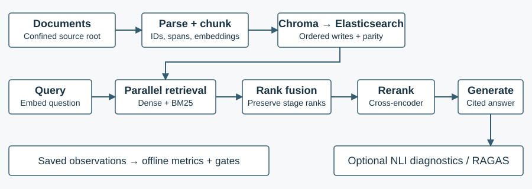
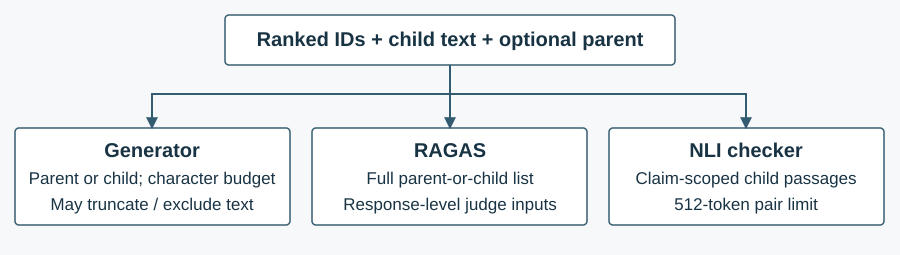

# XAI-RAG: Traceable Retrieval, Grounded Generation, and Component-Level Evaluation

<p class="byline">Technical report for project revision · 23 September 2026<br>Implementation baseline: <code>3fe12f7</code> · Repository version 0.1.0</p>

## Abstract

Retrieval-augmented generation is useful only when relevant evidence is retrieved, preserved through context construction, and used correctly by the generator. A fluent answer alone cannot identify which of these conditions failed. This report describes XAI-RAG, a Python system combining dense and lexical retrieval, reciprocal rank fusion, cross-encoder reranking, structured cited generation, optional natural-language-inference diagnostics, and RAGAS response evaluation. The system retains retrieval-stage provenance and exposes a separate deterministic evaluator for captured pipeline observations. Its principal engineering value is the ability to trace an answer back through selection, attribution, and evaluation boundaries. Inspection reveals an important limitation: the generator, RAGAS evaluator, and NLI checker can receive different textual views of the same retrieved results. Consequently, a high evaluation score cannot automatically certify the evidence actually visible during generation. Focused local tests and a synthetic evaluation fixture validate selected contracts, but do not establish production answer quality. The report defines the implemented methods, explains their metrics, distinguishes available evidence from unperformed experiments, and proposes a controlled evaluation program. It is a systems report, not a claim of a novel retrieval algorithm or a completed representative benchmark.

**Keywords:** retrieval-augmented generation; hybrid search; retrieval attribution; RAGAS; evaluation; provenance.

## 1. Introduction and scope

A document question-answering system must solve several distinct problems: finding evidence, ranking it, fitting it into a model's input, producing an answer, and determining whether that answer is defensible. These problems interact but are not interchangeable. A relevant passage can be retrieved and later truncated; a valid citation can accompany an unsupported statement; an accurate answer can receive a poor lexical-overlap score because it is paraphrased. Evaluating only the final response obscures these distinctions.

XAI-RAG addresses this observability problem through an explicitly staged pipeline. Documents become source-addressable chunks stored in Chroma and Elasticsearch. Queries retrieve candidates from both stores, merge their ranks, and rerank the merged candidates. The generator returns an answer together with claims and source identifiers. Retrieval explanations retain stage scores, while optional NLI and RAGAS evaluations inspect support and response quality. A separate offline evaluator aggregates stored observations and applies declared release gates [1].

The report organizes this implementation around three questions. **RQ1:** What evidence and transformations explain why a passage reached the final context? **RQ2:** What does each evaluation metric actually measure, and which inputs determine its interpretation? **RQ3:** Which validation claims are supported today, and what additional study would justify production-quality conclusions? The answers are architectural and empirical only within the boundaries explicitly described in Section 7.

The term *explainable* is deliberately restricted. This project provides retrieval provenance, generated claim attribution, and post-generation diagnostics. It does not compute a causal explanation of the language model's internal decision process. Likewise, the response field named `overall_confidence` is a routing-dependent score, not a calibrated probability of correctness. These qualifications are necessary to describe the implementation accurately in an interview or technical review.

**Revision route.** For a 15-minute review, read the abstract, Figures 1–2, Tables 1–3, and Sections 7–9. For a deeper 30-minute session, read sequentially and work through the ranking example. These are suggested time allocations, not measured reading times. The separate long-form interview reference remains the source for exhaustive questions and code walkthroughs.

## 2. Related work and design position

Lewis et al. describe retrieval-augmented generation as combining parametric generation with access to non-parametric textual memory [2]. XAI-RAG uses the broader retrieve-then-generate pattern, but it does not reproduce that paper's joint training procedure. Its local embedding and reranking models are composed with an independently hosted generation API. This distinction separates architectural inspiration from an implementation claim.

Rank fusion provides a practical response to heterogeneous retrieval scores. A cosine similarity and a BM25 score have different scales; their uncalibrated sum has no reliable shared interpretation. Reciprocal rank fusion instead assigns contributions from ranking positions [3]. XAI-RAG implements that algorithm locally after querying the two stores. It does not invoke Elasticsearch's native RRF retriever, and its behavior should be verified against its own `rrf_fusion` function.

RAGAS separates dimensions such as response support, question relevance, and context usefulness [4]. XAI-RAG integrates its collections API rather than renaming a custom NLI aggregate as a RAGAS metric. The installed dependency is pinned to RAGAS 0.4.3; the implementation, not an arbitrary current tutorial, determines the exact classes called. Current official metric documentation supplies conceptual definitions [5–7]. The native offline evaluator is complementary: it uses explicit judgments and stored outputs to calculate deterministic component measures.

Long-context research also motivates caution about simply supplying more retrieved text. Liu et al. found that evidence position could substantially affect performance in the models and tasks they studied [8]. This does not establish the same effect size for XAI-RAG. It does justify testing context order, truncation, and parent-document expansion rather than assuming that a larger context is necessarily better.

The system's contribution is therefore integration and traceability: preserving evidence identities across indexing, exposing successive ranking decisions, enforcing a structured generation contract, and separating several evaluation boundaries. Its effectiveness relative to simpler dense-only or lexical-only baselines remains a question for the controlled experiments in Section 8.

## 3. Architecture and evidence lifecycle

### 3.1 Shared orchestration and records

`RAGService` is the shared application layer used by REST, server-sent events (SSE), and command-line entry points. Pydantic records distinguish search results, fused results, ranked results, claims, verdicts, and the final response. A result can carry a child passage in `content`, a larger parent passage in `context_content`, source metadata, and independent stage scores. Preserving these distinctions avoids replacing a retrieval similarity with a reranker score under the same ambiguous field.

<figure>

<figcaption>Figure 1. Implemented system boundaries. Store writes are ordered, not transactional. The offline runner consumes captured observations; it does not execute the live query pipeline.</figcaption>
</figure>

The query service embeds the question and launches dense retrieval and asynchronous BM25 retrieval concurrently. Fusion precedes reranking; optional retrieval explanations are constructed from the preserved stage records. Generation follows selection, then optional NLI checks and optional external evaluation execute. The final response contains the answer, claims, citations, diagnostics, token usage when available, and stage timings. SSE emits stage events rather than language-model tokens; its terminal event is not the complete REST response with every evaluation field.

### 3.2 Parsing, source identity, and chunking

The parser supports PDF, DOCX, plain text, and Markdown. Source identity is the resolved path relative to a configured document root, not just a filename. This keeps similarly named documents in different subdirectories distinct while avoiding machine-specific absolute paths in logical identifiers. File discovery limits document count, individual bytes, and total bytes before ingestion. Parser success should not be confused with support for every scanned, encrypted, malformed, or layout-intensive document.

Three chunking strategies are implemented. Fixed splitting favors natural boundaries while enforcing character limits and overlap. Semantic splitting uses adjacent-sentence embedding similarity and a threshold to identify breaks, while retaining bounded source spans. Parent-document splitting retrieves small children but preserves larger parent text for contextual generation. Importantly, these bounds are implemented through character slices; a docstring's token terminology does not make them tokenizer-derived limits.

The default chunk size is 512 characters and fixed-strategy overlap is 50. Parent children use a 128-character bound. Semantic chunking uses a separately revision-pinned MiniLM model; it is not the BGE retrieval embedding model. Every strategy retains offsets into extracted text, so the key provenance invariant is that a chunk equals the corresponding source-text slice. Those offsets do not automatically identify a PDF page region or a DOCX layout element.

### 3.3 Embeddings, identity, and dual-store consistency

The default retrieval encoder is revision-pinned `BAAI/bge-small-en-v1.5`, producing normalized 384-dimensional embeddings. Chroma stores the dense representation and metadata; Elasticsearch indexes the lexical text. Stable chunk IDs hash a canonical representation of source identity, ordinal, character span, strategy, content, and an identity-schema version. Replaying unchanged input therefore reuses identities rather than manufacturing duplicate records.

Both stores support source-scoped replacement and stale-record cleanup. However, the ingestion sequence writes Chroma before Elasticsearch. If the second operation fails, the first does not roll back. Per-document outcomes and a final parity check expose failure or partial completion; they do not create an atomic distributed transaction. Parity compares IDs and recorded content hashes, not every vector value or metadata field. A “consistent” result is useful evidence with a limited scope.

The index fingerprint binds schema version, embedding model, model revision, dimension, and cosine distance. It is not a complete fingerprint of every chunking or preprocessing choice. A changed model can require reindexing; an expanded compatibility manifest and tested migration procedure would improve reproducibility. Operationally, ingestion is a state-changing data pipeline that needs recovery and deletion semantics, not merely an embedding loop.

## 4. Retrieval, fusion, reranking, and attribution

### 4.1 Candidate selection

Dense retrieval maps a question into embedding space and queries Chroma's cosine index. The adapter converts distance to similarity using `similarity = 1 − distance` and retains vector rank. Lexical retrieval uses Elasticsearch BM25 and retains its native score and rank. Dense retrieval can recover semantic matches without exact wording; lexical retrieval can help with rare terms and exact identifiers. Whether either advantage holds on the target corpus must be measured, not assumed from the method's name.

The default candidate limits are 100 per retriever. This broad first stage defines an upper bound on evidence available downstream. Reranking cannot recover a relevant passage absent from both candidate lists. Conversely, a large first-stage window may improve candidate recall while increasing transfer, fusion, or reranking costs. Retrieval quality and final-answer quality should therefore be reported separately.

### 4.2 Reciprocal rank fusion

For passage <em>d</em>, XAI-RAG calculates the following score over lists in which it appears, with one-based rank <em>r</em> and configured constant <em>c</em>:

<div class="equation">RRF(d) = Σ<sub>i : d ∈ Lᵢ</sub> 1 / (c + rᵢ(d)), &nbsp; c = 60 by default. &nbsp; (1)</div>

Duplicates within one list contribute once, and final score ties are broken by ID. The implementation retains vector, BM25, and RRF scores and ranks independently. The constant controls how strongly rank differences matter; it is not the number of retrieved passages. Using ranks avoids a direct comparison between the native scales, but it also discards differences in score magnitude that might have been informative under a validated calibration scheme.

For a worked example, let the dense order be A, B, C and the lexical order B, D, A. Then B receives `1/62 + 1/61 = 0.032522`, while A receives `1/61 + 1/63 = 0.032266`. B ranks higher because of its joint positions, not because its BM25 score exceeds a cosine similarity. These numbers illustrate Equation 1; they are not an experiment on the repository's document corpus.

### 4.3 Cross-encoder and explanation boundary

The revision-pinned `BAAI/bge-reranker-v2-m3` cross-encoder jointly scores question–passage pairs. The service supplies the top fused `max(request.top_k, reranker_candidate_k)` candidates; the configured candidate minimum is five. This is a materially narrower stage than the first-stage retrieval windows. The final `top_k` results preserve original evidence plus the new reranker score and rank.

The retrieval explainer summarizes whether a selected result appeared in dense search, lexical search, or both, and reports matching query terms and stage scores. Its term matching uses simple lowercase token overlap; it is not Elasticsearch's complete analyzer or a term-level BM25 decomposition. These explanations answer “through which selection stages did this passage survive?” They do not establish that the language model causally used that passage in producing a specific sentence.

<p class="table-caption">Table 1. Scores that must not be treated as interchangeable.</p>

| Quantity | Meaning in this pipeline | Invalid inference |
|---|---|---|
| Vector similarity | Dense-space proximity after distance conversion | Probability that the answer is correct |
| BM25 score | Lexical relevance in the search index | Directly comparable with cosine similarity |
| RRF score | Sum of reciprocal-rank contributions | Calibrated passage relevance |
| Reranker score | Cross-encoder's question–passage ordering signal | Guaranteed downstream answer improvement |
| RAGAS faithfulness | Judge-assessed support in supplied contexts | Independent verification of real-world truth |

## 5. Cited generation and evidence diagnostics

### 5.1 Structured output is a contract, not a truth guarantee

The generator sends delimited retrieved passages to an OpenAI-compatible client, with `gpt-4o-mini` as the configured default model. The prompt asks it to treat retrieved material as untrusted data, answer only from supplied evidence, cite chunk IDs, and decompose factual statements into claims. The strict JSON schema contains `answer`, `claims`, and `sources`; every claim contains text and source IDs. No retrieved chunks produce a local no-answer response without a generation call.

After parsing, citation validation rejects unknown IDs, claims without source IDs, and outputs with claims but no inline citations. It deduplicates claim references and normalizes the source list to retrieved order. This is stronger than accepting arbitrary model-produced citations, but weaker than proving every sentence is supported. It does not independently establish that the model listed all factual claims, that an inline citation is semantically appropriate, or that a cited passage was fully retained in the final prompt.

Generation retries selected transient API failures, with bounded attempts, rather than treating authentication or malformed output as automatically retryable. Provider token counts are retained when available. The prompt and schema improve controllability, but neither eliminates prompt injection, omissions, fabricated statements, nor provider-specific behavior. Those require adversarial and representative tests.

### 5.2 Three different evidence views

Context packing uses parent text when present, otherwise child text, and enforces a 32,000-character default budget including delimiters. It can truncate a passage or exclude later passages. Citation validation nevertheless checks against the complete ranked ID set. RAGAS receives the untruncated parent-or-child list from that set, while NLI examines child text scoped to claim references. Figure 2 shows why the same identifiers do not guarantee the same evaluated evidence.

<figure>

<figcaption>Figure 2. Evaluation-input mismatch. A valid source ID can survive even when some associated text was truncated before generation. Capturing the exact prompt-visible spans would make this boundary auditable.</figcaption>
</figure>

Suppose a child contains a refund deadline, while its parent also contains an exception. Generation may see the parent, RAGAS may assess the full parent, and NLI may receive only the child. Disagreement then need not mean one evaluator is intrinsically defective: the evaluated propositions and evidence differ. Conversely, RAGAS might support an assertion using parent text that was truncated from the generator's prompt. The highest-value correction is to record the actual packed evidence and evaluate the intended boundary explicitly.

### 5.3 Optional claim-level NLI

The DeBERTa-based checker treats a retrieved child as premise and a generated claim as hypothesis. It resolves entailment, neutral, and contradiction labels from model metadata rather than assuming a fixed output ordering. For each claim, it retains the largest entailment and contradiction values across eligible chunks, potentially from different passages. A sufficiently strong contradiction that is at least as large as entailment yields `not_supported`; otherwise entailment at or above its threshold yields `supported`, with the remaining case marked `neutral`.

The default entailment and contradiction thresholds are both 0.5. Model inputs are truncated to 512 tokens, introducing another evidence limit. These diagnostics are local NLI outputs, not RAGAS faithfulness, and their probabilities are not calibrated to the target corpus merely because a softmax was used. Human-labeled disagreement analysis is needed before applying a risk-sensitive acceptance threshold.

## 6. Evaluation methodology

### 6.1 Request-scoped RAGAS evaluation

The request path requires both server permission, `allow_request_evaluation`, and the request flag `include_ragas`. Server permission defaults to false. A disallowed evaluation request is rejected before the pipeline runs. When permitted, `evaluate_response` constructs RAGAS collections metrics with explicit asynchronous model clients and evaluates three measures concurrently. The report envelope distinguishes `computed`, dependency `unavailable`, and `error`; a failed evaluation is never represented as a successful empty score set.

**Faithfulness** measures the fraction of response statements judged supported by the supplied contexts [5]. It asks whether the answer follows the retrieved evidence, not whether the evidence itself is current, authoritative, or complete. Its statement decomposition is performed by the evaluator and need not coincide with the generator's structured `claims` list.

**Answer relevancy** uses questions generated from the answer and their embedding similarity to the original question [6]. An answer can be relevant but unsupported; a faithful response can still miss the question's intent. The configured evaluation embedding model is `text-embedding-3-small`, distinct from the local BGE model used for retrieval. Conflating these models would make a reproduction incomplete.

**Context precision** is the output key for two different classes. Normal service requests supply no reference answer, so the adapter selects `ContextUtilization`, which judges contexts against the generated response. A direct call with `ground_truth` selects reference-based `ContextPrecision`, using the reference instead. Both follow an average-precision-style weighting of judged useful contexts, but answer-conditioned usefulness is not independent human retrieval relevance [7].

<div class="equation">CP = Σ<sub>i=1…K</sub> P(i) · vᵢ / (Σ<sub>i=1…K</sub> vᵢ + ε), &nbsp; P(i) = Σ<sub>j=1…i</sub> vⱼ / i. &nbsp; (2)</div>

Here <em>v</em> is the judge's usefulness indicator over the returned list. The denominator is not the total number of relevant passages in the corpus. Thus this metric is neither corpus recall nor a replacement for a human-judged retrieval benchmark. A generated answer that omits a topic can also change which contexts appear useful in the reference-free variant.

<p class="table-caption">Table 2. Current evaluation entry points and their contracts.</p>

| Entry point | Inputs and work performed | Output interpretation |
|---|---|---|
| Service with `include_ragas` | Question, answer, full ranked parent-or-child contexts; model-judge calls | Three RAGAS scores plus status; reference-free context variant |
| Direct `evaluate_response(..., ground_truth=...)` | Same data plus reference answer | Reference-based context precision |
| Optional NLI checker | Generated claims and referenced child passages | Claim diagnostics; separate local model |
| `xai-rag evaluate` | Saved versioned observations and judgments | Deterministic metrics/gates; no retrieval, generation, or judge calls |

A valid, computed RAGAS faithfulness value in [0,1] becomes `overall_confidence`. If RAGAS was requested but failed or is unusable, the aggregate becomes zero, not an NLI substitute. When RAGAS was not requested, the service uses mean NLI entailment when available, otherwise zero. Consumers must retain the request flags and evaluation status: a numerical zero alone cannot distinguish poor support, missing evaluation, and evaluator failure.

### 6.2 Deterministic component evaluation

The offline evaluator reads a strict JSONL dataset comprising a manifest and query or ingestion records. The manifest identifies dataset, corpus, configuration and model revisions; a canonical digest binds the recorded dataset. Query records separate graded relevance judgments from observed vector, BM25, fused, and reranked IDs. They can also contain answers, claim references, verdicts, judge/human scores, refusals, errors, timing, token counts, and cost. These are captured observations: storing a judge score is not proof that this command invoked a judge.

Let <em>R</em> be the set of positively judged relevant IDs and <em>U</em><sub>K</sub> the unique relevant IDs in the first <em>K</em> ranks. Implemented precision is |<em>U</em><sub>K</sub>|/<em>K</em>; recall is |<em>U</em><sub>K</sub>|/|<em>R</em>|. Precision uses the requested cutoff even when the list is shorter. Duplicate IDs earn no additional relevance, but their positions still consume ranking slots. Hit rate checks whether any relevant ID was retrieved; reciprocal rank emphasizes the first relevant result, and MRR averages this value across eligible queries.

Average precision sums precision at newly encountered relevant ranks and divides by `min(|R|, K)`. MAP averages per-query AP. Graded NDCG uses gain `2^grade − 1`, logarithmic discount `log₂(rank + 1)`, and the ideal ordering of positive grades. Duplicate IDs receive zero additional gain. Queries without positive judgments are excluded from these judged retrieval aggregates rather than assigned invented relevance; sample size must accompany the score.

For example, with relevant IDs {A,B,C}, the ranking D,A,B at cutoff three yields precision = recall = 2/3, reciprocal rank = 1/2, and AP@3 = `(1/2 + 2/3)/3 = 7/18`. Recall is incomplete although precision appears respectable. This native AP denominator differs from Equation 2, which normalizes over judged useful contexts in the returned list.

The runner also computes fusion NDCG gain over the better individual retriever *per query*, and reranking gain over the fused order. Negative deltas are meaningful regressions. Generation measures include normalized exact match, bag-of-token F1, citation validity, and claim citation coverage. These last two validate references to available IDs, not semantic support. Ingestion measures summarize outcome, span/provenance coverage, and index parity; operational measures summarize errors, refusals, latency and recorded usage.

Missing eligible observations produce `not_computed`, a null value and sample size zero. Blocking gates fail when their required metric is missing. Advisory gates expose proposed targets without making them approved release policy. Default cutoffs are 1, 3, 5 and 10; because the gate file contains advisory metrics at two, the reproduction command in Section 7 explicitly adds `--k 2`.

## 7. Validation evidence and reproducibility

This report pins implementation claims to repository commit `3fe12f7`, whose full identifier and source map appear in reference [1]. On 23 September 2026, a focused local run exercised the native metric, evaluation-runner, RAGAS-adapter and service test modules. It passed 24 tests with one Chroma dependency deprecation warning. The adapter tests include real metric-class construction and injected fake scoring; they do not establish hosted-judge quality. Model-download offline flags were set, and no paid provider inference was performed.

The synthetic evaluator fixture was also rerun with cutoffs 1, 2, 3, 5 and 10. It contains two query cases and one ingestion record and emitted 160 metric entries. All six blocking and six advisory gates passed. The number 160 counts report entries, not independent experiments, human judgments, or unique evaluation concepts. The fixture's manifest explicitly marks it non-representative. Its apparently perfect citation and refusal scores are properties of hand-authored smoke observations, not estimates of production behavior.

<p class="table-caption">Table 3. Evidence ladder: what was checked and what remains unproven.</p>

| Boundary | Evidence | Permissible conclusion |
|---|---|---|
| Focused local contracts, 23 Sep 2026 | 24 selected tests passed | Tested routing and metric contracts behave as asserted |
| Synthetic evaluator, 23 Sep 2026 | 2 query cases, 1 ingestion record; 12 gates passed | Dataset parsing, aggregation and configured gate wiring work on this fixture |
| Historical integration/HTTP validation, 14 Sep 2026 [9] | Recorded dual-store and deployed workflow checks | Historical evidence exists; not rerun for this report |
| Historical warm concurrency smoke [9] | Four queries; p50 826.17 ms, maximum 1,097.98 ms | Small local smoke only, not a p95/p99 SLO or capacity result |
| Representative RAG quality | No new corpus study performed | No production-quality or superiority claim justified |

The following commands reproduce the focused checks from an already provisioned repository environment. `--no-sync` avoids changing the installed dependency graph; reproducing class construction requires the optional evaluation dependencies to be present. The full dependency specification and lockfile remain necessary context.

```sh
HF_HUB_OFFLINE=1 TRANSFORMERS_OFFLINE=1 uv run --no-sync pytest \
  tests/unit/test_evaluation_metrics.py \
  tests/unit/test_evaluation_runner.py \
  tests/unit/test_ragas_adapter.py tests/unit/test_service.py -q

uv run --no-sync xai-rag evaluate \
  evals/smoke/evaluator-contract.jsonl --gates evals/gates.toml \
  --k 1 --k 2 --k 3 --k 5 --k 10 \
  --output artifacts/report-evaluation-smoke.json
```

The executed checks used the repository's existing `.venv` directly. The fixture digest begins `71e453167c10`; the full generated result is retained with this report's research evidence. Historic dependency and container-security observations in the readiness document are time-sensitive and are not re-certified here. In particular, that document records unresolved advisories for the optional evaluation stack. This report did not perform a fresh security audit or infer safety from successful imports.

## 8. Proposed experimental protocol and threats to validity

### 8.1 A representative evaluation study

The next useful study should freeze a corpus snapshot and collect representative questions, including exact identifiers, paraphrases, multi-passage questions, ambiguous requests, unanswerable cases, stale documents and adversarial instructions. Domain reviewers should assign graded evidence relevance and expected answer or refusal behavior. A separately adjudicated subset should assess claim support, correctness, completeness and citation appropriateness. Corpus and query sources, selection criteria, label disagreements, and exclusions must be documented.

Split development and final evaluation cases before tuning. Compare dense-only, BM25-only, fused, and fused-plus-reranked variants on the same questions and corpus. Those are proposed experimental configurations; the current live service always follows its composed hybrid path, so a comparison harness must deliberately capture alternate outputs rather than claiming a nonexistent API switch. Vary chunk strategy, retrieval windows, RRF constant, reranker candidates, and context budget in controlled steps. Change one factor first, then test interactions justified by observed failures.

Report retrieval recall and NDCG alongside answer correctness, support, refusal quality, latency, and cost. Use paired per-query differences and uncertainty intervals rather than comparing unrelated averages. Separate warm and cold runs and report sample counts and the target hardware. A candidate should be preferred only when its benefit is credible on the relevant slices and does not violate agreed operational constraints. The present code does not prove that its default constants are optimal.

### 8.2 Judge calibration and context controls

Evaluate RAGAS and NLI against independently labeled cases. Record the metric class, package version, judge model, prompt/configuration revision, reference policy, evidence text and status. Repeated scoring of a subset can reveal judge variability. Inspect disagreements manually: incorrect claim extraction, parent/child mismatch, truncation, domain terminology and genuinely conflicting documents require different remedies. Do not select a judge solely because it agrees with the system being evaluated.

A crucial ablation compares scores using full retrieved contexts with scores using the exact generator-visible text. Persist packing order, retained spans, excluded IDs and truncation decisions. This tests whether improvements arise from better answer grounding or merely from giving the evaluator more information. It also enables stricter citation validation against visible evidence. Token-aware packing and redundancy removal are proposed improvements, not existing features.

### 8.3 Operational and validity limits

The HTTP boundary implements authentication, a per-process rate limiter, query concurrency limits, a queue-plus-execution timeout, and dependency-aware readiness. These are useful controls, but a shared API key is not tenant identity, and process-local limits are not distributed quotas. Document ACL enforcement, secured store access, backup/restore, deletion guarantees and production-target failure drills remain separate requirements. SSE stage progress should not be marketed as token streaming or guaranteed cancellation of every underlying operation.

Observability records stage timings and avoids raw queries in explicit attributes, but privacy must also cover exception events, dependency instrumentation and downstream collectors. Hashing selected attributes alone does not establish that an entire trace contains no sensitive material. Similarly, revision-pinned models aid repeatability but do not remove hardware effects, provider changes or ingestion drift.

The main threats to validity are therefore concrete: synthetic-case selection bias; incomplete relevance judgments; judge correlation and variability; differing evidence views; weak equivalence between lexical answer overlap and semantic correctness; and extrapolating small local smoke runs to production scale. The proposed study must address these before assigning business thresholds. A deployment claim needs both trustworthy answers and a demonstrated operating envelope.

## 9. Conclusion

XAI-RAG implements an inspectable hybrid RAG system with stable evidence identities, preserved ranking stages, structured citations, optional NLI diagnostics, RAGAS response metrics, and deterministic offline evaluation. Its strongest defensible claim is traceability across these boundaries—not that retrieval provenance explains the generator causally, or that one aggregate score certifies an answer.

For revision, retain the dependency chain: **source identity → exact chunks → dual indexes → candidate retrieval → rank fusion → reranking → packed context → cited generation → separately interpreted evaluation**. Failures should be localized along this chain. The immediate research priority is a representative, human-reviewed dataset and exact generator-context capture; the immediate engineering priority is turning that evidence into calibrated quality gates and a tested production operating envelope. The existing contracts provide a base for that work, while the report's explicit limitations prevent test success from being mistaken for completed research.

## References

<div class="references" markdown="1">

[1] XAI-RAG repository, version 0.1.0, commit `3fe12f78ff99bc212092099f7d46145f6d6a13f5`. [Source tree](https://github.com/neeraj1909/xai-rag/tree/3fe12f78ff99bc212092099f7d46145f6d6a13f5). Principal implementation: `src/xai_rag/service.py`, `config.py`, `models.py`, `ingestion/`, `retrieval/`, `generation/generator.py`, `explainability/`, `evaluation/`, and `api/app.py`.

[2] P. Lewis et al. “Retrieval-Augmented Generation for Knowledge-Intensive NLP Tasks.” NeurIPS, 2020. [arXiv:2005.11401](https://arxiv.org/abs/2005.11401).

[3] Elastic. “Reciprocal rank fusion.” Elasticsearch Reference. [Algorithm and rank-constant definition](https://www.elastic.co/docs/reference/elasticsearch/rest-apis/reciprocal-rank-fusion). Accessed 23 September 2026; used for algorithmic context, not as XAI-RAG's execution backend.

[4] S. Es, J. James, L. Espinosa Anke, and S. Schockaert. “RAGAs: Automated Evaluation of Retrieval Augmented Generation.” EACL System Demonstrations, pp. 150–158, 2024. [doi:10.18653/v1/2024.eacl-demo.16](https://aclanthology.org/2024.eacl-demo.16/).

[5] Ragas documentation. “Faithfulness.” [Metric definition](https://docs.ragas.io/en/stable/concepts/metrics/available_metrics/faithfulness/). Accessed 23 September 2026.

[6] Ragas documentation. “Response Relevancy.” [Metric definition](https://docs.ragas.io/en/stable/concepts/metrics/available_metrics/answer_relevance/). Accessed 23 September 2026.

[7] Ragas documentation. “Context Precision.” [Metric variants and definition](https://docs.ragas.io/en/stable/concepts/metrics/available_metrics/context_precision/). Accessed 23 September 2026. Actual class selection is pinned by [1], `evaluation/ragas_eval.py`.

[8] N. F. Liu et al. “Lost in the Middle: How Language Models Use Long Contexts.” Transactions of the ACL, 12:157–173, 2024. [doi:10.1162/tacl_a_00638](https://aclanthology.org/2024.tacl-1.9/).

[9] XAI-RAG. “Production readiness and RAG evaluation matrix.” Snapshot 14 September 2026. [Versioned evidence record](https://github.com/neeraj1909/xai-rag/blob/3fe12f78ff99bc212092099f7d46145f6d6a13f5/docs/production-readiness.md). Historical results, not a fresh audit.

</div>
